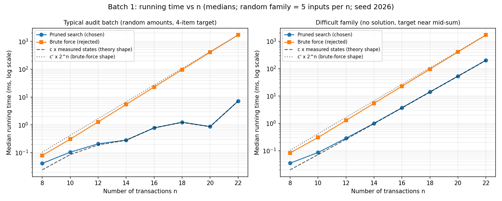

# Batch 1 — Fintech Audit: Reconciling a Disputed Bank Debit

## Team

| Roll No. | Name | GitHub username | Part presented | Contribution (code, report sections) |
|----------|------|-----------------|----------------|--------------------------------------|
| 24I328 | Madhumitha N | 24i328-gif| Slides 1–7 (problem, model, technique, algorithm, trace, proof, complexity and worst case) | Code: main_solution.py, rejected_alternative.py, generate_inputs.py, test_all.py, benchmark.py, analysis_tools.py, make_trace.py. Results: timing.csv, timing_plot.png, search tree, full trace. Report: sections 1–3 and 5–9 (modelling, data structures, technique, algorithm, correctness proof, trace, complexity, worst case), slides.pdf |
| 24I335 | Nivedhini M | Nivedhini-2212 | Slides 8–13 (rejected techniques, experiments, ±₹50 change, reference, conclusion) | Code: verify_independent.py (independent brute-force implementation, 200-case cross-check against the main solver, hard-input state-count check, mutation test). Verification: MEMBER2_VERIFICATION.md (hand verification of the two solutions, arithmetic review of sections 2 and 4, benchmark reproducibility check, changed-requirement check, reference validation). Benchmark re-run on own machine and review of report sections 4 and 10–13 |


## Presentation

- Video link: https://youtu.be/mclYJj7JDUA?si=PWV4xWdP6RvlkaQb
- Duration: 11:11
- Slides: [slides.pdf](slides.pdf)

---

## 1. Problem modelling

- **Input:** a list of `n` pending-transaction amounts `a_1 … a_n` (positive integers; here ₹ thousands, converted to integer rupees), a target `T` (the disputed debit) and a tolerance `τ ≥ 0` (₹0 for the original requirement, ₹50 for the changed one).  
  Given instance: `A = {15, 22, 35, 40, 48, 53, 61}` (thousand ₹), `T = 110`, i.e. `T = 1,10,000` rupees.
- **Output:** the list of **all** non-empty subsets `S ⊆ {1..n}` of *transactions* with `T − τ ≤ Σ_{i∈S} a_i ≤ T + τ`. Each transaction is its own item (identified by position), so two transactions with the same amount are different items and an item is used at most once.
- **Objective:** completeness — *every* valid combination must be reported, none missed, none invalid, none repeated. There is no quantity to maximise or minimise.
- **Constraints:** `a_i > 0` (needed for the pruning rules); each item used at most once; `n` is 30–40 in a real batch; amounts handled as exact integers (rupees), never floating point.
- **Problem class:** *enumeration* (listing all solutions). The related decision problem ("does a subset with sum T exist?") is NP-complete, so no polynomial-time algorithm is known; and the number of solutions can itself be exponential (e.g. `C(n, n/2)` when all amounts are equal), so any enumerator needs time at least proportional to its output.
- **Classical problem:** **Subset Sum** (the 0/1 knapsack feasibility problem with weight = value), in its *all-solutions listing* form.

**Why "every combination" matters for the design.** A technique that only answers yes/no (a reachability table), or that follows a single greedy path, does not produce a list. The algorithm must be able to generate every candidate subset, and the only way to avoid looking at all `2^n` of them is to *prove* that whole groups of candidates are invalid and skip them.

## 2. Data structure analysis

`n = 30–40` transactions, target `≈ 10^9` paise (₹1 crore). `T` = target in the unit used.

| Data structure | Key operation(s) and cost | Space | Behaviour at the scale in the scenario |
|----------------|---------------------------|-------|----------------------------------------|
| **Chosen: sorted array of amounts + suffix-sum array (+ recursion stack / list of chosen positions)** | sort `O(n log n)` once; suffix sums `O(n)` once; per recursive step: read `a[j]`, `suffix[j]`, add/compare ints — `O(1)`; push/pop chosen item `O(1)`; copying one solution `O(k)` | `O(n)` plus output | Independent of the size of `T` (64-bit arithmetic). No memory growth with the number of states because DFS keeps only the current path (depth ≤ n ≤ 40). |
| Alternative 1: boolean DP table `reach[i][s]` (or one bitset per row) | build `O(n·T)`; query `O(1)`; listing solutions needs walking back through all rows, `O(n)` per solution | `O(n·T)` bits/bytes | `T = 10^9`, `n = 40` ⇒ `(n+1)(T+1) ≈ 4.1×10^10` cells = **41 GB** as bytes or **≈ 5.1 GB** as bits (one row = 125 MB). Needs the whole table to enumerate. Very sensitive to the target. |
| Alternative 2: bitmask loop over all `2^n` integers `0 … 2^n − 1` | `O(n)` per mask to compute the sum (`O(1)` amortised with `sum[m] = sum[m & (m−1)] + a[lowbit]`) | `O(1)` per mask (or `O(2^n)` if sums are stored) | `2^40 ≈ 1.1×10^12` masks: infeasible; no pruning is possible. Independent of `T`. (Our rejected alternative uses `itertools.combinations`, equivalent cost `O(n·2^n)`.) |
| Alternative 3: sorted lists of half-subset sums + binary search (meet-in-the-middle) | build two lists of `2^{n/2}` sums, sort `O(2^{n/2}·n)`; look up a partner by binary search `O(n)` | `O(2^{n/2})` | `n = 40` ⇒ `2^20 ≈ 10^6` sums per half (≈ tens of MB in Python): practical, independent of `T`; no early termination and always pays `2^{n/2}`, even when the answer is easy. |
| Alternative 4: hash map `sum → list of subsets` (memoisation of partial sums) | insert/lookup `O(1)` expected | up to `O(2^n)` | Stores every distinct partial sum with its subsets: memory explodes. Useless for *listing*, since subsets rarely share a state. |

**Why the chosen structure wins.** The algorithm needs only three things: (i) the amounts in sorted order, so that the first item that overshoots implies all later items overshoot; (ii) `suffix[j]` to bound "the most we could still add"; (iii) the current path. A sorted array with a suffix-sum array gives all of these in `O(1)` per step and `O(n)` memory, and does not care how large `T` is. The DP table's memory grows linearly with `T`; a hash map or bitmask loop gains nothing for enumeration; meet-in-the-middle is a legitimate competitor (Section 4) but has an unavoidable `2^{n/2}` memory.

## 3. Design technique identification

- **Technique chosen: Backtracking** (depth-first generation of candidate subsets in increasing item order, cutting off a branch as soon as it provably cannot contain a valid subset).
- **Property of the problem that makes it work (with proof).**  
  A solution is built by a sequence of item choices, and **the sum of a partial choice bounds the sum of every completion of it.** Let amounts be sorted `v_0 ≤ v_1 ≤ … ≤ v_{n−1}`, all `> 0`, `lo = T − τ`, `hi = T + τ`, `suffix[j] = v_j + … + v_{n−1}`. Let `C` be the current partial subset with sum `c`, and suppose all further items come from positions `≥ j`.
  * **Lemma A (overshoot).** If `c + v_j > hi`, then every subset `C ∪ D` with `D ⊆ {j, …, n−1}`, `D ≠ ∅`, has sum `> hi`.  
    *Proof.* `D` contains some position `p ≥ j`; since amounts are sorted and positive, `Σ D ≥ v_p ≥ v_j`. So `c + Σ D ≥ c + v_j > hi`. ∎
  * **Lemma B (unreachable).** If `c + suffix[j] < lo`, then every `C ∪ D` with `D ⊆ {j, …, n−1}` has sum `< lo`.  
    *Proof.* Positive amounts give `Σ D ≤ Σ_{p ≥ j} v_p = suffix[j]`, so `c + Σ D ≤ c + suffix[j] < lo`. ∎
  * Both statements are *also* true for every larger starting position `j' ≥ j` (since `v_{j'} ≥ v_j` and `suffix[j'] ≤ suffix[j]`). So when the test fails at `j`, the loop can stop completely.  
  Both lemmas rely on **positive amounts**: with zero or negative amounts, adding an item could lower the sum again and the pruning would be unsafe — which is why the program rejects non-positive amounts.

**Independent look at Backtracking versus Branch and Bound.** Branch and Bound normally keeps an *incumbent* (best value found so far) and cuts a branch whose optimistic *bound* cannot beat it. This problem has no objective to optimise, so there is no incumbent to compare against; the only available "bounds" are the *feasibility* bounds of Lemmas A and B — exactly constraint-based pruning in backtracking. A best-first B&B (priority queue ordered by bound) would add `O(log)` queue cost and `O(frontier)` memory without reducing the number of states, because every valid subset must be reported anyway. The compelling reason to stay with plain depth-first backtracking is therefore *memory `O(n)`, simplicity and a search tree that can be traced by hand* — not that B&B is incapable. A fair summary: our algorithm is backtracking with branch-and-bound-style feasibility bounds.

## 4. Why the other four techniques do not fit

For each technique, the table separates **"can it be made to work?"** from **"is it the best fit for this assignment?"**. Numbers marked (measured) come from the programs in `code/`.

| Technique | Why it is unsuitable here (evidence) |
|-----------|--------------------------------------|
| **Greedy** (repeatedly take the largest transaction that still fits) | **Cannot be correct.** On `A = {15,22,35,40,48,53,61}`, `T = 110`: greedy takes 61 (remaining 49), then the largest amount `≤ 49` is 48 (remaining 1); nothing `≤ 1` exists, so greedy fails with remainder ₹1,000 and reports **no combination** (verified by `analysis_tools.greedy_largest_fit`). Yet two valid combinations exist: `{22,35,53}` and `{22,40,48}`. Neither contains 61, so the *greedy-choice property* fails at the very first step: 110 − 61 = 49 is not a sum of any subset of `{15,22,35,40,48,53}` (no single amount is 49; every pair sums to 37 or more and none equals 49, e.g. 15+22 = 37, 15+35 = 50; every triple sums to at least 72). No exchange argument can repair this. Moreover, a greedy method commits to one path, so it can output at most one subset, but the task needs *all*. Greedy has no variant that is both fast and complete for Subset Sum (a problem with no known polynomial algorithm). |
| **Dynamic Programming** (table `reach[i][s]` = "some subset of the first i items sums to s") | **Possible, but pseudo-polynomial and a poor fit for this scale.** The table decides *existence* ("is there a subset summing to s?") in `O(n·T)`; to *list* all subsets you additionally keep every row and walk back from `reach[n][T]` along true cells; each walk step stays on a true cell, so listing costs `O(n)` per solution — DP **can** enumerate. The cost is the table: it depends on the numeric value of `T`, not on `n` alone. With `T ≈ 10^9` paise and `n = 40`: `(n+1)(T+1) ≈ 4.1×10^10` cells ⇒ **41 GB** as bytes, **≈ 5.1 GB** even as bits, `≈ 4×10^10` operations (computed in `extra_experiments.py`). For the given instance, `T = 110` (thousands) gives a table of 888 cells versus **35** states for the search, i.e. the table is *bigger* than the search. Trade-off, honestly: the worst-case `2^40 ≈ 1.1×10^12` is larger than `n·T = 4×10^10`, so DP wins the *worst-case count* at this scale; but it loses on memory, scales with the unit chosen for money (paise ⇒ ×100 compared with rupees), and on realistic batches our search visited only `5.6×10^5` states (median, `n = 40`, 5 random batches; maximum `8.2×10^6`) — roughly 5,000 to 70,000 times fewer than the table's `4×10^10` cells. |
| **Divide and Conquer** | **Possible: meet-in-the-middle** (Horowitz–Sahni): split into two halves of 20, list `2^20 ≈ 10^6` sums each, sort, match with binary search / two pointers — worst-case time `O(n·2^{n/2} + output)`, which for `n = 40` is *far* better than `2^40`. We do not claim D&C is wrong; it is a strong alternative (verified: `analysis_tools.meet_in_middle` returns the same two solutions and agrees with brute force on 400 random cases). Why it is not our primary choice: (1) the split gives only two independent halves — deeper recursive halving does not help because the **combine step**, matching every left sum with compatible right sums, is the cost and does not decompose; (2) it always pays `2^{n/2}` time *and memory* (~10^6 sums for `n = 40`, versus `O(n)` for the DFS), even when the target is small and the answer is easy; (3) the audit setting has a small target relative to the batch total, so overshoot pruning keeps the DFS tiny; (4) the pruned DFS gives a traceable tree for the assignment. For a *worst-case adversarial* batch with `n = 40`, meet-in-the-middle would be preferable, and this should be said openly. |
| **Branch and Bound** | **Possible and not wrong** (see Section 3). B&B shines when there is an objective and an incumbent. Here the bounds are feasibility bounds only (Lemmas A and B), identical to those in backtracking; best-first ordering needs a priority queue (`O(log m)` per push) and keeps the whole frontier in memory (`O(m)`), whereas the DFS keeps one path (`O(n)`). Because *all* solutions must be output, node ordering cannot reduce the number of states; the number of states is exactly the number of subsets that pass the bounds. So B&B costs more bookkeeping for the same work; we select the simpler, memory-light depth-first form. |

## 5. Algorithm

**State definition.** One *state* = one recursive call = one candidate subset `C` described by `(start, c)`: `start` is the first position that may still be added (positions are increasing along a path, so each subset is built in exactly one order) and `c = Σ C`. The root is the empty subset `(0, 0)`.

**Search rule.** From state `(start, c)` the children are `C ∪ {j}` for `j = start … n−1`, taken in increasing `j`. Every state tests `lo ≤ c ≤ hi` (non-empty `C`) and reports the subset if true.

**Pruning rules (in the order they are checked, at candidate `j`).**
1. *Unreachable:* `c + suffix[j] < lo` → stop the loop (Lemma B).
2. *Overshoot:* `c + v_j > hi` → stop the loop (Lemma A).

```
SOLVE(a[0..n-1], T, tau):                      # amounts in integer rupees, all > 0
    validate inputs; lo <- T - tau; hi <- T + tau
    order <- indices sorted by (a[i], i)        # stable, duplicates stay distinct items
    v[p] <- a[order[p]];  suffix[n] <- 0;  suffix[p] <- v[p] + suffix[p+1]
    solutions <- [];  chosen <- []
    SEARCH(0, 0)
    return solutions

SEARCH(start, c):                               # c = sum of items in `chosen`
    states <- states + 1
    if chosen not empty and lo <= c <= hi:
        append sorted(order[p] for p in chosen) to solutions
    for j <- start .. n-1:
        if c + suffix[j] < lo:  count unreachable cut; break
        if c + v[j]    > hi:    count overshoot cut;  break
        push j onto chosen
        SEARCH(j + 1, c + v[j])
        pop chosen
```

**Output generation.** Solutions are stored as tuples of *original* indices; at the end they are sorted and printed with their amounts. Printing is outside the algorithm and outside all timed regions.

## 6. Proof of correctness

Notation: positions `0..n−1` of the sorted array; a *state* `(C, start)` where `C` is a set of positions all `< start`, `c = Σ_{p∈C} v_p`. For a state, let `Ext(C, start) = { C ∪ D : D ⊆ {start, …, n−1} }` (all completions, including `D = ∅`).

**Invariant.** In every call `SEARCH(start, c)`, the list `chosen` equals `C` in increasing order, `start = max(C) + 1` (or `0` for `C = ∅`), and `c = Σ_{p∈C} v_p`. *Proof:* true at the root; a child call pushes `j ≥ start` and passes `start' = j+1`, `c' = c + v_j`; the pop restores `chosen` after return. ∎

**Theorem.** `SEARCH(start, c)` appends to `solutions`, exactly once each, precisely the non-empty sets `X ∈ Ext(C, start)` with `lo ≤ Σ X ≤ hi`.

*Proof by induction on `n − start`.*

* **Base (`start = n`).** `Ext = {C}`. The entry test reports `C` iff `C ≠ ∅` and `lo ≤ c ≤ hi`; the loop body never runs. ✔
* **Step (`start < n`).** Split `Ext(C, start)` by the smallest added position: `X = C` (`D = ∅`), or `X ∈ G_j = Ext(C ∪ {j}, j+1)` for the unique `j = min D ∈ [start, n)`. These groups are disjoint and cover `Ext`.
  * `X = C` is handled by the entry test. ✔
  * Consider the loop at `j`. **(i) No cut at `j`:** the recursive call `SEARCH(j+1, c + v_j)` handles `G_j` by the induction hypothesis (`n − (j+1) < n − start`), reporting each valid member exactly once. **(ii) Cut at `j`:** by Lemma B (or Lemma A), *every* set in `G_{j'}` for *every* `j' ≥ j` is invalid (the lemmas hold for all `j' ≥ j`, shown in Section 3), so breaking discards only invalid sets. ✔  
  Combined, every valid member of `Ext(C, start)` is reported once, and nothing else. ∎

**Soundness (no invalid subset reported).** A set is appended only after the test `lo ≤ c ≤ hi` with `c` equal to its true sum (Invariant) and `chosen ≠ ∅`. Positions in `chosen` strictly increase, so no transaction appears twice. ✔

**Completeness (every valid subset found).** Apply the Theorem to the root `(C = ∅, start = 0)`: `Ext(∅, 0)` is *all* subsets. ✔

**Pruning cannot discard a solution.** This is case (ii) above: Lemma A and Lemma B show that all discarded completions are invalid, using only `a_i > 0`, sortedness, and `suffix` being the maximum possible addition. ✔

**No duplicates.** Each subset corresponds to exactly one increasing sequence of positions; it can be generated only by the path that adds those positions in order, and the parent of `C` is always `C` minus its largest position. So every subset appears at most once in the recursion tree. Equal amounts occupy different positions and are therefore different subsets (`[5,5,5,10]`, target 10 gives three pairs `{5,5}` plus `{10}`, tested in `test_all.py`). ✔

**Termination.** `start` strictly increases, depth ≤ `n`. ✔

**Changed requirement.** The proof is unchanged with `lo = T − τ`, `hi = T + τ` (only the two constants differ). One consequence: with `τ > 0` a solution may be a prefix of another solution (adding a small item may stay inside the window), so solution states are not necessarily leaves.

## 7. Trace on the given instance

`A = {15, 22, 35, 40, 48, 53, 61}` (already sorted), `T = 110`, `τ = 0`. Suffix sums: `suffix = [274, 259, 237, 202, 162, 114, 61]` for positions `0..6`.

**Answer: exactly 2 combinations**

| # | Transactions (₹ thousand) | Sum |
|---|---------------------------|-----|
| 1 | 22 + 35 + 53 | 110 |
| 2 | 22 + 40 + 48 | 110 |

**Measured counts (from the real program):**

| Quantity | Value |
|---|---|
| Subsets in the full space | `2^7 = 128` (127 non-empty) |
| **States visited = candidate subsets examined** (each tests its sum once; includes empty root) | **35** (27.3 % of 128) |
| States by subset size 0 / 1 / 2 / 3 | 1 / 6 / 15 / 13 |
| Overshoot cut-offs | 28 |
| Unreachable cut-offs | 7 |
| Child branches never created because of cut-offs | 56 |
| Subsets never generated | 128 − 35 = 93 (includes all 64 subsets with 4 or more items, since `15+22+35+40 = 112 > 110`) |
| Solutions | 2 |

Distinguishing the terms: *recursive states* = 35 (all calls); *complete subsets tested* = the same 35 (every call tests its own subset's sum once — there is no separate "leaf test" stage); *pruned branches* = 35 cut-off events (28 + 7) that together skip 56 child branches; *solutions found* = 2 (states S21 and S23).

**Key steps of the trace** (full 35-state table: [`extras/TRACE.md`](extras/TRACE.md); tree picture: `results/search_tree.png`).

* `S1 {}` (sum 0): children 15, 22, 35, 40, 48, 53 are explored. Candidate 61 is cut: `0 + suffix[6] = 61 < 110` (*unreachable*; `{61}` can never reach 110).
* `S2 {15}`: children 22, 35, 40, 48, 53; candidate 61 gives `15 + 61 = 76 < 110` → *unreachable*.
* `S4 {15,22,35}` (72): next candidate 40 gives 112 > 110 → *overshoot*; all four later items are skipped.
* `S8 {15,35}` (50): children 40, 48, 53 tried; 61 gives 111 > 110 → *overshoot*.
* `S17 {22}` (22): children 35, 40, 48, 53 (see below); `61` gives `22 + 61 = 83 < 110` → *unreachable*.
* `S18 {22,35}` (57): children 40 (97), 48 (105), **53 (110 → S21 solution)**; 61 gives 118 > 110 → *overshoot*.
* `S22 {22,40}` (62): **48 → 110 (S23 solution)**; 53 gives 115 > 110 → *overshoot*.
* After `S23` and `S21`, extension is impossible: any further positive item pushes the sum above 110.
* The remaining *unreachable* cuts (7 in total: S1, S2, S3, S17, S26, S30, S33) all have the same shape: the state's sum plus the largest item 61 stays below 110, e.g. `S26 {35}`: 35 + 61 = 96; `S30 {40}`: 40 + 61 = 101; `S33 {48}`: 48 + 61 = 109 < 110 (so close that the cut-off is only visible because the sum is exactly one thousand short).

Full per-state behaviour (shown by `python main_solution.py --trace`) agrees with `extras/TRACE.md` because both are produced by the same function.

## 8. Complexity analysis

* **Counting argument.** Let `S` be the number of states. Each state costs `O(1)` for its test, plus one loop iteration per child, plus at most one cut-off iteration. The total number of loop iterations is `(S − 1) + (cut-offs) ≤ 2S`. So time is `Θ(S)` basic operations, plus `O(k)` to store each solution of size `k`, plus `O(n log n)` for the initial sort:

  `T(n) = O(n log n + S + Σ_{solutions}|X|)`.

  Every visited state is a distinct subset whose sum is `≤ hi` (prefix sums grow monotonically), and its size is at most `K`, the largest `k` with `(sum of the k smallest amounts) ≤ hi`. Hence

  `S ≤ min( 2^n , Σ_{k=0}^{K} C(n, k) )`.

  For the given instance `K = 3` (15+22+35 = 72 ≤ 110, but 15+22+35+40 = 112), so `S ≤ 1+7+21+35 = 64`; the measured value is 35.
* **Best case:** `Θ(n log n)` — e.g. when the smallest amount already exceeds `hi`: the root's first candidate is cut, `S = 1`.
* **Worst case:** `Θ(2^n)` states, and this cannot be improved for this algorithm: (a) *output-dominated:* if all amounts are equal and the window contains every subset sum (huge `τ`), all `2^n − 1` subsets are valid (measured: `n = 16`, 65535 solutions, 65536 states); (b) *search-dominated:* the "hard" family of Section 9 has no solution and `S = C(n, ⌊n/2⌋) = Θ(2^n/√n)` states (exact).
* **Practical case:** when `T` is small compared with the batch total (an audit typically explains a debit with a few transactions), `K` is small and `S ≤ Σ_{k≤K}C(n,k) = O(n^K)`: polynomial for fixed `K`. Measured: random batches of `n = 40` visited a median of `5.6×10^5` states (maximum `8.2×10^6`), compared with `2^40 ≈ 1.1×10^12`.
* **Output size.** Reporting costs `Σ|X|`. The number of solutions can reach `C(n, n/2)` (equal amounts), so `Ω(output)` is a lower bound for *every* correct algorithm; no algorithm can beat the output size.
* **Space:** `O(n)` auxiliary (recursion depth ≤ `n`, `chosen`, `order`, `v`, `suffix`) plus the stored output.
* **Relation of states to runtime.** Time is proportional to `S`: `≈ 0.29 µs` per state on the sandbox used for the measurements (hard family `n = 22`: 200.97 ms / 705,432 states; random `n = 22`: 7.14 ms / 24,580 states). Constants depend on the computer.
* **Comparison with the rejected algorithm.** Brute force always tests all `2^n` subsets and computes each sum from scratch: `Θ(n·2^n)` time (`≈ n·2^{n−1}` additions), `O(n)` space apart from output. The search never does more than brute force in the number of subsets, and it does the same work only when pruning removes nothing.

## 9. Worst-case input

**Honest classification.** The true worst case for this algorithm is `Θ(2^n)` states; it is attained by "everything is a solution" inputs (Section 8a), where the *output* is exponential and nothing can be saved. To test the **search** itself, we constructed a *difficult family with no solutions* (`generate_inputs.py --family hard`):

* `a_i = M + i` for `i = 1..n`, with `M = 10·n²`; target `T = (⌊n/2⌋ + 1)·M − 1`; `τ = 0`.
* **Why no solution exists:** a subset of `k` items has sum in `[kM, kM + kn]`; because `M > n²` these ranges for different `k` do not overlap, and `T` lies in the gap just below `(⌊n/2⌋+1)M`. So the target is never hit.
* **Why pruning removes little:** with `h = ⌊n/2⌋ + 1`, a candidate that would be the `h`-th item overshoots; a candidate is *unreachable* only if (items already chosen) + (items from the candidate onward) `< h`. Every subset of at most `h − 1` items whose largest position leaves enough items after it survives both rules.
* **Exact state count (derived, then verified).** A subset of size `k` with largest position `m` (0-indexed) is generated iff `m ≤ n − 1 + k − h`; there are `C(m, k−1)` of them for each `m`, and summing with the hockey-stick identity over `k = 1..h−1` gives `C(n, h−1) − 1`; adding the root: `S = C(n, h − 1) = C(n, ⌊n/2⌋)`. The test suite asserts `states == comb(n, n//2)` for every `n = 4..18`, and the benchmark confirms it for `n = 8..22`.

| n | states (measured) | `C(n, n/2)` | `2^n` | states / `2^n` | overshoot cuts | unreachable cuts |
|---|---|---|---|---|---|---|
| 10 | 252 | 252 | 1,024 | 0.246 | 126 | 126 |
| 14 | 3,432 | 3,432 | 16,384 | 0.209 | 1,716 | 1,716 |
| 18 | 48,620 | 48,620 | 262,144 | 0.185 | 24,310 | 24,310 |
| 22 | 705,432 | 705,432 | 4,194,304 | 0.168 | 352,716 | 352,716 |

Output size is 0 for this family. A second difficult input, *equal amounts with the target at half the total* (verified in `code/verify_independent.py`), is **output-bound** instead of search-bound: for `n = 12 / 16 / 20` it has `C(n, n/2) = 924 / 12,870 / 184,756` solutions and visits `1,716 / 24,310 / 352,716` states (of `2^n = 4,096 / 65,536 / 1,048,576`); every algorithm must output all of those subsets. So the pruning rules save only a factor `≈ √(πn/2)` (about 6 at `n = 22`) in states and about 8.5× in time here: the search is still `Θ(2^n/√n)`. This is evidence that the two cheap rules (which look only at the current sum and the remaining total) cannot defeat all inputs, which is expected for an NP-complete problem.

## 10. Implementation and empirical analysis

- **Language and how to run:** Python 3 — see [code/RUN.md](code/RUN.md). Files: `main_solution.py` (chosen), `rejected_alternative.py` (brute force), `generate_inputs.py`, plus `benchmark.py`, `test_all.py`, `analysis_tools.py` (greedy / DP / meet-in-the-middle used for cross-checking), `extra_experiments.py`, `make_trace.py`.
- **Input sizes used (at least five):** `n = 8, 10, 12, 14, 16, 18, 20, 22` (both algorithms); `n = 24, 28, 32, 36, 40` (chosen algorithm only, `timing_large_n.csv`).
- **Reproducibility:** `random.Random(2026 + n + 1000·k)` for the random family (5 inputs per `n`); the hard family is deterministic. Both algorithms receive the *same* list. Timed region = the function call only (no printing, no file writing); `gc.collect()` before each repetition; **median** of 5 repetitions (hard family) or median across 5 inputs of the median of 3 repetitions (random family). Before timing, the benchmark compares the two solution sets and aborts if they differ — they matched in every case.
- **Environment of the committed numbers:** Python 3.12.3, Linux sandbox. Your laptop will give different absolute times; re-run `python benchmark.py` and commit CSV and plot together.
- **Independent verification and reproducibility (Member 2).** `code/verify_independent.py` uses a separately written bitmask brute force and a separately written hard-family generator: it confirms the two solutions, agrees with the main solver and with the `itertools` brute force on 200 random inputs (including duplicates and tolerances 0/1/5), reproduces `states = C(n, n/2)` for `n = 8, 12, 16, 20`, and passes a *mutation test* (changing `>` to `>=` in the overshoot rule is detected). A second run of `benchmark.py` gave identical state counts and times within a few percent for `n ≥ 12` (speed-up at `n = 22`: 241.6× vs 239.4× random, 8.4× vs 8.5× hard); timings for `n ≤ 10` (tens of microseconds) are only indicative because they differ by up to about 50 % between runs. Details: `extras/MEMBER2_VERIFICATION.md`.
- **Plot:**

  

  Data: `results/timing.csv` (columns `n, time_chosen_ms, time_rejected_ms` first, then family and counts).

| n | random: chosen ms | random: brute ms | random states | hard: chosen ms | hard: brute ms | hard states |
|---|---|---|---|---|---|---|
| 8 | 0.041 | 0.079 | 83 | 0.035 | 0.083 | 70 |
| 10 | 0.104 | 0.307 | 293 | 0.086 | 0.304 | 252 |
| 12 | 0.208 | 1.280 | 653 | 0.286 | 1.276 | 924 |
| 14 | 0.283 | 5.410 | 960 | 0.996 | 5.383 | 3,432 |
| 16 | 0.776 | 22.953 | 2,699 | 3.724 | 22.655 | 12,870 |
| 18 | 1.247 | 96.544 | 4,205 | 14.107 | 95.618 | 48,620 |
| 20 | 0.866 | 407.455 | 2,966 | 52.946 | 404.945 | 184,756 |
| 22 | 7.141 | 1709.555 | 24,580 | 200.971 | 1699.662 | 705,432 |

Larger `n` (chosen algorithm only, random family, median of 5 inputs; `states_max` = worst of the 5): `n = 24`: 2.2 ms (7,570 states; max 104,133); `28`: 22.8 ms (80,936; 527,347); `32`: 43.5 ms (152,356; 659,729); `36`: 30.8 ms (109,270; 1,271,206); `40`: 159.7 ms (558,770; 8,230,674). Brute force would need `2^40 ≈ 1.1×10^12` subsets.

- **Does the measured growth match Section 8?** *Brute force:* yes. Time multiplies by ≈ 4.2 for every `+2` in `n` (e.g. 1709.6 / 407.5 = 4.20), matching `n·2^n` (`4 × 22/20 = 4.4`). *Chosen, hard family:* yes. Time multiplies by ≈ 3.8 per `+2` (200.97 / 52.95 = 3.80), exactly the growth of `C(n, n/2)` (`C(22,11)/C(20,10) = 3.82`); the dashed line (`c × measured states`) lies on top of the measurements, which confirms that **time ∝ states**. *Chosen, random family:* the *state count*, not `n`, drives time, and the state count is not a smooth function of `n`: it depends on how large the target is compared to the total and on which amounts were picked. That is why `n = 20` (2,966 states) is faster than `n = 18` (4,205 states) in this set; with only 5 inputs per `n` this irregularity remains. Larger `n` shows the same behaviour (`n = 36` faster than `n = 32`).
- **Other deviations.** For very small `n` (8, 10) the chosen algorithm's time is dominated by fixed overhead (sorting, closure creation), so the gain is only 2–3×. For the hard family the time ratio (8.5×) is larger than the ratio of subsets (5.9× fewer): brute force spends ≈ 0.41 µs per subset (it re-adds about n/2 amounts each time) whereas the DFS spends ≈ 0.29 µs per state (one addition per state).
- **Cases where pruning helps little:** the hard family (Section 9): states ≈ 17 % of `2^n` at `n = 22`, 8.5× speed-up, and the advantage shrinks only slowly (`√n`). Pruning also does nothing when almost every subset is a solution (Section 8a).
- **Comparison with the rejected alternative:** identical solution lists on every benchmark input and in 400 random tests plus the assignment instance. Speed-up at `n = 22`: **≈ 239×** (random) and **≈ 8.5×** (hard). Brute force becomes impractical beyond `n ≈ 30` (`2^30 ≈ 10^9` subsets); the chosen algorithm solved random `n = 40` batches in 160 ms (median).

## 11. Changed requirement

*Accept every combination whose sum is within ±₹50 of the target.*

* **Units.** The amounts are in thousands of rupees. Everything is converted to **integer rupees**: `T = 110 × 1000 = 110,000`; `τ = 50` rupees (= 0.05 thousand). The program converts decimals with `fractions.Fraction` (so `0.05 × 1000 = 50` exactly, no floating-point error), and `--tolerance` is given directly in rupees.
* **New output condition.** `T − τ ≤ Σ_{i∈S} a_i ≤ T + τ`, i.e. `109,950 ≤ sum ≤ 110,050` rupees.
* **Algorithm change.** Only two constants change: `lo = T − τ`, `hi = T + τ`. The unreachable test becomes `c + suffix[j] < lo` and the overshoot test `c + v_j > hi` (the code already used `lo`/`hi`). The technique still holds: Lemmas A and B and the proof in Section 6 are unchanged. A DP table would also have to cover the whole window `[lo, hi]`.
* **Complexity.** The state bound becomes: states are subsets with sum `≤ hi` that can still reach `lo`; so `S ≤ Σ_{k≤K'} C(n,k)` with `K'` computed from `hi`. Worst case remains `Θ(2^n)`; best case `Θ(n log n)`. Time = `O(n log n + S + output)`, but the **output term can grow**, because more subsets qualify, and a solution can now be extended into other solutions.
* **Effect on the given instance.** All amounts are multiples of ₹1,000, so every subset sum is a multiple of 1,000. The window `[109,950, 110,050]` contains exactly one multiple of 1,000, namely 110,000. Therefore the solution set stays the same two combinations and the state count stays 35 (measured: `python main_solution.py --tolerance 50`).
* **When the answer changes (demonstration).** For amounts that are not multiples of 1,000, e.g. `[15020, 22000, 35000, 39990, 48000, 53030, 61000]` (rupees, hypothetical), with `τ = 0` there are **0** solutions (34 states), but with `τ = 50` there are **2**: `22000 + 35000 + 53030 = 110,030` and `22000 + 39990 + 48000 = 109,990` (35 states) — verified against brute force in `test_all.py`.
* **Effect on effort (random batch, `n = 22`, target 231,116, from `extra_experiments.py`):**

| tolerance (₹) | solutions | states |
|---|---|---|
| 0 | 3 | 24,580 |
| 50 | 61 | 24,609 |
| 500 | 605 | 24,901 |
| 5,000 | 5,920 | 27,990 |
| 50,000 | 64,963 | 72,530 |

Solutions grow roughly in proportion to the window width (here roughly proportional to `τ`) while the number of states grows far more slowly for small `τ` (extra states are only those with sums in the extra band `(T, T+τ]` and those no longer unreachable). For `τ` this small, the search effort is practically unchanged; when `τ` becomes large, both approach `2^n`.

## 12. Answers to the remaining scenario questions

**Q1. Classical problem and why "every combination" matters.** It is **Subset Sum**, in the *listing all solutions* form (decision version NP-complete). Requiring *every* combination excludes: greedy (one path, wrong), yes/no DP tables (they report existence only; enumeration needs extra reconstruction), and "find one solution and stop" search. It requires an exhaustive generator whose cut-offs are *provably safe*, i.e. Backtracking. (Sections 1, 3.)

**Q2. Every valid combination and counts.** `{22, 35, 53}` and `{22, 40, 48}` (₹ thousand). **35 candidates** (states, each a distinct subset whose sum is tested) are examined out of **`2^7 = 128`** subsets (27.3 %); 93 subsets are never generated. Pruning: 28 *overshoot* cut-offs (the next item makes the sum exceed 110; because items are sorted every larger item would too) and 7 *unreachable* cut-offs (even adding all remaining larger items cannot reach 110). Subsets of 4 or more items cannot be solutions because the four smallest amounts already sum to 112 > 110. (Sections 7, 8.)

**Q3. Greedy ("take the largest transaction that still fits").** Fails: takes 61, then 48, remainder ₹1,000, no combination found although two exist, and neither contains 61. (Section 4.)

**Q4. Comparison with an `O(n × target)` table when the target is in paise ≈ 10^9 and `n = 40`.** `n × target ≈ 4×10^10` cells (41 GB as bytes, ≈ 5.1 GB as bits); the cost depends on the *numeric size* of the target (pseudo-polynomial), so measuring in paise instead of rupees multiplies it by 100. DP can enumerate by walking back through the table, so it is not "unable"; but the table costs far more memory than the DFS (`O(n)`), and on realistic batches the pruned search visited about `5.6×10^5` states (median) or `8.2×10^6` (worst of 5), *much* fewer than `4×10^10`. In the pure worst case `2^40` exceeds `n·T`, so DP (or better, meet-in-the-middle at `~2^20`) would have the better *guarantee*. (Section 4.)

**Q5. Tolerance ±₹50.** Section 11.

## 13. Real-world reference

* **Horowitz, E. and Sahni, S., "Computing Partitions with Applications to the Knapsack Problem", *Journal of the ACM* 21(2): 277–292, April 1974.** DOI: <https://doi.org/10.1145/321812.321823>. (Technical-report version: <https://hdl.handle.net/1813/5989>.)  
  This paper studies exactly our task — finding *all* combinations of given numbers that sum to `M`, a special case of 0/1 knapsack — and compares the usual algorithms (including dynamic programming) in terms of asymptotic time, storage and average time; its main technique improves the dynamic-programming methods by a square-root factor, a result commonly presented as the two-list (meet-in-the-middle) method discussed in Section 4 (we rely on the paper's abstract for this description, we have not re-derived its algorithms).  
  *Difference from our implementation:* we use a plain depth-first search with two simple feasibility bounds, `O(n)` memory and `Θ(2^n)` worst case; the paper's two-half technique has `O(2^{n/2})` worst-case time and memory, and its heuristics and data structures are more elaborate. We do not reproduce its algorithms.
* **Golomb, S. W. and Baumert, L. D., "Backtrack Programming", *Journal of the ACM* 12(4): 516–524, October 1965.** DOI: <https://doi.org/10.1145/321296.321300>; also described in the NIST *Dictionary of Algorithms and Data Structures*: <https://www.nist.gov/dads/HTML/backtrack.html>. This is the classic early description of the backtracking technique (a depth-first search of partial solutions that abandons a partial solution as soon as it cannot lead to a valid one). It is a general method, not a Subset Sum solver; our contribution is the problem-specific cut-offs (Lemmas A and B).
* **Python documentation, `itertools.combinations`:** <https://docs.python.org/3/library/itertools.html>. We use it only inside the *rejected* brute-force alternative as a generic exhaustive enumerator of subsets; it generates all `C(n,k)` combinations in lexicographic order and has no notion of a target or of pruning.


