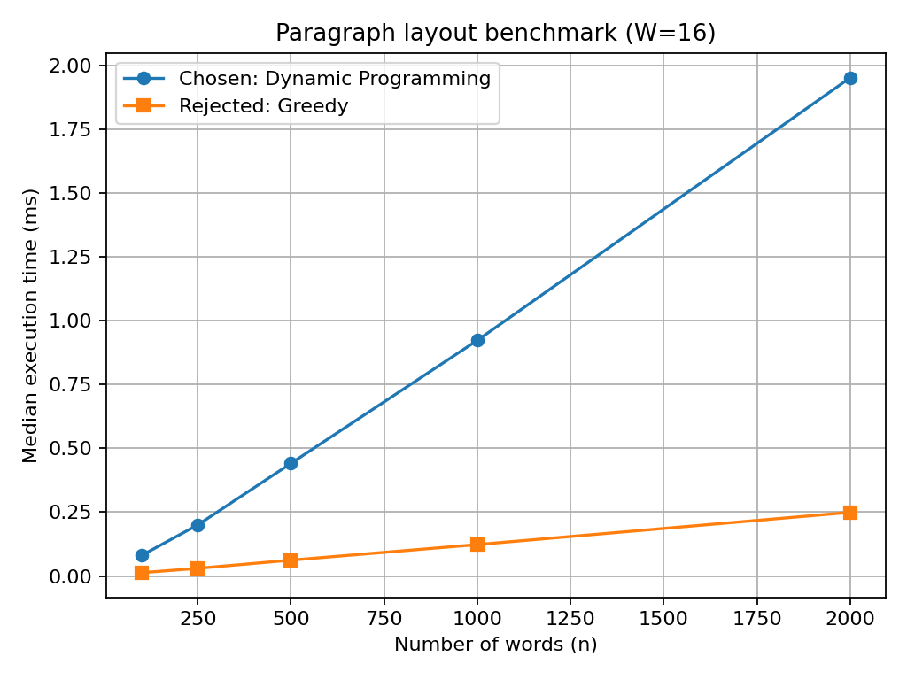

# Batch 11 — Publishing: Paragraph Layout in an E-Reader

## Team

| Roll No. | Name | GitHub username | Part presented | Contribution (code, report sections) |
|---|---|---|---|---|
| 24I351 | Sabarinathan L | [sabarinathan50](https://github.com/sabarinathan50) | Execution instructions | Prepared `code/RUN.md`, including software requirements, execution commands, and instructions for running the algorithms and generating benchmark results. |
| 24I337 | Om Arya SP | [arya1485553-cyber](https://github.com/arya1485553-cyber) | Rejected alternative | Implemented the greedy alternative in `code/rejected_alternative.py` for comparison with the dynamic programming solution. |
| 24I321 | Karthick B | [karthick25-car](https://github.com/karthick25-car) | Results and presentation | Coordinated the team, managed the results, prepared the presentation slides, and generated the timing graph. |
| 24I367 | Tarun A | [Tarun24i367](https://github.com/Tarun24i367) | Main solution | Implemented the optimal dynamic programming algorithm in `code/main_solution.py`. |
| 24I375 | Vishal V | [Vishal24i375](https://github.com/Vishal24i375) | Input generation and benchmarking | Prepared `code/generate_inputs.py`, generated benchmark inputs, measured execution times, and produced timing results. |

## Presentation

- **Video link:** [Batch 11 Presentation](https://drive.google.com/file/d/1U1lMdO1MDSZbVZ2eUVc4u86fEu4gMC7p/view?usp=sharing)
- **Duration:** 8 minutes 58 seconds
- **Slides:** [slides.pdf](slides.pdf)

---

## 1. Problem modelling

### Input
- A sequence of `n` words in their original order.
- A fixed maximum line width `W`, measured in characters.
- Each word has a positive character length.

### Output
- A paragraph divided into lines.
- Every word must appear in its original order.
- No word can be split between two lines.
- Every line must fit within the maximum width.

### Objective

Minimize the total penalty of the paragraph.

For every line except the last line:

\[
Penalty=(Unused\ Spaces)^3
\]

The last line has zero penalty.

If a line contains words whose total length is `L`, and it contains `k` words, its used width is:

\[
UsedWidth=L+(k-1)
\]

The unused spaces are:

\[
Slack=W-UsedWidth
\]

Therefore, the total penalty is:

\[
TotalPenalty=\sum_{i=1}^{m-1}(W-UsedWidth_i)^3
\]

where `m` is the total number of lines.

### Constraints

1. Words must remain in their original order.
2. Words cannot be divided.
3. Each line must have a width less than or equal to `W`.
4. The final line has zero penalty.
5. The total penalty must be minimum.

### Problem class

**Optimisation problem**, because the objective is to find a paragraph arrangement with the minimum possible penalty.

### Classical problem it maps to

This problem maps to the classical **Word Wrap Problem**, also called the **Text Justification Problem**.

Dynamic programming is used to find the best line breaks instead of choosing each line independently.

---

## 2. Data structure analysis

| Data structure | Key operation(s) and cost | Space | Behaviour at the scale in the scenario |
|---|---|---|---|
| **Chosen: Python lists with prefix-sum, DP, and parent arrays** | Prefix-sum calculation takes O(1) for a range. DP transitions examine valid previous line positions. | O(n) | Efficient for processing a large sequence of words and reconstructing the final paragraph. |
| Alternative 1: Two-dimensional DP table | Stores results for multiple ranges or states. Access takes O(1). | O(n²) | Uses more memory than necessary because the solution only needs the best cost for each prefix. |
| Alternative 2: Recursive memoization using a dictionary | Looks up previously calculated states in O(1) average time. | O(n) memoization space, plus recursion stack | Avoids repeated calculations, but recursion can cause additional overhead and deep recursion for large inputs. |

### Why the chosen structure wins

The chosen implementation uses Python lists because they provide efficient indexed access.

A prefix-sum array helps calculate the total character length of a group of words without repeatedly adding every word length.

The DP array stores the minimum penalty for each prefix of the paragraph. A parent array stores the starting position of the selected last line, allowing the final layout to be reconstructed.

This approach uses O(n) auxiliary space and avoids the extra memory required by a two-dimensional table or the function-call overhead of recursion.

---

## 3. Design technique identification

### Technique chosen: Dynamic Programming

Dynamic programming is used because the problem has:

1. **Optimal substructure**
2. **Overlapping subproblems**

### Optimal substructure

The optimal arrangement of the first `j` words depends on the optimal arrangement of a smaller prefix.

If the last line contains words from position `i` to `j`, the previous words must already have an optimal arrangement.

Therefore, the solution can be built using previously calculated optimal results.

### Overlapping subproblems

While calculating the minimum penalty for different prefixes, the algorithm repeatedly needs the best result for earlier prefixes.

Instead of solving the same subproblem repeatedly, dynamic programming stores the result in the DP array and reuses it.

### Why dynamic programming works

The algorithm checks all valid choices for the last line of each prefix and selects the choice with the minimum total penalty.

Since all valid previous line arrangements are considered, the algorithm finds the globally minimum penalty.

---

## 4. Why the other four techniques do not fit

| Technique | Why unsuitable (evidence) |
|---|---|
| Greedy | Greedy chooses a line using a local decision without considering the complete paragraph. For the example in Section 7, greedy produces a penalty of 133, while dynamic programming produces 43. Therefore, greedy does not always produce the optimal answer. |
| Divide and Conquer | Dividing the paragraph into independent halves does not directly solve the problem because the best line breaks can cross the division boundary. The cost of a prefix also depends on earlier prefixes. A divide-and-conquer implementation would need additional state handling or memoization to reuse overlapping results. |
| Backtracking | Each gap between consecutive words can either contain a line break or not. For `n` words, there are `n-1` gaps and therefore `2^(n-1)` possible line arrangements before checking constraints. For 12 words, this gives 2,048 possible arrangements. This becomes expensive for large paragraphs. |
| Branch and Bound | Branch and Bound can prune arrangements that exceed the line width, but it still explores possible line arrangements. A simple lower bound of zero is weak because all penalty values are non-negative. Dynamic programming avoids repeatedly exploring the same prefix states. |

Dynamic programming is the most suitable technique because it reuses previously calculated results and guarantees the minimum penalty.

---

## 5. Algorithm

### State definition

Let:

- `n` = number of words.
- `W` = maximum line width.
- `dp[j]` = minimum penalty for arranging the first `j` words.
- `parent[j]` = starting index of the final line in the optimal arrangement of the first `j` words.
- `prefix[j]` = total character length of the first `j` words.

Initially:

\[
dp[0]=0
\]

For every other state:

\[
dp[j]=\infty
\]

### Recurrence relation

Suppose the last line contains words from position `i` to `j`.

The used width is:

\[
UsedWidth=prefix[j]-prefix[i-1]+(j-i)
\]

If:

\[
UsedWidth>W
\]

the line is invalid and is not considered.

Otherwise, the line penalty is:

\[
LineCost=
\begin{cases}
0 & \text{if }j=n\\
(W-UsedWidth)^3 & \text{otherwise}
\end{cases}
\]

The recurrence is:

\[
dp[j]=\min_{1\leq i\leq j}
\left(dp[i-1]+LineCost(i,j)\right)
\]

Only valid line arrangements are considered.

### Pseudocode

```text
WORD_WRAP(words, W):

    n = number of words

    Create prefix array
    prefix[0] = 0

    for i = 1 to n:
        prefix[i] = prefix[i-1] + length(words[i-1])

    Create dp array of size n+1
    Create parent array of size n+1

    Set all dp values to infinity
    dp[0] = 0

    for j = 1 to n:

        for i = j down to 1:

            used = prefix[j] - prefix[i-1] + (j-i)

            if used > W:
                break

            if j == n:
                cost = 0
            else:
                cost = (W-used)^3

            candidate = dp[i-1] + cost

            if candidate < dp[j]:
                dp[j] = candidate
                parent[j] = i

    Reconstruct lines using parent array

    return lines and dp[n]
```

### Selection

For every prefix, the algorithm selects the valid last line that produces the smallest total penalty.

### Pruning

When the used width exceeds `W`, the inner loop stops.

Adding more words to the same line can only increase its width, so no earlier starting position can make that line valid.

---

## 6. Proof of correctness

We prove that the dynamic programming algorithm produces the minimum possible penalty.

### Base case

For zero words:

\[
dp[0]=0
\]

This is correct because an empty paragraph has no line penalty.

### Inductive hypothesis

Assume that `dp[k]` stores the minimum penalty for arranging the first `k` words correctly, for every `k` less than `j`.

### Inductive step

Consider an optimal arrangement of the first `j` words.

Its final line must contain some consecutive words from position `i` to `j`.

The words before position `i` form the first `i-1` words.

By the inductive hypothesis, `dp[i-1]` contains the minimum penalty for arranging those previous words.

The algorithm considers every valid starting position `i` for the final line.

It calculates:

\[
dp[i-1]+LineCost(i,j)
\]

It then selects the minimum value among all valid choices.

Since every possible valid final line is considered, the algorithm cannot miss the optimal arrangement.

Therefore, `dp[j]` stores the minimum penalty for the first `j` words.

### Conclusion

By mathematical induction, `dp[n]` gives the minimum possible total penalty for the complete paragraph.

The parent array stores the selected line boundaries, so the algorithm can reconstruct an arrangement that achieves this minimum.

Hence, the algorithm is correct.

---

## 7. Trace on given instance

Consider the following example.

**Input words:**

```text
A clear model of the problem is half of the final answer
```

**Maximum line width:**

\[
W=16
\]

### Step 1: Greedy approach

The greedy approach places as many words as possible in each line.

| Line | Words | Used width | Slack | Penalty |
|---|---|---:|---:|---:|
| 1 | A clear model of | 16 | 0 | 0 |
| 2 | the problem is | 14 | 2 | 8 |
| 3 | half of the | 11 | 5 | 125 |
| 4 | final answer | 12 | 4 | 0 (last line) |

Total penalty:

\[
0+8+125+0=\boxed{133}
\]

### Step 2: Dynamic programming approach

The dynamic programming algorithm considers different possible line breaks and stores the minimum penalty for every prefix.

The following table shows the minimum cost for each prefix.

| Number of words | Prefix ending with | Minimum penalty `dp[j]` |
|---:|---|---:|
| 0 | Empty | 0 |
| 1 | A | 3375 |
| 2 | clear | 729 |
| 3 | model | 27 |
| 4 | of | 0 |
| 5 | the | 793 |
| 6 | problem | 35 |
| 7 | is | 8 |
| 8 | half | 764 |
| 9 | of | 251 |
| 10 | the | 43 |
| 11 | final | 594 |
| 12 | answer | 43 |

### Step 3: Reconstruct the optimal lines

Using the parent array, the selected line arrangement is:

| Line | Words | Used width | Slack | Penalty |
|---|---|---:|---:|---:|
| 1 | A clear model | 13 | 3 | 27 |
| 2 | of the problem | 14 | 2 | 8 |
| 3 | is half of the | 14 | 2 | 8 |
| 4 | final answer | 12 | 4 | 0 (last line) |

### Step 4: Calculate total penalty

\[
TotalPenalty=3^3+2^3+2^3+0
\]

\[
=27+8+8+0
\]

\[
\boxed{TotalPenalty=43}
\]

### Final comparison

| Approach | Total penalty |
|---|---:|
| Greedy | 133 |
| Dynamic Programming | **43** |

Dynamic programming produces the lower penalty and gives the optimal line arrangement for this example.

---

## 8. Complexity analysis

Let:

- `n` = number of words.
- `W` = maximum line width.

### Prefix-sum calculation

The prefix-sum array is calculated by visiting each word once.

Time complexity:

\[
O(n)
\]

Space complexity:

\[
O(n)
\]

### Dynamic programming calculation

For every word position `j`, the algorithm checks possible starting positions `i` for the last line.

Since every word has at least one character, no more than `W` words can fit into a line of width `W`.

Therefore, the number of candidates checked for each position is at most:

\[
\min(n,W)
\]

Total worst-case time:

\[
\boxed{O(n\min(n,W))}
\]

This is commonly expressed as:

\[
O(nW)
\]

when `W` is smaller than or equal to `n`.

### Time complexity

| Case | Time complexity | Explanation |
|---|---|---|
| Best case | O(n) | Only a constant number of candidate line positions are checked for each word. |
| Worst case | O(n × min(n, W)) | Each prefix checks up to the maximum number of words that can fit in a line. |
| Typical case | Depends on word lengths and width | The average number of valid candidate lines depends on the input word-length distribution. |

For a fixed line width, the worst-case running time grows linearly with the number of words.

### Space complexity

The algorithm stores:

- Prefix-sum array: O(n)
- DP array: O(n)
- Parent array: O(n)

Therefore:

\[
\boxed{Space=O(n)}
\]

The reconstructed output also contains all `n` words.

---

## 9. Worst-case input

A worst-case input for the inner DP loop is a paragraph containing many one-character words.

Example:

```text
a a a a a a a a a a a a a a a a ...
```

Let:

\[
W=16
\]

Each line can contain several one-character words, including the spaces between them.

Because each word is very short, the algorithm can examine many possible starting positions for each prefix before reaching the width limit.

This creates a large number of DP transitions compared with inputs containing longer words.

For a fixed `W`, the number of candidates per position is still bounded by `W`.

Therefore, the worst-case time complexity remains:

\[
O(nW)
\]

The implementation also stops checking earlier positions as soon as a line exceeds the width.

---

## 10. Implementation and empirical analysis

### Language and how to run

The project is implemented using **Python 3.9 or later**.

Refer to [code/RUN.md](code/RUN.md) for the complete installation requirements and execution commands.

### Project files

```text
Batch_11/
│
├── README.md
├── slides.pdf
│
├── code/
│   ├── RUN.md
│   ├── main_solution.py
│   ├── rejected_alternative.py
│   └── generate_inputs.py
│
└── results/
    ├── timing.csv
    └── timing_plot.png
```

### Input sizes used

Five input sizes were used to compare the dynamic programming solution and the greedy alternative.

The benchmark results are recorded in `results/timing.csv`.

| Number of words | DP time (ms) | Greedy time (ms) |
|---:|---:|---:|
| 100 | 0.081012 | 0.012979 |
| 250 | 0.199931 | 0.029925 |
| 500 | 0.441025 | 0.062084 |
| 1000 | 0.923113 | 0.123146 |
| 2000 | 1.951815 | 0.249296 |

### Timing plot



### Does measured growth match Section 8?

Yes. The measured execution time of the dynamic programming algorithm increases as the input size increases.

When the number of words increases from 500 to 1000, the execution time also increases approximately two times.

This is consistent with the expected behaviour when the line width is fixed.

The theoretical worst-case complexity is O(nW). Since `W` is fixed in the benchmark, the growth is approximately linear in `n`.

Small differences in the measurements can occur because of Python execution overhead, machine performance, and input characteristics.

### Comparison with rejected alternative

The greedy algorithm is faster in the measured experiments because it makes local decisions and does not calculate multiple DP states.

However, it does not always produce the minimum penalty.

The dynamic programming algorithm takes more time, but it guarantees an optimal arrangement.

Therefore, dynamic programming is selected as the main solution because correctness and minimum penalty are more important than the small execution-time advantage of the greedy approach.

---

## 11. Changed requirement

### Changed requirement: Allow hyphenation of long words

In the original problem, words cannot be split between lines.

If the requirement changes to allow hyphenation, a word may be divided into smaller parts when it does not fit on the current line.

For example, a long word could be split at an allowed hyphenation position.

### Changes required

1. Identify valid hyphenation positions in each word.
2. Treat each valid split as an additional possible line break.
3. Include the hyphen character in the used line width.
4. Add an appropriate penalty for splitting a word.
5. Update the DP transitions to consider both normal word boundaries and valid hyphenation boundaries.

### Does dynamic programming still work?

Yes. Dynamic programming still works because the problem continues to have optimal substructure.

The algorithm must consider more possible line-ending positions, including hyphenated parts.

### New complexity

The complexity depends on the number of valid hyphenation positions.

If the expanded input contains `N` possible break units and the maximum width is `W`, a similar bounded-width DP approach can take:

\[
O(NW)
\]

time and O(N) space, assuming the number of possible break units is represented in the expanded sequence.

---

## 12. Answers to remaining scenario questions

### 1. Why is the last line free?

The last line of a paragraph does not need to fill the complete line width.

Therefore, unused spaces on the final line should not increase the penalty.

This is represented by assigning zero cost whenever `j == n`.

### 2. Why is the unused-space penalty cubed?

Cubing the unused spaces makes lines with large gaps much more expensive.

For example:

- Slack 1 gives penalty 1.
- Slack 2 gives penalty 8.
- Slack 3 gives penalty 27.

This encourages the algorithm to avoid lines with large unused spaces.

### 3. What happens if a word is longer than the maximum width?

If a word itself is longer than `W`, it cannot fit on any line under the original constraints.

The input must be rejected or the requirements must be changed to allow hyphenation or another special handling method.

### 4. Why is the greedy approach not selected?

Greedy makes a local decision by selecting words for the current line.

It does not consider how that decision affects the remaining paragraph.

The example in Section 7 demonstrates this: greedy produces a penalty of 133, while dynamic programming produces 43.

### 5. Can the algorithm handle a large book?

The algorithm can process a large sequence of words by solving the paragraph layout problem using dynamic programming.

However, the implementation should process paragraphs separately when the input contains multiple paragraphs, because line breaks and the free final-line rule apply to each paragraph.

For each paragraph containing `n` words, the algorithm uses O(n) space and O(n × min(n, W)) worst-case time.

---

## 13. Real-world reference

### Knuth–Plass line-breaking algorithm

A well-known real-world application of dynamic programming in text layout is the **Knuth–Plass line-breaking algorithm**, introduced by Donald E. Knuth and Michael F. Plass in their 1981 research paper, *Breaking Paragraphs into Lines*.

The algorithm is used in the TeX typesetting system to choose good line-breaking positions across an entire paragraph.

It uses three main concepts:

- **Boxes:** Represent words or other fixed-width text elements.
- **Glue:** Represents flexible spaces between words.
- **Penalties:** Represent costs associated with possible line breaks.

The algorithm considers the paragraph as a whole instead of making an independent decision for every line.

### Difference from our implementation

| Our implementation | Knuth–Plass algorithm |
|---|---|
| Uses character count to calculate line width. | Can use actual typesetting widths. |
| Uses the cube of unused spaces as the penalty. | Uses a more detailed system of line-breaking demerits. |
| Does not allow word splitting. | Can consider additional break opportunities, including hyphenation. |
| Uses a simple DP recurrence for word boundaries. | Uses a more advanced global line-breaking method. |

### Reference links

- [Knuth and Plass — Breaking Paragraphs into Lines (1981)](https://doi.org/10.1002/spe.4380111102)
- [Unicode Standard — Line Breaking Algorithm](https://unicode.org/reports/tr14/)

The Knuth–Plass algorithm demonstrates how dynamic programming can be applied to real-world text formatting and publishing systems.

---

## Conclusion

This project implements the Word Wrap Problem using dynamic programming.

The algorithm calculates the minimum penalty by considering valid line breaks and reusing previously computed results.

The greedy alternative is faster in the benchmark experiments, but it does not guarantee an optimal paragraph layout.

The dynamic programming solution produces the minimum penalty and uses O(n) space with O(n × min(n, W)) worst-case time complexity.

This project demonstrates the importance of dynamic programming in solving optimisation problems involving overlapping subproblems and optimal substructure.
