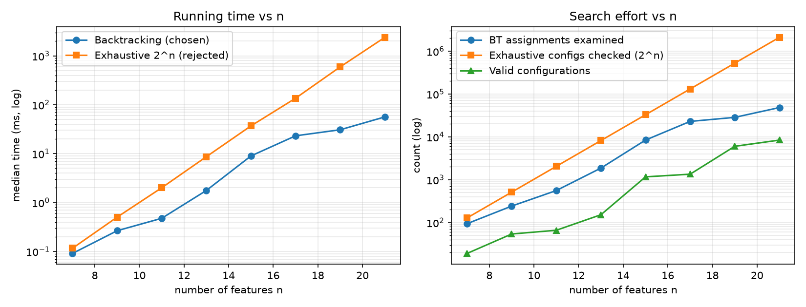

# Batch 14 — Automotive software: valid ECU feature configurations

Course 23I501 – Design and Analysis of Algorithms · PSG College of Technology, IT Department

## Team

| Roll No. | Name                | GitHub username        | Part presented                                              | Contribution (code, report sections)                                    |
| -------- | ------------------- | ---------------------- | ----------------------------------------------------------- | ----------------------------------------------------------------------- |
| `24I306` | `Aryaa Madhavan`    | `AryaaM1`              | Member 1: introduction, ECU problem                         | Sections 1, 13; slides 1–3                                              |
| `24I329` | `Maileshwaran S`    | `Maileshwaran-S`       | Member 2: CSP modelling                                     | Section 1, 12 (Q1); `generate_inputs.py`; slides 4–6                    |
| `24I333` | `Nishwanth B`       | `Nishwanth333`         | Member 3: backtracking, rejected techniques                 | Sections 3–6; `main_solution.py`, `rejected_alternative.py`; slides 7–9 |
| `24I338` | `Param Vijayeshvar` | `paramvijayeshvar-del` | Member 4: configurations, trace, orderings, data structures | Sections 2, 7, 12 (Q2–Q4); slides 10–12                                 |
| `24I354` | `Sanjith B K`       | `Sanjith1477`          | Member 5: complexity, benchmark, worst case, pairwise       | Sections 8–11; `pairwise_testing.py`, `benchmark.py`; slides 13–15      |

## Presentation

- Video link: `https://drive.google.com/drive/folders/1IWGiu9yvU9AK180tZgQWsjwanjZc7_gM?usp=drive_link`
- Duration: `<14:10>` (maximum 12:00; script targets about 10:30)
- Slides: [slides.pdf](slides.pdf) (editable: `slides.pptx`; speaker script: `presentation_script.md`)

---

## 1. Problem modelling

- **Input:** seven binary features ACC (adaptive cruise), BC (basic cruise), LKA (lane keep), PA (park assist), RAD (radar), CAM (camera), US (ultrasonic); constraints and sensor costs RAD ₹12,000, CAM ₹8,000, US ₹5,000.
- **Output:** the set S of **all** assignments x ∈ {0,1}^7 satisfying every constraint.
- **Objective:** none to optimise; completeness (list every valid configuration, no duplicates) so the test team can plan coverage.
- **Problem class:** _enumeration_ (the decision version "is there a valid configuration?" is SAT-like; counting is #SAT-like).
- **Classical problem:** a Constraint Satisfaction Problem (CSP) / feature-model configuration problem (all-solutions SAT). Here |S| = 19 of 2^7 = 128.

**Q1 — CSP model.** Variables X = {ACC, BC, LKA, PA, RAD, CAM, US}; every domain D = {0,1}.

| #   | Constraint                  | Formal form                            | Class                                                                                                                 | Arity |
| --- | --------------------------- | -------------------------------------- | --------------------------------------------------------------------------------------------------------------------- | ----- |
| C1  | ACC requires RAD            | ACC ⇒ RAD                              | **binary**                                                                                                            | 2     |
| C2  | LKA requires CAM            | LKA ⇒ CAM                              | **binary**                                                                                                            | 2     |
| C3  | PA requires US              | PA ⇒ US                                | **binary**                                                                                                            | 2     |
| C4  | ACC excludes BC             | ¬(ACC ∧ BC)                            | **binary**                                                                                                            | 2     |
| C5  | at least one of ACC, BC     | ACC ∨ BC                               | **binary** (a 2-ary clause; it is a "cardinality" rule, so it generalises to a global at-least-1 over a larger group) | 2     |
| C6  | total sensor cost ≤ ₹20,000 | 12000·RAD + 8000·CAM + 5000·US ≤ 20000 | **global** (linear inequality over RAD, CAM, US; arity 3)                                                             | 3     |
| –   | domains {0,1}               | x ∈ {0,1}                              | **unary** (domain constraint, enforced by the loop over {0,1})                                                        | 1     |

The instance has no unary constraint beyond the domains (no feature is forced on/off). C6 is the only truly global constraint; it is also monotone (costs ≥ 0), so a _partial_ sum already above ₹20,000 cannot be repaired. C6 implies ¬(RAD ∧ CAM ∧ US) (25,000 > 20,000) and no other restriction (RAD+CAM = 20,000 is allowed).

## 2. Data structure analysis

Candidates for representing/checking constraints (Q4). Costs are analytical, n = number of features, c = number of constraints, E = number of implication edges.

| Data structure                                                                                                                                 | Key operation(s) and cost                                                                                                                                                                          | Space                                                                                                                  | Behaviour at scale in the scenario (≈200 features)                                                                                                                                                     |
| ---------------------------------------------------------------------------------------------------------------------------------------------- | -------------------------------------------------------------------------------------------------------------------------------------------------------------------------------------------------- | ---------------------------------------------------------------------------------------------------------------------- | ------------------------------------------------------------------------------------------------------------------------------------------------------------------------------------------------------ |
| **Chosen: assignment array / bit vector** (one bit per feature; constraints as bit-mask tests, e.g. ACC⇒RAD is `(m>>ACC & 1) <= (m>>RAD & 1)`) | set/unset a feature O(1); check one binary constraint O(1); incremental check at depth d = constraints closing at d; full validation O(c) word operations; cost check O(1) incremental running sum | O(n/w + c) (w = word size; one 64-bit word for n ≤ 64, 4 words for 200)                                                | Tiny and cache-friendly; handles global cost constraint naturally; supports O(1) undo (backtrack)                                                                                                      |
| Alternative 1: **implication graph** (2n literal nodes, edge a→b per implication)                                                              | check a full configuration O(n + E); unit propagation from one literal O(out-reachable edges); pair feasibility O(n + E)                                                                           | O(n + E)                                                                                                               | Excellent for pure binary constraints and for 2-SAT reasoning (used in Section 12 for pairwise feasibility); **cannot** express the cost budget (global)                                               |
| Alternative 2: **Binary Decision Diagram (ROBDD)** over a fixed variable order                                                                 | check a full configuration O(n) (one root-to-terminal walk, independent of c); count solutions O(\|BDD\|); build cost = O(\|BDD\|) after the fact, worst case exponential                          | O(\|BDD\|); **measured here: 23 internal nodes (features-first order), 24 (sensors-first)** — `main_solution.py --bdd` | For 200 features the size depends entirely on the order and the constraint structure; feature models often compile well, but there is no guarantee and building it needs the problem solved implicitly |

Why the bit vector wins for the primary task: backtracking only needs O(1) set/undo and O(1) "does the constraint that just closed hold?" tests. The implication graph is the best tool for _reasoning_ (propagation) and the BDD for _repeated_ checking and counting, but neither is cheaper per backtracking step, and neither captures the budget constraint without extra machinery. (Per-check timings were not micro-benchmarked; the table is analytical.)

## 3. Design technique identification

- **Technique chosen: Backtracking** (depth-first search over partial assignments with constraint pruning).
- **Enabling property (prunable state space), with proof.** Order the variables v1…vn. A partial assignment p on v1…vd is _dead_ if some constraint whose entire scope lies in v1…vd is violated by p, or if the partial cost already exceeds the budget.
  **Lemma (monotone pruning).** If p is dead, no complete assignment extending p is valid.
  _Proof._ A violated constraint whose scope is inside the assigned variables is violated by every extension, because its truth value depends only on those variables. For the budget, costs are non-negative, so cost(extension) ≥ cost(p) > 20,000. ∎
  So dead nodes can be discarded together with their whole subtree (up to 2^(n−d) leaves), without losing any valid configuration. Constraint violations are decidable locally and incrementally, in O(1) per constraint, which is exactly the situation backtracking exploits.
- Because the task is _enumeration_ (all solutions), the result has to be produced element by element; the search tree is the natural output-sensitive structure.

## 4. Why the other four techniques do not fit

| Technique               | Why it is unsuitable here (evidence)                                                                                                                                                                                                                                                                                                                                                                                                                                                                                                                                                                                         |
| ----------------------- | ---------------------------------------------------------------------------------------------------------------------------------------------------------------------------------------------------------------------------------------------------------------------------------------------------------------------------------------------------------------------------------------------------------------------------------------------------------------------------------------------------------------------------------------------------------------------------------------------------------------------------- |
| **Divide and Conquer**  | The halves are not independent: ACC–RAD, ACC–BC, LKA–CAM, PA–US are cross constraints, and the budget couples the sensors. Split {ACC,BC,LKA,PA} \| {RAD,CAM,US}: the left half has 8 locally valid assignments (exactly one of ACC/BC × LKA × PA), the right half 7 (all except RAD∧CAM∧US). The merge must test **8 × 7 = 56** pairs to find the 19 valid ones (66 % wasted), and for n features the merge is a cross-product of up to 2^(n/2) × 2^(n/2) = 2^n pairs, so T(n) = 2T(n/2) + Θ(2^n) = Θ(2^n) with _no_ pruning of cross-constraints. There is no recombination step cheaper than checking pairs.              |
| **Greedy**              | A greedy rule makes one irrevocable choice per variable and so produces **one** configuration; the answer has 19, and 14 of them contain BC while 5 contain ACC. If greedy turns ACC on first it can never output the 14 BC-configurations; to output all, it has to be re-run with every alternative choice, i.e. it degenerates into backtracking. There is no objective, so no greedy-choice property or exchange argument exists.                                                                                                                                                                                        |
| **Dynamic Programming** | DP needs optimal substructure/overlapping subproblems for an _optimisation/counting_ value. It can count the 19 solutions (state = (feature index, partial cost, pending obligations)), but it cannot list them without a second pass that walks the table, which is the backtracking traversal again. The state is also not small: pending requirements ("RAD owed", "CAM owed", …) form a **subset** of features, so up to 2^k states for k outstanding dependencies; with arbitrary cross-feature dependencies (200 features) the table is not polynomial. The output itself (19 → exponentially many) is not a DP value. |
| **Branch and Bound**    | B&B prunes a node when a _bound_ on the objective cannot beat the incumbent. Here there is no objective and **every** valid leaf is required, so any bound-based pruning discards valid answers. Example: the minimum-cost valid configuration is {BC} (cost 0); B&B would then prune every node with bound ≥ 0, i.e. all 18 other solutions. The only valid "bound" is feasibility (cost > budget, constraint violated), which is precisely backtracking's pruning rule. (B&B would be right for the _different_ question "cheapest valid configuration containing ACC and LKA".)                                           |

## 5. Algorithm

State: depth d, partial assignment A on order[0..d−1], running sensor cost. Pruning rule: after setting order[d], (a) cost > budget, or (b) any constraint whose last variable (in this order) is order[d] is violated, then prune.

```
Enumerate(order[0..n-1]):
    checks[d] <- constraints whose last variable in `order` is order[d]
    Search(0, cost = 0)

Search(d, cost):
    if d = n:  output A ; return                 // all constraints were checked on the way
    v <- order[d]
    for val in {0, 1}:
        A[v] <- val
        c' <- cost + (costOf(v) if val = 1 else 0)
        if c' <= budget and no constraint in checks[d] is violated by A:
            Search(d+1, c')
        // else: prune (count it); the subtree of 2^(n-d-1) leaves is skipped
    unset A[v]                                   // backtrack
```

Recurrence for the number of nodes: N(d) = 1 + Σ\_{val ok} N(d+1); the tree size is bounded by 2^(n+1) − 1. Implemented in `code/main_solution.py` (`enumerate_valid`, both variable orders: sensors-first RAD,CAM,US,ACC,BC,LKA,PA and features-first ACC,BC,LKA,PA,RAD,CAM,US).

**Rejected alternative** (`code/rejected_alternative.py`): generate and test all 2^n assignments, validating each against every constraint independently.

## 6. Proof of correctness

Let S be the set of valid configurations and out the output of Enumerate.

- **Soundness (out ⊆ S).** A leaf is reached only if at every depth d the check of all constraints closing at d passed and the running cost ≤ budget. Every constraint has a last variable in the order, so it is checked once with its whole scope assigned; the final running cost is the total cost. Hence a leaf satisfies all constraints.
- **Completeness (S ⊆ out).** Invariant: _for every valid configuration s and every depth d, the prefix s|d is accepted by the checks._ Induction on d: d = 0 is trivial; if s|d is accepted, the loop tries val = s(order[d]); the checks can only fail if a constraint over assigned variables is violated or the partial cost exceeds the budget, which by the monotone-pruning lemma (Section 3) would make s invalid, a contradiction. So s|d+1 is accepted and the leaf s is reached.
- **Uniqueness (no duplicates).** Two different leaves differ at a first depth d, where one took val = 0 and the other val = 1 in the same call; the root-to-leaf path is a unique sequence of decisions, and each complete configuration corresponds to exactly one path. So each valid configuration is output exactly once. ∎

Empirical cross-check: `rejected_alternative.py` produces exactly the same 19 configurations; the benchmark asserts equality for every size n = 7…21.

## 7. Trace on the given instance

Result (identical for both orders; 1 = enabled; column order ACC, BC, LKA, PA, RAD, CAM, US):

```
Valid configurations (canonical order ACC,BC,LKA,PA,RAD,CAM,US):
  1. 0100000  {BC}  sensor cost = 0
  2. 0100001  {BC, US}  sensor cost = 5000
  3. 0100010  {BC, CAM}  sensor cost = 8000
  4. 0100011  {BC, CAM, US}  sensor cost = 13000
  5. 0100100  {BC, RAD}  sensor cost = 12000
  6. 0100101  {BC, RAD, US}  sensor cost = 17000
  7. 0100110  {BC, RAD, CAM}  sensor cost = 20000
  8. 0101001  {BC, PA, US}  sensor cost = 5000
  9. 0101011  {BC, PA, CAM, US}  sensor cost = 13000
  10. 0101101  {BC, PA, RAD, US}  sensor cost = 17000
  11. 0110010  {BC, LKA, CAM}  sensor cost = 8000
  12. 0110011  {BC, LKA, CAM, US}  sensor cost = 13000
  13. 0110110  {BC, LKA, RAD, CAM}  sensor cost = 20000
  14. 0111011  {BC, LKA, PA, CAM, US}  sensor cost = 13000
  15. 1000100  {ACC, RAD}  sensor cost = 12000
  16. 1000101  {ACC, RAD, US}  sensor cost = 17000
  17. 1000110  {ACC, RAD, CAM}  sensor cost = 20000
  18. 1001101  {ACC, PA, RAD, US}  sensor cost = 17000
  19. 1010110  {ACC, LKA, RAD, CAM}  sensor cost = 20000
```

**Answer: 19 valid configurations** (14 with BC, 5 with ACC). Hand-check: BC branch: sensor sets {}, {US}, {CAM}, {CAM,US}, {RAD}, {RAD,US}, {RAD,CAM} have 1,2,2,4,1,2,2 choices of LKA/PA (LKA needs CAM, PA needs US) = 14; ACC branch: sensor sets {RAD}, {RAD,US}, {RAD,CAM} give 1+2+2 = 5; total 19.

Complete execution trace (features-first order; indentation = depth; `ok` = recursive call made, `PRUNE` = subtree skipped; produced by `python main_solution.py --trace`):

```
TRACE (features-first): ['ACC', 'BC', 'LKA', 'PA', 'RAD', 'CAM', 'US']
d1: ACC=0  [cost=0]  ok
  d2: BC=0  [cost=0]  PRUNE: atleast(ACC, BC) violated
  d2: BC=1  [cost=0]  ok
    d3: LKA=0  [cost=0]  ok
      d4: PA=0  [cost=0]  ok
        d5: RAD=0  [cost=0]  ok
          d6: CAM=0  [cost=0]  ok
            d7: US=0  [cost=0]  ok
              SOLUTION {BC}
            d7: US=1  [cost=5000]  ok
              SOLUTION {BC, US}
          d6: CAM=1  [cost=8000]  ok
            d7: US=0  [cost=8000]  ok
              SOLUTION {BC, CAM}
            d7: US=1  [cost=13000]  ok
              SOLUTION {BC, CAM, US}
        d5: RAD=1  [cost=12000]  ok
          d6: CAM=0  [cost=12000]  ok
            d7: US=0  [cost=12000]  ok
              SOLUTION {BC, RAD}
            d7: US=1  [cost=17000]  ok
              SOLUTION {BC, RAD, US}
          d6: CAM=1  [cost=20000]  ok
            d7: US=0  [cost=20000]  ok
              SOLUTION {BC, RAD, CAM}
            d7: US=1  [cost=25000]  PRUNE: sensor cost 25000 > 20000
      d4: PA=1  [cost=0]  ok
        d5: RAD=0  [cost=0]  ok
          d6: CAM=0  [cost=0]  ok
            d7: US=0  [cost=0]  PRUNE: requires(PA, US) violated
            d7: US=1  [cost=5000]  ok
              SOLUTION {BC, PA, US}
          d6: CAM=1  [cost=8000]  ok
            d7: US=0  [cost=8000]  PRUNE: requires(PA, US) violated
            d7: US=1  [cost=13000]  ok
              SOLUTION {BC, PA, CAM, US}
        d5: RAD=1  [cost=12000]  ok
          d6: CAM=0  [cost=12000]  ok
            d7: US=0  [cost=12000]  PRUNE: requires(PA, US) violated
            d7: US=1  [cost=17000]  ok
              SOLUTION {BC, PA, RAD, US}
          d6: CAM=1  [cost=20000]  ok
            d7: US=0  [cost=20000]  PRUNE: requires(PA, US) violated
            d7: US=1  [cost=25000]  PRUNE: sensor cost 25000 > 20000
    d3: LKA=1  [cost=0]  ok
      d4: PA=0  [cost=0]  ok
        d5: RAD=0  [cost=0]  ok
          d6: CAM=0  [cost=0]  PRUNE: requires(LKA, CAM) violated
          d6: CAM=1  [cost=8000]  ok
            d7: US=0  [cost=8000]  ok
              SOLUTION {BC, LKA, CAM}
            d7: US=1  [cost=13000]  ok
              SOLUTION {BC, LKA, CAM, US}
        d5: RAD=1  [cost=12000]  ok
          d6: CAM=0  [cost=12000]  PRUNE: requires(LKA, CAM) violated
          d6: CAM=1  [cost=20000]  ok
            d7: US=0  [cost=20000]  ok
              SOLUTION {BC, LKA, RAD, CAM}
            d7: US=1  [cost=25000]  PRUNE: sensor cost 25000 > 20000
      d4: PA=1  [cost=0]  ok
        d5: RAD=0  [cost=0]  ok
          d6: CAM=0  [cost=0]  PRUNE: requires(LKA, CAM) violated
          d6: CAM=1  [cost=8000]  ok
            d7: US=0  [cost=8000]  PRUNE: requires(PA, US) violated
            d7: US=1  [cost=13000]  ok
              SOLUTION {BC, LKA, PA, CAM, US}
        d5: RAD=1  [cost=12000]  ok
          d6: CAM=0  [cost=12000]  PRUNE: requires(LKA, CAM) violated
          d6: CAM=1  [cost=20000]  ok
            d7: US=0  [cost=20000]  PRUNE: requires(PA, US) violated
            d7: US=1  [cost=25000]  PRUNE: sensor cost 25000 > 20000
d1: ACC=1  [cost=0]  ok
  d2: BC=0  [cost=0]  ok
    d3: LKA=0  [cost=0]  ok
      d4: PA=0  [cost=0]  ok
        d5: RAD=0  [cost=0]  PRUNE: requires(ACC, RAD) violated
        d5: RAD=1  [cost=12000]  ok
          d6: CAM=0  [cost=12000]  ok
            d7: US=0  [cost=12000]  ok
              SOLUTION {ACC, RAD}
            d7: US=1  [cost=17000]  ok
              SOLUTION {ACC, RAD, US}
          d6: CAM=1  [cost=20000]  ok
            d7: US=0  [cost=20000]  ok
              SOLUTION {ACC, RAD, CAM}
            d7: US=1  [cost=25000]  PRUNE: sensor cost 25000 > 20000
      d4: PA=1  [cost=0]  ok
        d5: RAD=0  [cost=0]  PRUNE: requires(ACC, RAD) violated
        d5: RAD=1  [cost=12000]  ok
          d6: CAM=0  [cost=12000]  ok
            d7: US=0  [cost=12000]  PRUNE: requires(PA, US) violated
            d7: US=1  [cost=17000]  ok
              SOLUTION {ACC, PA, RAD, US}
          d6: CAM=1  [cost=20000]  ok
            d7: US=0  [cost=20000]  PRUNE: requires(PA, US) violated
            d7: US=1  [cost=25000]  PRUNE: sensor cost 25000 > 20000
    d3: LKA=1  [cost=0]  ok
      d4: PA=0  [cost=0]  ok
        d5: RAD=0  [cost=0]  PRUNE: requires(ACC, RAD) violated
        d5: RAD=1  [cost=12000]  ok
          d6: CAM=0  [cost=12000]  PRUNE: requires(LKA, CAM) violated
          d6: CAM=1  [cost=20000]  ok
            d7: US=0  [cost=20000]  ok
              SOLUTION {ACC, LKA, RAD, CAM}
            d7: US=1  [cost=25000]  PRUNE: sensor cost 25000 > 20000
      d4: PA=1  [cost=0]  ok
        d5: RAD=0  [cost=0]  PRUNE: requires(ACC, RAD) violated
        d5: RAD=1  [cost=12000]  ok
          d6: CAM=0  [cost=12000]  PRUNE: requires(LKA, CAM) violated
          d6: CAM=1  [cost=20000]  ok
            d7: US=0  [cost=20000]  PRUNE: requires(PA, US) violated
            d7: US=1  [cost=25000]  PRUNE: sensor cost 25000 > 20000
  d2: BC=1  [cost=0]  PRUNE: excludes(ACC, BC) violated
```

## 8. Complexity analysis

Let n = number of features, c = number of constraints, S = set of solutions.

- **Counting argument.** The search tree has at most 2^(n+1) − 1 nodes. Each node does O(c_d) incremental constraint tests (constraints closing at that depth; Σ c_d = c) plus O(1) cost update; each solution costs O(n) to copy. Time = O(N · c_max + n·|S|) where N is the number of visited nodes, N ≤ 2^(n+1) − 1.
- **Best case:** a contradiction at the first variable (both values violate a constraint) costs 1 call and 2 assignments, i.e. O(1); and if there are no dead ends (every accepted node leads to a solution) N ≤ n·|S| + 1, giving output-sensitive O(n·|S|).
- **Practical/average case:** between these, governed by how early constraints close. ECU instance: 66 calls and 94 assignments examined (features-first) versus 255 nodes / 254 assignments in the full tree and 128 leaves; the 5 benchmark sizes below confirm cost ∝ assignments examined (≈1 µs each in CPython).
- **Worst case:** Θ(2^n) (see Section 9); this is unavoidable because |S| itself can be 2^n.
- **Space:** O(n) recursion stack + O(n) assignment/mask (O(n·|S|) if the solutions are stored rather than streamed).
- **Exhaustive alternative:** Θ(2^n · c) time (every vector is validated), O(n) space.

## 9. Worst-case input

Constructed (`python main_solution.py --worst`): n features with **no constraint at all** (every one of the 2^n vectors is valid) or with a single constraint relating the first and last variable of the order (`x0 ⇒ x_last`), which is detected only at depth n and so prunes nothing earlier. Measured:

| n   | instance        | valid  | recursive calls | assignments examined | pruned |
| --- | --------------- | ------ | --------------- | -------------------- | ------ |
| 10  | unconstrained   | 1,024  | 2,047           | 2,046                | 0      |
| 10  | x0 ⇒ x9 (late)  | 768    | 1,791           | 2,046                | 256    |
| 15  | unconstrained   | 32,768 | 65,535          | 65,534               | 0      |
| 15  | x0 ⇒ x14 (late) | 24,576 | 57,343          | 65,534               | 8,192  |

Backtracking visits (almost) the entire tree (2^(n+1) − 1 calls in the unconstrained case) with no savings, so it has no advantage over exhaustive search there (its recursion overhead was not benchmarked separately); the work is Θ(2^n), matching the output size in the unconstrained case. The "late" instance shows that pruning only helps if constraints close early, which is the reason variable order matters (Section 12, Q3).

## 10. Implementation and empirical analysis

- **Language / run:** Python 3, see [code/RUN.md](code/RUN.md).
- **Inputs:** n = 7 is the real ECU instance; n = 9…21 are **synthetic** seeded instances from `generate_inputs.py` (`random.Random(1000+n)`: roughly n/3 sensors with costs ₹5,000/8,000/12,000; each feature requires a sensor with probability 0.7; a few exclusions and one at-least-one rule; budget = 60 % of total sensor cost). Eight sizes were used: 7, 9, 11, 13, 15, 17, 19, 21. Each time is the median of 5 runs (re-running `benchmark.py` gives slightly different milliseconds; the counts never change) (`time.perf_counter`) on the machine that produced this report; both algorithms were checked to return identical solution sets at every size.
- **Plot:** 

<!--BENCH-START-->

| n   | backtracking (ms) | exhaustive (ms) | speed-up | valid configs | BT assignments examined | exhaustive configs (2^n) |
| --- | ----------------- | --------------- | -------- | ------------- | ----------------------- | ------------------------ |
| 7   | 0.091             | 0.116           | 1.3x     | 19            | 94                      | 128                      |
| 9   | 0.265             | 0.502           | 1.9x     | 54            | 242                     | 512                      |
| 11  | 0.476             | 2.006           | 4.2x     | 66            | 558                     | 2048                     |
| 13  | 1.764             | 8.645           | 4.9x     | 152           | 1864                    | 8192                     |
| 15  | 8.97              | 36.925          | 4.1x     | 1164          | 8412                    | 32768                    |
| 17  | 23.144            | 135.898         | 5.9x     | 1344          | 22926                   | 131072                   |
| 19  | 30.782            | 594.386         | 19.3x    | 6016          | 28470                   | 524288                   |
| 21  | 56.34             | 2387.26         | 42.4x    | 8392          | 48206                   | 2097152                  |

Measured on this machine: exhaustive search needs 36.9 ms at n = 15 and 2387.3 ms at n = 21; backtracking needs 9.0 ms and 56.3 ms, a speed-up of 42x at n = 21. Backtracking cost is about 0.85-1.17 µs per assignment examined.

<!--BENCH-END-->

- **Does measured growth match Section 8?** Yes. Exhaustive time roughly quadruples for every +2 features (≈ 2^n·c). Backtracking time follows the number of assignments examined (about 1 µs per assignment in every row), not 2^n: the examined count grows more slowly because pruning removes most of the tree, but it is not smooth: it depends on the seeded instance's constraint structure (e.g. n = 17 vs 19), and the number of valid configurations (up to 8,392) sets a floor since each solution must be output. So the trend is "sub-2^n but still exponential in the worst case", consistent with Section 8. Exact milliseconds vary from run to run and machine to machine; the counts do not. The table and summary line above are regenerated from `results/timing.csv` by `code/update_docs.py` (called by `benchmark.py`).
- **Deviations/limitations:** timings are CPython wall-clock times on one machine, with run-to-run noise at the sub-millisecond level (n = 7, 9); n = 7 is too small for the gap to be meaningful (both < 0.1 ms). Larger n for exhaustive search is impractical in Python (n = 21 already needs 2,097,152 validations, a few seconds; n = 30 would need over 10^9 validations, roughly 25 minutes by extrapolation, which was not run); synthetic instances are not real automotive models, so the speed-ups are illustrative.
- **Comparison with the rejected alternative:** same output, exhaustive time grows ≈ 4× per +2 features; backtracking is faster from n = 9 onward and the gap widens with n, except in the worst case of Section 9 where it has no advantage.

## 11. Changed requirement (Q5): 200 features — pairwise test set

With 200 features |S| can be astronomically large (up to 2^200 ≈ 1.6 × 10^60), so listing every configuration is impossible. The requirement becomes: **generate a small set of valid configurations such that every feasible pair of feature settings (fi = a, fj = b), a, b ∈ {0,1}, appears in at least one test** (2-way / pairwise combinatorial testing; the pair universe has 4·C(n,2) elements, = 79,600 for n = 200).

**Method (`pairwise_testing.py`).**

1. _Feasible pairs._ A pair of settings is feasible if some valid configuration contains it. For binary constraints (requires, excludes, at-least-one-of-two) the model is a 2-CNF and feasibility is decided exactly by implication propagation: propagate the two literals through the implication graph; the pair is feasible iff no conflict arises (valid for satisfiable 2-CNF). Cost O(n² · (n + E)). With the budget constraint (a global linear constraint) feasibility is NP-hard in general; the 7-feature ECU is handled exactly by enumerating the 19 valid configurations, and for a real model a SAT/CSP solver would be called per pair.
2. _Greedy construction (AETG-style)._ Repeat: take an uncovered feasible pair as seed, propagate it, then set each remaining feature (random order) to the value (0/1) that keeps the partial test conflict-free and covers the most still-uncovered pairs with already-assigned features. Mark all pairs of the finished test as covered. Stop when none remain.
3. _Verification._ The program checks that (i) every test satisfies all constraints, (ii) every feasible pair is covered, (iii) no infeasible pair appears, and (iv) the propagation-based feasibility equals brute-force enumeration on a 12-feature synthetic model.

**Complexity.** Feasibility O(n²(n+E)); greedy: each test O(n(n+E)) for candidate propagation plus O(n²) to update coverage; if T tests are produced, O(T·n·(n+E) + T·n²). T is not bounded by a closed form for the greedy heuristic; for the unconstrained case the optimum grows only logarithmically (Kleitman–Spencer covering-array bound: smallest N with C(N−1, ⌈N/2⌉) ≥ n, which gives N = 11 for n = 200). Space O(n²) for the pair table.

**Actual results (program output):**

```
PART A - real ECU (7 features): total pairs 84, feasible 78, infeasible 6
  pairwise suite size = 6 (vs 19 valid, 128 total); coverage verified
  columns ['ACC', 'BC', 'LKA', 'PA', 'RAD', 'CAM', 'US']
    0100000 {BC}
    1001101 {ACC, PA, RAD, US}
    0111011 {BC, LKA, PA, CAM, US}
    1010110 {ACC, LKA, RAD, CAM}
    0100101 {BC, RAD, US}
    0100010 {BC, CAM}

SELF-TEST: propagation feasibility == brute force on 12-feature synthetic model (234 feasible pairs)

PART B - ILLUSTRATIVE SYNTHETIC 200 binary features F001..F200 (not real ECU features)
  constraints: 120 requires, 50 excludes, 11 at-least-one
  pair-settings total 79600, feasible 77964, infeasible 1636
  suite size = 58 tests; every feasible pair covered: True; all tests valid: True
  uncovered feasible pairs = 0; time: feasibility 0.10s, generation 0.71s
  (listing all configurations is impossible; exhaustive would need up to 2^200 ~ 1.61e+60)
```

The real ECU needs 6 tests (versus 19 valid and 128 raw vectors) to cover all 78 feasible pairs; the 6 infeasible pairs are ACC=0∧BC=0, ACC=1∧BC=1, ACC=1∧RAD=0, LKA=1∧CAM=0, PA=1∧US=0 and BC=0∧RAD=0 (BC off forces ACC on, which forces RAD). The **200 features are synthetic and illustrative (F001…F200, seeded, planted-satisfiable), not real automotive features**; the constraint density (120 requires, 50 excludes, 11 at-least-one) is arbitrary. Their suite has 58 tests: valid and complete but a greedy heuristic result, not an optimum (the unconstrained lower bound is 11; the constrained optimum was not computed).

**Does the technique still hold?** Backtracking remains the engine for exactly enumerating small groups; for 200 features the primary technique is replaced by greedy set-cover-style construction guided by propagation (greedy is justified here because the objective is an approximate minimum cover, an NP-hard problem; the greedy rule achieves a ln-factor approximation for set cover in the abstract setting).

## 12. Answers to the remaining scenario questions

**Q2 — all valid configurations and examined count.** The 19 configurations are listed in Section 7. Features-first backtracking made **66 recursive calls and examined 94 assignments (29 pruned)**; sensors-first made 67 calls and examined 96 assignments (30 pruned). The unpruned tree has 255 nodes / 254 assignments and 128 = 2^7 leaves. The method skips the rest because a violated constraint (or an exceeded budget) kills the whole subtree below it (Section 3 lemma). In the sense "partial configurations created": 94 vs the 254 of the full tree, i.e. about 37 %; leaf-level work: 19 solutions plus 17 children pruned at depth 7, instead of 128 leaves.

**Q3 — sensors-first vs features-first (actual statistics).**

| Statistic            | sensors-first (RAD,CAM,US,ACC,BC,LKA,PA) | features-first (ACC,BC,LKA,PA,RAD,CAM,US) |
| -------------------- | ---------------------------------------- | ----------------------------------------- |
| recursive calls      | 67                                       | 66                                        |
| assignments examined | 96                                       | 94                                        |
| pruned               | 30 (cost 1, logic 29)                    | 29 (cost 8, logic 21)                     |
| prunes by depth      | d3:1, d4:4, d5:10, d6:6, d7:9            | d2:2, d5:4, d6:6, d7:17                   |
| mean prune depth     | 5.60                                     | 6.17                                      |
| valid                | 19                                       | 19                                        |

Neither order dominates strongly for this instance: **features-first does marginally less total work** (one call, two assignments) because the ACC/BC rule closes at depth 2 and cuts two subtrees of 2^5 leaves at once (the deepest single saving), while **sensors-first rejects earlier on average** (mean depth 5.6 vs 6.2) because the sensors are fixed first, so the budget prune fires at depth 3 and the requirements ACC⇒RAD etc. close as soon as the dependent feature is placed (depth 4–5). In features-first, every requires-constraint (ACC⇒RAD, LKA⇒CAM, PA⇒US) closes only when the sensor is chosen at depths 5–7, so 17 prunes happen at the leaf level. The principle: a good order closes constraints as early as possible (put the most constrained variables and both endpoints of the tightest constraints first). With 7 variables the difference is a few nodes; on the late-detection instance of Section 9 the gap would be the entire tree.

**Q4 — bit vector vs implication graph vs BDD.** See the table in Section 2: bit vector O(1) per constraint (O(c) full check, one word for ≤ 64 features); implication graph O(n + E) per full check, cheap propagation but cannot encode the budget; ROBDD O(n) per full check regardless of c, measured 23/24 nodes here, but exponential worst-case size and construction cost.

**Q5** — Section 11.

## 13. Real-world reference

- **Feature-model analysis with SAT/BDD solvers and combinatorial test generation.** D. Batory, "Feature Models, Grammars, and Propositional Formulas", Software Product Lines Conference (SPLC) 2005, LNCS 3714, pp. 7–20, DOI [10.1007/11554844_3](https://doi.org/10.1007/11554844_3) — maps product-line feature models (requires/excludes/group rules) to propositional formulas and solves them with SAT solvers; and the NIST **ACTS** combinatorial test tool (Yu, Lei, Kacker, Kuhn, "ACTS: A Combinatorial Test Generation Tool", IEEE ICST 2013; <https://csrc.nist.gov/projects/automated-combinatorial-testing-for-software>), which generates constrained t-way covering arrays.
- **How it differs from this version:** industrial tools encode constraints as CNF and use CDCL SAT solvers (with learning and propagation) or BDD compilation instead of plain backtracking with only checks at constraint closure, handle arbitrary Boolean constraints and t > 2, and use stronger covering-array heuristics than the simple greedy used here. Our solution uses no learning/forward checking, and our 200-feature model is synthetic.
- The requires/excludes feature-dependency idea itself comes from automotive product-line engineering (variant management of ECU software); the seven-feature instance is the batch's textbook model, not data from a real vehicle.

## Files

`code/` (main_solution.py, rejected_alternative.py, pairwise_testing.py, generate_inputs.py, benchmark.py, RUN.md), `results/` (timing.csv, timing_plot.png), `slides.pptx`, `slides.pdf`, `presentation_script.md`.
