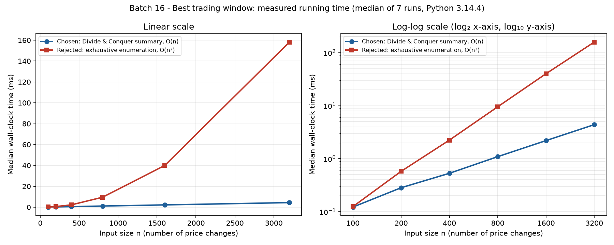

# Batch 16 — Stock Trading: Best Trading Window in Distributed Tick Data

**Course:** 23I501 — Design and Analysis of Algorithms · **Institution:** PSG College of Technology · **Semester:** Odd semester (V), 2026–27

## Team

| Roll No. | Name | GitHub username | Part presented | Contribution (code, report sections) |
| --- | --- | --- | --- | --- |
| `24I355` | Sankar S V | `sankar0211` | All parts (sole member): slides 1–12 | All code (`code/`), tests, benchmark and results; every report section (1–13); slides and presentation script |

This is a one-person batch, so this single row covers 100% of the work.

## Presentation

- Video link: `TODO: Google Drive (PSG account) or unlisted YouTube link, set to "Anyone with the link can view"`
- Duration: `TODO: mm:ss` (maximum 12:00)
- Slides: [slides.pdf](slides.pdf)
- Speaking notes: [presentation_script.md](presentation_script.md) (about 10 minutes)

---

## 1. Problem modelling

- **Input:** A sequence $A[1..n]$ of signed integers, where $A[i]$ is the net price change (₹) for tick or day $i$. It is stored across $p = 8$ servers, each holding one contiguous date range in time order. At production scale $n \approx 2.4\times10^6$ (25 years of minute ticks).
- **Output:** A non-empty window $[i, j]$, $1 \le i \le j \le n$, together with its total gain.
- **Objective:** Maximise $G(i,j) = \sum_{k=i}^{j} A[k]$.
- **Constraints:** The window is contiguous and non-empty. The data is partitioned across servers, so each server's result must be composable without shipping its raw ticks to the coordinator. Ties are broken deterministically (below).
- **Problem class (decision / optimisation / enumeration):** Optimisation.
- **Classical problem it maps to:** The maximum-sum contiguous subarray problem.

**Modelling decisions**

| Decision | Choice | Reason |
|---|---|---|
| Window length | Non-empty | An analyst needs an actual window. When every change is negative, the answer is the least-bad single tick, not an "empty window with gain 0". |
| Empty input ($n = 0$) | Rejected with `ValueError` (CLI exit code 2) | No non-empty window exists, and returning 0 would hide the error. |
| Ties | Highest sum, then **earliest start**, then **earliest end** | Deterministic and easy to explain. Every implementation and test uses the same rule. |
| Indexing | 1-based in this report, slides, and CLI output; 0-based inclusive inside the Python code | Report position = code index + 1. |
| Value type | Integers (₹), using Python's exact big integers | Sums over 2.4 M values cannot overflow. |

**Given instance (₹ per day)**

| Position | 1 | 2 | 3 | 4 | 5 | 6 | 7 | 8 | 9 | 10 | 11 | 12 |
|---|---|---|---|---|---|---|---|---|---|---|---|---|
| $A[i]$ | +3 | −5 | +8 | −2 | +6 | −9 | +4 | +7 | −3 | −6 | +5 | +2 |

## 2. Data structure analysis

This section also answers scenario **Q4** (repeated "best window between day $L$ and day $R$" queries).

| Data structure | Key operation(s) and cost | Space | Behaviour at the scale in the scenario |
| --- | --- | --- | --- |
| Chosen: segment tree whose nodes store the segment summary (total, prefix, suffix, best) | Build $O(n)$; range query $O(\log n)$; point update $O(\log n)$ | $O(n)$ | About 22 levels at $n = 2.4\times10^6$, so each query costs a few dozen $O(1)$ merges and a corrected tick is cheap to apply. Memory stays linear. |
| Alternative 1: plain array scanned with Kadane per query | Build $O(1)$; query $O(R-L+1)$; update $O(1)$ | $O(1)$ extra | Fine for a handful of queries, but every long-range query touches up to 2.4 M values. |
| Alternative 2: disjoint sparse table of summaries | Build $O(n\log n)$; query $O(1)$ merges; update needs a rebuild | $O(n\log n)$ | Fastest queries on frozen history, but about 22× the summaries of a single level and no efficient updates. |

**Why the chosen structure wins:** The scenario needs repeated range queries over a large, occasionally corrected series. The segment tree is the only option with sub-linear queries *and* sub-linear updates at linear memory. All three structures store or use the same associative summary as the main algorithm, so they agree exactly (verified by tests). For a single whole-series query, the summary computed directly over the array, with no tree at all, is enough.

### 2.1 The record every structure uses: the segment summary

Every non-empty segment $X$ is represented by a constant-size record:

$$S(X) = (\textit{total}, \textit{prefix}, \textit{suffix}, \textit{best})$$

| Field | Meaning |
|---|---|
| `total` | Sum of every value in $X$ |
| `prefix` | Largest sum of a non-empty prefix of $X$ |
| `suffix` | Largest sum of a non-empty suffix of $X$ |
| `best` | Largest sum of a non-empty contiguous window anywhere in $X$ |

**Positional metadata** (stored alongside the four aggregates, not part of them): `prefix_end`, `suffix_start`, `best_start`, `best_end`. These four indices are enough to reconstruct the winning prefix, suffix, and best window. The record therefore holds 8 integers, which is $O(1)$ space per segment. It is the "message" a server sends, and the value a segment-tree node stores.

### 2.2 Range-query structures in detail

All three structures answer the same query, with the same non-empty and tie-breaking rules. All three are **implemented and tested** in [`code/range_queries.py`](code/range_queries.py). Their results are checked against the direct scan for every $(L, R)$ pair on random arrays.

**A. Direct scan (Kadane over $[L, R]$).** There is no preprocessing. Each query walks the range once, keeping the best window that ends at the current position, and that window's start. This costs $O(1)$ extra space and $O(k)$ time for a range of length $k = R - L + 1$. A single query over the full 2.4 M series touches all 2.4 M values.

**B. Segment tree of summaries.** Leaf $i$ stores $S(A[i])$. Each internal node stores `merge(left child, right child)`. A query $[L, R]$ splits into $O(\log n)$ canonical nodes, which are merged **in left-to-right order**. A point update rewrites one leaf and the $O(\log n)$ ancestors above it.

**C. Disjoint sparse table of summaries.** For each level $h$, the array is cut into blocks of size $2^{h+1}$ with midpoint $m$. For every $i$ in the left half, the table stores $S(A[i..m-1])$; for every $j$ in the right half, it stores $S(A[m..j])$. A query with $L \ne R$ selects the level of the highest bit where $L$ and $R$ differ. The answer is `merge(table[h][L], table[h][R])`, a single ordered combination of two **disjoint** pieces.

**Why the classic (overlapping) sparse table fails here.** For min or max queries, a range can be covered by two blocks that overlap, because $\min(x, x) = x$ (the operation is *idempotent*). The summary merge is associative but **not idempotent**. For example, merging a segment with an overlapping copy of itself double-counts `total`, and can create a "window" that uses some ticks twice. That is why the disjoint variant is needed, and why every query must combine pieces in their original order. The merge is also not commutative: `merge(L, R)` ≠ `merge(R, L)` in general.

| Structure | Build | Query | Point update | Space | Suitability at $n \approx 2.4\times10^6$ |
|---|---|---|---|---|---|
| Direct scan (Kadane) | $O(1)$ | $O(R-L+1)$ | $O(1)$ (just edit the array) | $O(1)$ extra | Best for a handful of queries or one full scan. Too slow for thousands of long-range queries, since each costs up to $2.4\times10^6$ steps. |
| Segment tree | $O(n)$ ($2n-1$ merges) | $O(\log n)$ (≈ 22 levels) | $O(\log n)$ | $O(n)$ nodes (array of $4n$ slots in our code) | **Recommended.** Each query costs a few dozen merges, corrections and late ticks are cheap to apply, and memory stays linear. |
| Disjoint sparse table | $O(n \log n)$ | $O(1)$ merges | Not supported efficiently (a change can affect $\Theta(n)$ entries per level, so a rebuild is needed) | $O(n \log n)$ (≈ 22 levels × n summaries) | Only for frozen historical data with a very large number of queries, when roughly 22× the memory of a single level is acceptable. |

These memory figures are asymptotic and qualitative. We did not measure the memory of any implementation, and Python object overhead would make any absolute number specific to CPython.

**Recommendation.** For frequent range queries with occasional point updates (late or corrected ticks), use the **segment tree**. Use the direct scan when there are only a few queries, or the ranges are short, so building a structure is not worth it. Use the disjoint sparse table only when the data is immutable, queries vastly outnumber builds, and $O(n \log n)$ memory is acceptable.

## 3. Design technique identification

- **Technique chosen:** Divide and Conquer.
- **Property of the problem that makes it work (with proof):** Every window of a concatenation $L\cdot R$ lies in $L$, lies in $R$, or crosses the boundary as (suffix of $L$) + (prefix of $R$). So a constant-size summary per segment, combined by an $O(1)$ **associative** merge, is enough. The associativity proof is in §3.1, and full correctness is proved in §6.

**Enabling property.** A segment can be described by a compact summary, and the summaries of two **adjacent** segments can be combined in $O(1)$ time:

$$
\begin{aligned}
\textit{total} &= L.\textit{total} + R.\textit{total}\\
\textit{prefix} &= \max(L.\textit{prefix},\; L.\textit{total} + R.\textit{prefix})\\
\textit{suffix} &= \max(R.\textit{suffix},\; R.\textit{total} + L.\textit{suffix})\\
\textit{best} &= \max(L.\textit{best},\; R.\textit{best},\; L.\textit{suffix} + R.\textit{prefix})
\end{aligned}
$$

For a single value $x$: $S(x) = (x, x, x, x)$. The third candidate for `best`, $L.\textit{suffix} + R.\textit{prefix}$, is the best window that **crosses** the boundary between $L$ and $R$.

The problem has all three ingredients of Divide and Conquer:

1. **Divide.** Split the index range at its midpoint, or at the server boundaries.
2. **Conquer.** Each part is the same problem on a shorter contiguous range.
3. **Combine.** Constant-time merge. Every optimal window lies left of the cut, right of it, or crosses it, and the summary keeps exactly the information needed for the crossing case.

### 3.1 The merge is associative

Write $a, b, c$ for the summaries of three consecutive segments. Associativity means $\text{merge}(\text{merge}(a,b),c) = \text{merge}(a,\text{merge}(b,c))$. Here is the check, field by field, using the identity $\max(x,y)+z = \max(x+z, y+z)$:

* **total:** $(a.t + b.t) + c.t = a.t + (b.t + c.t)$.
* **prefix:**
  * Left grouping: $\max(\max(a.p,\, a.t+b.p),\; a.t+b.t+c.p) = \max(a.p,\, a.t+b.p,\, a.t+b.t+c.p)$.
  * Right grouping: $\max(a.p,\; a.t + \max(b.p,\, b.t+c.p))$, which is the same three terms.
* **suffix:** symmetric. Both groupings give $\max(c.s,\, c.t+b.s,\, c.t+b.t+a.s)$.
* **best:** both groupings expand to
  $$\max(a.b,\, b.b,\, c.b,\; a.s+b.p,\; b.s+c.p,\; a.s+b.t+c.p).$$
  These terms are: best inside each part, crossing a single boundary, and spanning all of $b$. For example, the left grouping gives $\max(\max(a.b, b.b, a.s+b.p),\, c.b,\, \max(b.s, b.t+a.s) + c.p)$, which distributes into exactly those six terms.

The metadata follows the same tie rule in both groupings. The `test_merge_is_associative` test checks every field, including the indices, on 500 random splits. Because the merge is associative, the coordinator may combine the eight server summaries in **any balanced tree, as long as the left-to-right order is kept**. The merge is **not commutative**, so order matters.

## 4. Why the other four techniques do not fit

| Technique | Why it is unsuitable here (evidence) |
| --- | --- |
| Greedy | **Counterexample.** The local rule "never let a window include a negative change" returns 5 on $[5,-1,-1,-1,5]$, but the optimum is the whole array, 7. That rule is wrong. |
| Dynamic Programming | **Correct, but not the primary architecture.** Kadane's $E[i]=\max(A[i],E[i-1]+A[i])$ is a correct $O(n)$ DP. Its state depends on the entire prefix to the left, so it is not a self-contained segment value that a server or tree node can hold and merge. |
| Backtracking | **State-space size.** The search space is all $n(n+1)/2$ windows: $2{,}880{,}001{,}200{,}000$ at $n=2.4\times10^6$, about $6\times10^5$ times the work of a linear method. Implemented and measured as the rejected alternative. |
| Branch and Bound | **Missing effective bound.** With signed data, the only cheap sound bound ("current sum + all remaining positives") is far too optimistic, so little is pruned and the generic interval search stays $\Theta(n^2)$ in the worst case. Tight bounds are the prefix and suffix summaries, i.e. the D&C quantities themselves. |

**Greedy.** Take the local rule "never let a window include a negative change: grow a window over consecutive positive values and cut at every negative one". On

$$A = [5, -1, -1, -1, 5]$$

this rule can only produce $[5]$ or $[5]$, each worth **5**. The true optimum is the whole array: $5 - 1 - 1 - 1 + 5 = $ **7**. Crossing the three small losses pays off because the gains on both sides outweigh them. The test `test_greedy_counterexample_from_report` checks this. This example refutes *that particular* local rule. It does not prove that every algorithm with a greedy component must fail. Indeed, Kadane's "drop the running sum once it goes negative" can be read as a greedy-flavoured choice, but it is correct only because of the DP argument behind it. A plain greedy choice without that argument is what fails here.

**Dynamic Programming.** It would be wrong to claim DP cannot solve this problem. Kadane's algorithm is a DP. Let $E[i]$ be the best window *ending at* $i$:

$$E[i] = \max(A[i],\; E[i-1] + A[i]), \qquad \text{answer} = \max_i E[i].$$

This runs in $O(n)$ time with $O(1)$ extra space, and we use it as the reference implementation (`kadane_range`) and as the range-scan structure in §2. It is **not selected as the primary design** for this assignment because its state $E[i]$ only describes windows that end at the current position, given everything to the left. A server holding block 5 cannot compute $E$ for its block without knowing $E$ at the end of block 4, so the scan is inherently sequential across servers. It also does not directly give a reusable value for an arbitrary sub-range $[L, R]$ that a segment tree could store. The four-field summary *is* such a value: it describes a segment on its own, independent of the context around it. Extending Kadane's state until it composes across segments turns it into exactly this summary. So the choice is about architecture, not about correctness.

**Backtracking.** A backtracking search chooses a start $i$ and then an end $j \ge i$, so its search space is every non-empty window:

$$\#\text{windows} = \sum_{i=1}^{n} (n - i + 1) = \frac{n(n+1)}{2} = \Theta(n^2).$$

At $n = 2{,}400{,}000$:

$$\frac{2{,}400{,}000 \times 2{,}400{,}001}{2} = 2{,}880{,}001{,}200{,}000 \approx 2.88\times10^{12}\ \text{windows},$$

compared with about $2n \approx 4.8\times10^6$ constant-time steps for the linear methods, a ratio of roughly $6\times10^5$. Even at an optimistic $10^9$ window checks per second, enumeration would take about 48 minutes per stock per query, against milliseconds for an $O(n)$ method in a compiled language. There is no partial-solution constraint that lets backtracking abandon a start early, since any extension might still add gain. Our running-sum enumeration ([`code/rejected_alternative.py`](code/rejected_alternative.py)) is therefore the realistic best case of this approach, and §10 measures its quadratic growth.

**Branch and Bound.** Pruning needs an upper bound $U(i, j)$ on the best window still reachable from a partial choice, and it can only discard a branch when $U < $ the incumbent. With arbitrary signed changes, the only bound that is both cheap and *sound* is something like "current sum + sum of all remaining positive changes". On mixed data that bound is far above the true value, because the positive changes are separated by losses that a real window cannot skip. So almost nothing gets pruned. Bounds tight enough to prune well, for example the exact best prefix sum starting after $j$, are themselves the prefix and suffix summaries that the linear algorithm computes directly. A straightforward interval search therefore stays $\Theta(n^2)$ in the worst case. A cleverer bounding strategy changes this analysis, but such a strategy ends up computing the Divide and Conquer quantities anyway. This argument is about this problem formulation and generic bounds. It is not a claim about every conceivable branch-and-bound design.

## 5. Algorithm

### 5.1 Sequential Divide and Conquer ([`code/main_solution.py`](code/main_solution.py))

```text
LEAF(x, i):           return (x, x, x, x | prefix_end=i, suffix_start=i, best=[i,i])

MERGE(L, R):                                   # L is immediately left of R
    total  ← L.total + R.total
    if L.prefix ≥ L.total + R.prefix:  prefix ← L.prefix,             pe ← L.prefix_end
    else:                              prefix ← L.total + R.prefix,   pe ← R.prefix_end
    if L.suffix + R.total ≥ R.suffix:  suffix ← L.suffix + R.total,   ss ← L.suffix_start
    else:                              suffix ← R.suffix,             ss ← R.suffix_start
    candidates ← { (L.best, L.best_start, L.best_end),
                   (L.suffix + R.prefix, L.suffix_start, R.prefix_end),   # crossing
                   (R.best, R.best_start, R.best_end) }
    (best, bs, be) ← the candidate with max sum, then min start, then min end
    return (total, prefix, suffix, best | pe, ss, bs, be)

SUMMARIZE(A, lo, hi):                           # indices only, no slicing
    if lo = hi: return LEAF(A[lo], lo)
    mid ← ⌊(lo + hi) / 2⌋
    return MERGE(SUMMARIZE(A, lo, mid), SUMMARIZE(A, mid+1, hi))

BEST-WINDOW(A):
    if |A| = 0: error "empty input"
    S ← SUMMARIZE(A, 0, |A|-1)
    return (S.best, S.best_start, S.best_end)
```

**Tie-breaking in the merge** (consistent with "max sum, earliest start, earliest end"):

* All prefixes start at the segment start, so among equal sums the shorter one, ending in $L$, wins. Hence `≥` in favour of `L.prefix`.
* All suffixes end at the segment end, so among equal sums the one starting earlier, in $L$, wins. Hence `≥` in favour of `L.suffix + R.total`.
* For `best`, the three candidates are compared by the key (sum, −start, −end). The left and crossing candidates both start in $L$, and the right candidate starts in $R$, so the right candidate wins only with a strictly larger sum.

### 5.2 Coordinator (bottom-up balanced reduction)

```text
REDUCE(S[1..p]):                       # ordered summaries of adjacent blocks
    while p > 1:
        T ← [ MERGE(S[1],S[2]), MERGE(S[3],S[4]), ... ]
        if p is odd: append S[p] to T unchanged      # carried to the next round
        S ← T;  p ← |T|
    return S[1]
```

This is `reduce_summaries`. By associativity (§3.1), it returns the same summary as the midpoint recursion, even though the merge trees differ. The worked trace in §7 uses this bottom-up order.

### 5.3 Eight-server version

The full cost analysis is in §12 (Q2).

```text
SERVER k  (holds contiguous block B_k = A[lo_k .. hi_k], k = 1..8):
    S_k ← SUMMARIZE(A, lo_k, hi_k)         # or one linear pass computing the same 8 fields
    send S_k to the coordinator            # 4 aggregates + 4 indices, constant size

COORDINATOR:
    receive S_1 .. S_8 (ordered by date range)
    round 1:  M12 ← MERGE(S1,S2)   M34 ← MERGE(S3,S4)   M56 ← MERGE(S5,S6)   M78 ← MERGE(S7,S8)
    round 2:  M1-4 ← MERGE(M12,M34)            M5-8 ← MERGE(M56,M78)
    round 3:  ROOT ← MERGE(M1-4, M5-8)
    return ROOT.best and [ROOT.best_start, ROOT.best_end] (global positions)
```

Each server reports **global** indices, so the coordinator never needs to translate positions. This is simulated in `distributed_best_window` (`--servers 8` on the CLI). The test `test_eight_servers_three_rounds` checks that it performs exactly 4 + 2 + 1 = 7 merges.

## 6. Proof of correctness

**Claim.** For every non-empty segment $X = A[lo..hi]$, `SUMMARIZE(A, lo, hi)` returns:

* $\textit{total} = \sum X$;
* $\textit{prefix} = \max_{lo \le e \le hi} \sum A[lo..e]$, with `prefix_end` the smallest maximiser $e$;
* $\textit{suffix} = \max_{lo \le s \le hi} \sum A[s..hi]$, with `suffix_start` the smallest maximiser $s$;
* $\textit{best} = \max_{lo \le s \le e \le hi} \sum A[s..e]$, with $[$`best_start`, `best_end`$]$ the lexicographically smallest maximiser $(s, e)$.

The proof is by strong induction on the segment length, following the recursion or merge tree.

**Base case ($|X| = 1$, value $x$ at position $i$).** The only non-empty prefix, suffix, and window is $[i, i]$, with sum $x$. `LEAF` returns $(x, x, x, x)$ with every index equal to $i$, which is correct and trivially the earliest.

**Inductive hypothesis.** $X = L \cdot R$, where $L = A[lo..mid]$ and $R = A[mid+1..hi]$ are both non-empty and shorter than $X$. Assume their summaries satisfy the claim.

**Inductive step.**

1. **Total.** $\sum X = \sum L + \sum R$, which is what the merge computes.
2. **Prefix.** A non-empty prefix of $X$ ends at some $e$.
   * If $e \le mid$, it is a non-empty prefix of $L$. The best such sum is $L.\textit{prefix}$ (by the hypothesis).
   * If $e > mid$, it is all of $L$ followed by the non-empty prefix $A[mid+1..e]$ of $R$. Its sum is $L.\textit{total} + \sum A[mid+1..e]$, and the best is $L.\textit{total} + R.\textit{prefix}$.

   These two cases cover all prefixes, so the larger of the two values is the maximum. On a tie, the case-1 prefix ends earlier, and the merge picks it (`≥`). Within each case the hypothesis supplies the earliest end.
3. **Suffix.** Symmetric. A non-empty suffix starts either inside $R$ (best $R.\textit{suffix}$) or inside $L$, in which case it is a non-empty suffix of $L$ followed by all of $R$ (best $L.\textit{suffix} + R.\textit{total}$). On a tie, the case starting in $L$ starts earlier, and the merge picks it.
4. **Best.** A non-empty window $[s, e]$ of $X$ is one of three kinds:
   * entirely in $L$ ($e \le mid$), with best $L.\textit{best}$;
   * entirely in $R$ ($s > mid$), with best $R.\textit{best}$;
   * crossing ($s \le mid < e$). Then $[s, e] = A[s..mid] \cdot A[mid+1..e]$: a non-empty suffix of $L$ followed by a non-empty prefix of $R$. The choices of $s$ and $e$ are independent, so the maximum crossing sum is $L.\textit{suffix} + R.\textit{prefix}$. The earliest maximising $s$ is `L.suffix_start`, and the earliest maximising $e$ is `R.prefix_end`, so this candidate is the lexicographically smallest optimal crossing window.

   The three kinds cover every window. The merge takes the maximum over the best member of each kind, comparing by (sum, −start, −end). This gives the maximum over all windows, and the smallest optimal (start, end) overall.

**Conclusion.** By induction, every node of the recursion tree (equivalently, every node of the coordinator's merge tree, by associativity) holds a correct summary. The root summarises $A[1..n]$, so its `best` field and indices give a globally optimal non-empty window. When there are ties, it is the one with the earliest start, then the earliest end. ∎

The tests check every part of this claim directly. `test_merge_matches_direct_computation` compares all 8 fields of `SUMMARIZE` on every sub-range of 500 random arrays against values computed from the definitions. `test_random_small_arrays` compares 2,000 random arrays against exhaustive search, including the tie-breaking.

## 7. Trace on the given instance

This section answers scenario **Q1**.

$A = [3, -5, 8, -2, 6, -9, 4, 7, -3, -6, 5, 2]$, with 1-based positions. The hierarchy is the coordinator's balanced bottom-up merge: leaves → 6 pairs → 3 blocks of four → $[1,8]$ (with $[9,12]$ carried) → root. Summaries are written as (total, prefix, suffix, best). The positional metadata columns give where the prefix ends, where the suffix starts, and the best window. These tables were **generated by** [`code/trace_instance.py`](code/trace_instance.py) from the implementation and checked against a hand calculation.

**Level 0 — leaves** (each $S(x) = (x, x, x, x)$)

| Pos | x | (total, prefix, suffix, best) | best window |
|---|---|---|---|
| 1 | 3 | (3, 3, 3, 3) | [1, 1] |
| 2 | -5 | (-5, -5, -5, -5) | [2, 2] |
| 3 | 8 | (8, 8, 8, 8) | [3, 3] |
| 4 | -2 | (-2, -2, -2, -2) | [4, 4] |
| 5 | 6 | (6, 6, 6, 6) | [5, 5] |
| 6 | -9 | (-9, -9, -9, -9) | [6, 6] |
| 7 | 4 | (4, 4, 4, 4) | [7, 7] |
| 8 | 7 | (7, 7, 7, 7) | [8, 8] |
| 9 | -3 | (-3, -3, -3, -3) | [9, 9] |
| 10 | -6 | (-6, -6, -6, -6) | [10, 10] |
| 11 | 5 | (5, 5, 5, 5) | [11, 11] |
| 12 | 2 | (2, 2, 2, 2) | [12, 12] |

**Level 1 - adjacent pairs**

| Segment | L summary | R summary | total = L.t + R.t | prefix = max(L.p, L.t + R.p) | suffix = max(R.s, R.t + L.s) | best = max(L.b, R.b, L.s + R.p) | Result (t, p, s, b) | prefix ends | suffix starts | best window |
|---|---|---|---|---|---|---|---|---|---|---|
| [1, 2] | (3, 3, 3, 3) | (-5, -5, -5, -5) | 3 + (-5) = **-2** | max(3, 3 + (-5) = -2) = **3** | max(-5, (-5) + 3 = -2) = **-2** | max(3, -5, 3 + (-5) = -2) = **3** | (-2, 3, -2, 3) | 1 | 1 | [1, 1] |
| [3, 4] | (8, 8, 8, 8) | (-2, -2, -2, -2) | 8 + (-2) = **6** | max(8, 8 + (-2) = 6) = **8** | max(-2, (-2) + 8 = 6) = **6** | max(8, -2, 8 + (-2) = 6) = **8** | (6, 8, 6, 8) | 3 | 3 | [3, 3] |
| [5, 6] | (6, 6, 6, 6) | (-9, -9, -9, -9) | 6 + (-9) = **-3** | max(6, 6 + (-9) = -3) = **6** | max(-9, (-9) + 6 = -3) = **-3** | max(6, -9, 6 + (-9) = -3) = **6** | (-3, 6, -3, 6) | 5 | 5 | [5, 5] |
| [7, 8] | (4, 4, 4, 4) | (7, 7, 7, 7) | 4 + 7 = **11** | max(4, 4 + 7 = 11) = **11** | max(7, 7 + 4 = 11) = **11** | max(4, 7, 4 + 7 = 11) = **11** | (11, 11, 11, 11) | 8 | 7 | [7, 8] |
| [9, 10] | (-3, -3, -3, -3) | (-6, -6, -6, -6) | (-3) + (-6) = **-9** | max(-3, (-3) + (-6) = -9) = **-3** | max(-6, (-6) + (-3) = -9) = **-6** | max(-3, -6, (-3) + (-6) = -9) = **-3** | (-9, -3, -6, -3) | 9 | 10 | [9, 9] |
| [11, 12] | (5, 5, 5, 5) | (2, 2, 2, 2) | 5 + 2 = **7** | max(5, 5 + 2 = 7) = **7** | max(2, 2 + 5 = 7) = **7** | max(5, 2, 5 + 2 = 7) = **7** | (7, 7, 7, 7) | 12 | 11 | [11, 12] |

**Level 2 - blocks of four**

| Segment | L summary | R summary | total = L.t + R.t | prefix = max(L.p, L.t + R.p) | suffix = max(R.s, R.t + L.s) | best = max(L.b, R.b, L.s + R.p) | Result (t, p, s, b) | prefix ends | suffix starts | best window |
|---|---|---|---|---|---|---|---|---|---|---|
| [1, 4] | (-2, 3, -2, 3) | (6, 8, 6, 8) | (-2) + 6 = **4** | max(3, (-2) + 8 = 6) = **6** | max(6, 6 + (-2) = 4) = **6** | max(3, 8, (-2) + 8 = 6) = **8** | (4, 6, 6, 8) | 3 | 3 | [3, 3] |
| [5, 8] | (-3, 6, -3, 6) | (11, 11, 11, 11) | (-3) + 11 = **8** | max(6, (-3) + 11 = 8) = **8** | max(11, 11 + (-3) = 8) = **11** | max(6, 11, (-3) + 11 = 8) = **11** | (8, 8, 11, 11) | 8 | 7 | [7, 8] |
| [9, 12] | (-9, -3, -6, -3) | (7, 7, 7, 7) | (-9) + 7 = **-2** | max(-3, (-9) + 7 = -2) = **-2** | max(7, 7 + (-6) = 1) = **7** | max(-3, 7, (-6) + 7 = 1) = **7** | (-2, -2, 7, 7) | 12 | 11 | [11, 12] |

**Level 3 - block of eight ([9, 12] carried forward unchanged)**

| Segment | L summary | R summary | total = L.t + R.t | prefix = max(L.p, L.t + R.p) | suffix = max(R.s, R.t + L.s) | best = max(L.b, R.b, L.s + R.p) | Result (t, p, s, b) | prefix ends | suffix starts | best window |
|---|---|---|---|---|---|---|---|---|---|---|
| [1, 8] | (4, 6, 6, 8) | (8, 8, 11, 11) | 4 + 8 = **12** | max(6, 4 + 8 = 12) = **12** | max(11, 8 + 6 = 14) = **14** | max(8, 11, 6 + 8 = 14) = **14** | (12, 12, 14, 14) | 8 | 3 | [3, 8] |

**Level 4 - root**

| Segment | L summary | R summary | total = L.t + R.t | prefix = max(L.p, L.t + R.p) | suffix = max(R.s, R.t + L.s) | best = max(L.b, R.b, L.s + R.p) | Result (t, p, s, b) | prefix ends | suffix starts | best window |
|---|---|---|---|---|---|---|---|---|---|---|
| [1, 12] | (12, 12, 14, 14) | (-2, -2, 7, 7) | 12 + (-2) = **10** | max(12, 12 + (-2) = 10) = **12** | max(7, (-2) + 14 = 12) = **12** | max(14, 7, 14 + (-2) = 12) = **14** | (10, 12, 12, 14) | 8 | 3 | [3, 8] |

**Final answer (Q1).** The best window is **positions 3 to 8**, with maximum total gain **₹14**:

$$A[3..8] = 8 - 2 + 6 - 9 + 4 + 7 = 14.$$

**Independent checks.**

* `python code/main_solution.py 3 -5 8 -2 6 -9 4 7 -3 -6 5 2` prints `best sum = 14`, `window (1-based, inclusive) = [3, 8]`.
* The exhaustive search, Kadane, and the 8-server simulation all return the same window.
* The midpoint recursion splits differently ($[1,6] \mid [7,12]$) and also produces root $(10, 12, 12, 14)$, as associativity predicts.
* Root fields can be verified by hand. The total is $10$. The best prefix is $A[1..8] = 12$. The best suffix is $A[3..12] = 12$. The suffix $A[1..12] = 10$ is smaller.

**Reading the key merges.**

* At $[1,8]$, the crossing candidate $L.\textit{suffix} + R.\textit{prefix} = 6 + 8 = 14$ beats both sides ($8$ and $11$). The suffix of $[1,4]$ is $A[3..4] = 6$, and the prefix of $[5,8]$ is the whole block, $8$. Their union $A[3..8]$ is the answer.
* At the root, $[9,12]$ offers only $7$ and the crossing candidate is $14 - 2 = 12$, so the left block's $14$ survives.

## 8. Complexity analysis

- **Recurrence or counting argument:** $T(n) = 2T(n/2) + \Theta(1)$. Equivalently, the recursion tree has exactly $n$ leaves and $n-1$ merges. The rejected exhaustive search examines $n(n+1)/2$ windows.
- **Time (best / worst / typical):** $\Theta(n)$ / $\Theta(n)$ / $\Theta(n)$. The splits depend only on indices, never on values, so every input of length $n$ costs exactly $2n-1$ calls.
- **Space:** $O(\log n)$ recursion stack ($\lceil\log_2 n\rceil + 1$ frames, 23 at $n = 2.4\times10^6$), plus the $O(n)$ input. No slices are copied and the tree is not stored.

### 8.1 Derivation

**Time.** Each call does $O(1)$ work besides its two recursive calls:

$$T(n) = 2T(n/2) + \Theta(1), \qquad T(1) = \Theta(1).$$

By the Master Theorem, with $a = 2$, $b = 2$, and $f(n) = \Theta(1) = O(n^{\log_2 2 - \varepsilon})$, this is case 1, so $T(n) = \Theta(n)$. Directly: the recursion tree has exactly $n$ leaves and $n - 1$ internal merges, which is $2n - 1$ calls, each doing $O(1)$ work. The time is $\Theta(n)$ on **every** input, because the splits depend only on indices and not on the values.

**Space.** Segments are passed as $(lo, hi)$ indices with no slicing, and the tree is never stored. At any moment, only the frames on the current root-to-leaf path are alive, which is at most $\lceil\log_2 n\rceil + 1$ frames, each holding $O(1)$ data. Extra space is therefore $O(\log n)$. For $n = 2.4\times10^6$ that is 23 frames. This is the recursion **depth**. It should not be confused with the **total number of calls**, which is $2n - 1$, made over time.

### 8.2 Summary of all components

| Component | Time | Extra space |
|---|---|---|
| One-window Divide and Conquer | $\Theta(n)$ | $O(\log n)$ stack |
| Kadane sequential scan | $\Theta(n)$ | $O(1)$ |
| Exhaustive interval enumeration (rejected) | $\Theta(n^2)$ | $O(1)$, excluding output |
| Coordinator (p summaries) | $p-1$ merges, $\lceil\log_2 p\rceil$ rounds | $O(p)$ summaries |
| Segment tree build | $O(n)$ | $O(n)$ (4n slots) |
| Segment tree range query | $O(\log n)$ | $O(\log n)$ recursion stack |
| Segment tree point update | $O(\log n)$ | $O(\log n)$ recursion stack |
| Disjoint sparse table build | $O(n \log n)$ | $O(n \log n)$ |
| Disjoint sparse table query | $O(1)$ summary combinations | $O(1)$ |
| Two-window prefix/suffix DP | $O(n)$ | $O(n)$ |
| k-window DP (extension) | $O(kn)$ | $O(k)$ |

## 9. Worst-case input

**Constructed input:** $A = [1, 1, \ldots, 1]$ ($n$ ones). The optimum is the entire array, $[1, n]$, with sum $n$.

* **Exhaustive enumeration:** it visits all $n(n+1)/2$ windows no matter what. On this input every window extending a start-1 window is a new record, so it also performs the most best-so-far updates. The cost is $\Theta(n^2)$.
* **Divide and Conquer:** it performs exactly $2n-1$ calls and $n-1$ merges, the same as on any other input of length $n$. Its running time does not depend on the values. The all-ones array is a worst case only for the *rejected* method. For the chosen method there is no bad input, only the length matters.
* **All-negative input** (for example $[-8, -3, -5, -3, -9]$) is the key **correctness** case rather than a performance case. The non-empty rule forces the answer to be the largest single value, $-3$ at position 2, the earliest of the tied $-3$ values. A version that allowed empty windows would wrongly return 0. This is tested in `test_all_negative_takes_largest_single_value`.

## 10. Implementation and empirical analysis

- **Language and how to run:** Python 3 (standard library for every algorithm; matplotlib for the plot). See [code/RUN.md](code/RUN.md).
- **Input sizes used (at least five):** $n$ = 100, 200, 400, 800, 1,600, 3,200 for the chosen-vs-rejected comparison (seeded mixed-sign data). Separately, the chosen algorithm alone at 24,000, 240,000, 1,200,000 and 2,400,000.
- **Plot:** 
- **Does the measured growth match Section 8?** Yes for the comparison range. Doubling $n$ multiplies D&C time by ×1.9–2.3 (linear) and exhaustive time by ×3.9–4.6 (quadratic). The deviations (small-$n$ noise, and a per-value cost increase above $2.4\times10^5$ in pure Python) are discussed below.
- **Comparison with the rejected alternative:** Both are equal at $n = 100$. At $n = 3{,}200$ the exhaustive search is about 36× slower, and the gap doubles with every doubling of $n$.

**Code** (Python 3, standard library only for every algorithm): see [`code/RUN.md`](code/RUN.md) for exact commands.

| File | Contents |
|---|---|
| [`main_solution.py`](code/main_solution.py) | `Summary`, `leaf`, `merge`, `summarize` (recursion by index), `best_window`, `reduce_summaries`, `distributed_best_window`, CLI |
| [`rejected_alternative.py`](code/rejected_alternative.py) | Exhaustive $O(n^2)$ enumeration with running sums, same tie-breaking |
| [`range_queries.py`](code/range_queries.py) | Kadane range scan, `SegmentTree` (with point update), `DisjointSparseTable` |
| [`two_windows.py`](code/two_windows.py) | Q5: prefix/suffix DP, plus the $O(kn)$ k-window DP |
| [`generate_inputs.py`](code/generate_inputs.py) | Deterministic `mixed` / `positive` / `negative` / `given` inputs, seed 2026 |
| [`benchmark.py`](code/benchmark.py) | Timing → `results/timing.csv`, `results/timing_plot.png` |
| [`test_correctness.py`](code/test_correctness.py) | 24 automated tests |
| [`trace_instance.py`](code/trace_instance.py) | Generates the §7 tables |
| [`make_slides.py`](code/make_slides.py) | Builds `slides.pdf` from `slides.html` (headless Chrome or Edge) using the CSV results |

**Correctness evidence.** `python -B code/test_correctness.py` reports **24 tests, all passing**. Coverage:

* the given instance (sum 14, window [3, 8]) with all methods agreeing;
* the CLI and the empty-input policy;
* single elements, all-positive, all-negative, and alternating arrays;
* ties and repeated values;
* optima at either end, and an optimum that crosses the middle split;
* the greedy counterexample;
* 2,000 random arrays against exhaustive search (D&C, Kadane, and $p$-server simulation for random $p$);
* every sub-range of 500 random arrays against the field definitions;
* associativity;
* the 4/2/1 merge rounds for 8 servers;
* segment tree and disjoint sparse table against direct scans, including 300 random point updates;
* the two-window and k-window DPs against exhaustive pair enumeration.

**Benchmark method.**

* Inputs are `generate("mixed", n)`: integers in $[-10, 10]$, fixed seed. Both algorithms receive the same list.
* Before timing, both results (sum and window) are asserted equal at every size.
* Only the function call is timed, using `time.perf_counter` (a monotonic high-resolution clock). Input generation, file I/O, and plotting are outside the timed region.
* Each (algorithm, n) pair is run once untimed (warm-up) and then 7 times with the garbage collector paused. The median is recorded.

**Measured results** (`results/timing.csv`, CPython 3.14.4, Windows 11, one laptop; these are real measurements, not estimates):

| n | D&C time (ms) | Exhaustive time (ms) | D&C growth vs previous n | Exhaustive growth vs previous n |
|---|---|---|---|---|
| 100 | 0.123 | 0.125 | — | — |
| 200 | 0.284 | 0.579 | ×2.32 | ×4.63 |
| 400 | 0.531 | 2.247 | ×1.87 | ×3.88 |
| 800 | 1.094 | 9.531 | ×2.06 | ×4.24 |
| 1,600 | 2.196 | 40.035 | ×2.01 | ×4.20 |
| 3,200 | 4.390 | 158.205 | ×2.00 | ×3.95 |

**Analysis.**

* **Growth matches the theory.** Each doubling of $n$ roughly doubles the Divide and Conquer time (×1.9 to ×2.3), which is linear behaviour since the total work is $2n-1$ calls. It roughly quadruples the exhaustive time (×3.9 to ×4.6), which is quadratic behaviour, because $n(n+1)/2$ windows means four times as many windows when $n$ doubles. On the log-log plot the two lines have slopes of about 1 and 2.
* **Crossover.** At $n = 100$ the two methods take about the same time (0.123 ms vs 0.125 ms). For small $n$, D&C's per-call overhead (Python function calls and creating 8-field records) offsets its asymptotic advantage, while the exhaustive loop's inner step is only an addition and a comparison. By $n = 3{,}200$ the gap is about 36×, and it keeps doubling with every doubling of $n$.
* **Noise and deviations.**
  * The first sizes take well under a millisecond, so timer resolution and interpreter effects (cache warm-up, adaptive bytecode specialisation) show up as the uneven ×2.32 and ×1.87 steps.
  * An early run without a warm-up, and with the garbage collector active, produced erratic exhaustive timings above 3,200: about 21× for a doubling, and the effect was not reproducible on single runs. We attribute it to sustained-load throttling on the laptop and to GC pauses. The final benchmark therefore adds an untimed warm-up and pauses the GC during timing (as `timeit` does), and the sizes are kept to 100–3,200 as suggested.
  * In a separate probe, the all-ones input made the exhaustive search about 5× slower per window than mixed data. Its running sums exceed CPython's cached small integers (−5 to 256), so each addition allocates a new object. This is a constant-factor effect only: the window count, and so the $\Theta(n^2)$ growth, is the same.

**Production scale (chosen algorithm only, `results/large_scale.csv`, median of 3):**

| n | Time | µs per value |
|---|---|---|
| 24,000 | 0.05 s | 2.05 |
| 240,000 | 0.35 s | 1.47 |
| 1,200,000 | 9.29 s | 7.74 |
| 2,400,000 | 18.90 s | 7.88 |

Up to $2.4\times10^5$ the cost per value is roughly constant (1.5–2 µs; the 24,000 run is short enough that fixed overhead and noise matter), as expected for linear work. Between $2.4\times10^5$ and $1.2\times10^6$ it rose about 5× and then stayed flat up to $2.4\times10^6$. We did not isolate the cause. Plausible explanations are memory and cache effects from millions of short-lived Python objects, and CPU throttling during multi-second runs. This is a property of this pure-Python implementation on this laptop, not of the algorithm: the algorithm performs exactly $2n-1$ calls at every size. A compiled implementation would be expected to be far faster, but we did not measure one, so we make no numeric claim.

The exhaustive method was **not** run at $2.4\times10^6$. Its window count ($2.88\times10^{12}$) makes that infeasible, which is the point of §4. Its cost at that scale comes from the analysis, not from a measurement.

## 11. Changed requirement

This section answers scenario **Q5**.

> This section is the **changed requirement**. Sections 1–10 and 12 refer to the original one-window problem.

**New objective.** Choose one window, or two non-empty windows $[a, b]$ and $[c, d]$ with $b < c$, so as to maximise the total gain.

**Does the original method still suffice? No, not as it stands.** The four fields describe only *one* window per segment. For example, they cannot tell whether the best pair in $L \cdot R$ is "one window in $L$ plus one in $R$", "two windows in $L$", or "a crossing window plus another one". On the given instance, the one-window answer is 14, but the best pair is 23. That pair uses $[3,5]$ and $[7,8]$, which *split* the one-window optimum at the loss of 9. No combination of the four fields gives 23. Divide and Conquer is still possible with an **extended** summary, for instance the best value using at most $k \le 2$ windows for each "open on the left / open on the right" status. But the simplest provably correct solution is a prefix/suffix DP.

### 11.1 Definitions and recurrences

$$P[i] = \max_{1 \le s \le e \le i} \sum A[s..e] \quad\text{(best window inside } A[1..i])$$
$$Q[i] = \max_{i \le s \le e \le n} \sum A[s..e] \quad\text{(best window inside } A[i..n])$$

These are computed with a forward and a backward Kadane pass:

$$E[1] = A[1],\quad E[i] = \max(A[i],\, E[i-1] + A[i]),\quad P[1] = A[1],\quad P[i] = \max(P[i-1], E[i])$$
$$F[n] = A[n],\quad F[i] = \max(A[i],\, A[i] + F[i+1]),\quad Q[n] = A[n],\quad Q[i] = \max(Q[i+1], F[i])$$

Here $E[i]$ is the best window ending at $i$, and $F[i]$ is the best window starting at $i$. The answer is

$$\text{answer} = \max\Big(\max_{1\le i\le n} P[i],\;\; \max_{1\le i<n}\big(P[i] + Q[i+1]\big)\Big) = \max\Big(P[n],\; \max_{1\le i<n}\big(P[i] + Q[i+1]\big)\Big).$$

The first term allows a single window, which covers "at most". The second term pairs a window in $A[1..i]$ with a window in $A[i+1..n]$, which therefore cannot overlap. When $n = 1$, the second term is empty and the answer is $A[1]$.

### 11.2 Pseudocode ([`code/two_windows.py`](code/two_windows.py))

```text
BEST-TWO(A[1..n]):
    if n = 0: error
    E ← A[1];  P[1] ← A[1]
    for i ← 2..n:   E ← max(A[i], E + A[i]);   P[i] ← max(P[i-1], E)
    F ← A[n];  Q[n] ← A[n]
    for i ← n-1 down to 1:   F ← max(A[i], A[i] + F);   Q[i] ← max(Q[i+1], F)
    best ← P[n]                                      # one window
    for i ← 1..n-1:  best ← max(best, P[i] + Q[i+1]) # two windows split after i
    return best          # the implementation also tracks the windows' endpoints
```

### 11.3 Proof that every case is covered

* **One window.** The best single window lies in $A[1..n]$, so it is $P[n]$, by the correctness of Kadane.
* **Two windows.** Take any valid pair $[a, b]$, $[c, d]$ with $b < c$, and choose the split $i = b$, so $1 \le i < n$. Then $[a, b] \subseteq A[1..i]$ gives $\sum A[a..b] \le P[i]$, and $[c, d] \subseteq A[i+1..n]$ gives $\sum A[c..d] \le Q[i+1]$. So every pair's total is at most some term $P[i] + Q[i+1]$.
* **Achievability.** Each term $P[i] + Q[i+1]$ is achieved by a real pair: one window inside $A[1..i]$ and one inside $A[i+1..n]$, which are disjoint because they sit on opposite sides of the split.

The maximum over all terms is therefore exactly the optimum. ∎

### 11.4 Given instance

| $i$ | 1 | 2 | 3 | 4 | 5 | 6 | 7 | 8 | 9 | 10 | 11 | 12 |
|---|---|---|---|---|---|---|---|---|---|---|---|---|
| $P[i]$ | 3 | 3 | 8 | 8 | 12 | 12 | 12 | 14 | 14 | 14 | 14 | 14 |
| $Q[i]$ | 14 | 14 | 14 | 11 | 11 | 11 | 11 | 7 | 7 | 7 | 7 | 2 |
| $P[i] + Q[i+1]$ | 17 | 17 | 19 | 19 | **23** | **23** | 19 | 21 | 21 | 21 | 16 | — |

The answer is **₹23**, using windows **[3, 5]** ($8-2+6 = 12$) and **[7, 8]** ($4+7 = 11$). This is ₹9 better than the single window [3, 8], because the pair skips the −9 at position 6. `python code/two_windows.py ...` prints exactly this.

### 11.5 Complexity and tests

* **Time:** two linear passes plus one linear combination, so $O(n)$.
* **Space:** $O(n)$ for the stored $P$ and $Q$ arrays (plus their windows). This can be cut to one stored array by fusing the combination into the backward pass.
* **Tests:** `test_random_against_exhaustive` checks 600 random arrays against the enumeration of every single window and every disjoint pair. It also verifies that the returned windows really sum to the answer and do not overlap. Small cases such as $[-4, -1]$, where one window beats two, are tested separately.

### 11.6 Generalisation and distribution

* **Up to $k$ windows.** Keep $\text{open}_j$, the best total using $j$ windows with the $j$-th still open at $i$, and $\text{closed}_j$, the best total with $j$ windows all closed. Then $\text{open}_j \leftarrow \max(\text{open}_j, \text{closed}_{j-1}) + A[i]$ and $\text{closed}_j \leftarrow \max(\text{closed}_j, \text{open}_j)$. This takes $O(kn)$ time and $O(k)$ space (`best_k_windows`, cross-checked with $k = 2$ and $k = 1$).
* **Distributed two-window solution.**
  * *Option 1:* compute $P$ and $Q$ with a parallel prefix and suffix scan over the server blocks. Each server first sends its one-window summary, the coordinator returns the incoming "left context", and each server finishes its part of $P$ locally. This is $O(n/p + \log p)$ in the same model.
  * *Option 2:* extend the summary to a constant number of fields, the best value with at most 2 windows for each combination of "touches left edge / touches right edge". These merge associatively, at $O(1)$ cost per merge for fixed $k$.

## 12. Answers to the remaining scenario questions

| Scenario question | Where it is answered |
|---|---|
| Q1 — Best window for the given instance, with every intermediate result | §7 (answer: ₹14 on days 3–8) |
| Q2 — Eight-server design | §12.1 below (pseudocode in §5.3) |
| Q3 — Comparison with a single left-to-right $O(n)$ scan | §12.2 below |
| Q4 — Data structures for repeated $[L, R]$ queries | §2 |
| Q5 — At most two non-overlapping windows | §11 |

### 12.1 Q2 — Algorithm for eight servers operating in parallel

**Server summary.** Each server sends the four aggregates (total, prefix, suffix, best) plus four global indices (prefix_end, suffix_start, best_start, best_end). That is 8 integers. **Combine rule.** The merge equations of §3, applied in date order.

**Why one summary per server is enough.** Take any window $W$ of the concatenation $L \cdot R$. Either $W$ ends inside $L$ (so it is entirely in $L$), or it starts inside $R$ (so it is entirely in $R$), or it starts in $L$ and ends in $R$. In the last case $W$ is a non-empty suffix of $L$ joined to a non-empty prefix of $R$. These three cases cover every window and are mutually exclusive. The best crossing window is the best suffix of $L$ plus the best prefix of $R$, because the two parts can be chosen independently. Every case is therefore determined by the summaries. The same argument applied over the merge tree shows that eight summaries determine the global answer.

**Cost model** (with $p$ servers and balanced blocks of $n/p$ values):

| Quantity | Value | For $n = 2.4\times10^6$, $p = 8$ |
|---|---|---|
| Local work per server | $\Theta(n/p)$ | 300,000 values each |
| Total local work | $\Theta(n)$ | 2.4 M values (no more than the sequential algorithm) |
| Coordinator merges | $p - 1 = O(p)$, each $O(1)$ | 7 merges |
| Merge rounds (depth) | $\lceil \log_2 p \rceil = O(\log p)$ | 3 rounds: 4, then 2, then 1 |
| Communication | $p$ records of $O(1)$ size, so $O(p)$ in total | 8 records × 8 integers = 64 integers, instead of shipping 2.4 M ticks |
| Total work | $\Theta(n) + \Theta(p) = \Theta(n)$ | |
| Idealised parallel time | $O(n/p + \log p)$ | ≈ 300,000 local steps + 3 merge rounds |

The cost model assumes:

* **balanced partitions**: each server holds about $n/p$ ticks; otherwise local time is the size of the largest block;
* **enough parallel resources**: one core per server, running at the same time;
* **local data**: each server already stores its block, with no shuffle of ticks;
* **network and synchronisation cost** that is negligible or modelled separately. A real round costs at least one network latency $\lambda$, so a more honest time is $O(n/p) + \lceil\log_2 p\rceil\cdot(\lambda + O(1))$.

**Total work vs wall-clock.** Total work does not shrink: all 2.4 M values are still touched once. Only the wall-clock time can drop, and by at most a factor of about $p$ in the local phase. On a single computer, the simulation runs the eight "servers" one after another, so it shows the *structure* and the correctness of the design, but **no speedup**. We report no cluster measurements because none were taken.

### 12.2 Q3 — Comparison with Kadane's single left-to-right scan

| Aspect | Kadane single scan | D&C with composable summary |
|---|---|---|
| Time | $\Theta(n)$ | $\Theta(n)$ total work. **Not** asymptotically faster. |
| Auxiliary space | $O(1)$ | $O(\log n)$ recursion stack |
| Sequential constant factor | Smaller: one pass with a couple of additions and comparisons per value | Larger: $2n-1$ calls, creating 8-field records |
| Parallelism | Inherently sequential: $E[i]$ needs $E[i-1]$ | Blocks are independent. Depth is $O(n/p + \log p)$. |
| Composability | The state is tied to "everything to the left" | Summaries of adjacent blocks merge in $O(1)$, associatively |
| Range-query reuse | Each query re-scans $[L, R]$ | The same summary is the node value of a segment tree or sparse table |
| Updates | Re-scan | $O(\log n)$ with a segment tree |

**When each wins.**

* **Kadane wins** on one machine with one complete scan, or with a handful of ad-hoc queries. It has the same asymptotic time, less memory, smaller constants, and no recursion. (It is also how a server can compute its local summary in one pass, extended with running prefix and suffix maxima.)
* **Divide and Conquer wins** when the data is already partitioned across servers, or when the same computation must serve many range queries or updates. In those settings the composable summary is what makes the architecture possible.

**Caveat.** Extra servers are not free. If the ticks must first be shipped to the servers, or if network latency per round is comparable to the local scan time (a 300,000-value scan takes well under a second in compiled code), the distributed version can be *slower* than one local Kadane pass. There is no automatic 8× speedup. At best, the local phase speeds up by about $p$, and only when the data already lives on the servers.

## 13. Real-world reference

**Primary reference.** J. Dean and S. Ghemawat, *MapReduce: Simplified Data Processing on Large Clusters*, OSDI '04 (Sixth Symposium on Operating System Design and Implementation), San Francisco, 2004, pp. 137–150. <https://research.google/pubs/mapreduce-simplified-data-processing-on-large-clusters/>

* **What it contributes.** It describes a model where each machine applies a *map* function to its local input split, and a *reduce* function then combines the intermediate values. The runtime takes care of partitioning, scheduling, communication between machines, and machine failures. Our eight-server design has the same shape: each server's local summary is the "map" output for its date range, and the coordinator's ordered merge tree is the "reduce".
* **What we do differently.** MapReduce groups intermediate values *by key*, and general reducers do not assume an order. Our reduction is over a single key, and it is **order-sensitive**: the merge is associative but not commutative, so summaries must be combined in date order. We also simulate the servers in one process. We do not handle failures, scheduling, or data movement.
* **Limitations as evidence.** The paper shows that partitioned, aggregate-then-combine processing is used in practice at scale. It does not mention maximum-subarray summaries or stock data, and it provides no performance evidence for our algorithm. Our claims about this algorithm rest on the proofs in §6 and the measurements in §10.

**Data-structure reference.** cp-algorithms, *Segment Tree*, section "Finding subsegments with the maximal sum": <https://cp-algorithms.com/data_structures/segment_tree.html>. It describes storing (sum, maximum prefix, maximum suffix, best answer) in each node, with the answer combining the left answer, the right answer, and the left suffix plus the right prefix. That is the summary used in §2 and §3. We add explicit interval metadata and the tie-breaking rule, plus the disjoint sparse table variant.

Both links were opened and checked while this report was prepared. No figures from either source are reused.
