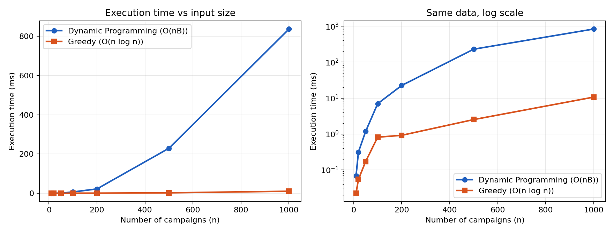

# Batch 17: Digital Marketing Campaign Selection (0/1 Knapsack)

Course: Design and Analysis of Algorithms (DAA), Assignment 2026
Chosen technique: Dynamic Programming. Rejected technique implemented: Greedy (conversions-per-lakh ratio).

| File | Purpose |
|---|---|
| `code/main_solution.py` | Dynamic Programming (2-D table, 1-D optimised, FPTAS, cost-scaled DP, benchmark) |
| `code/rejected_alternative.py` | Greedy implementation |
| `code/generate_inputs.py` | Given instance, benchmark data, worst-case data, 300-campaign data |
| `code/RUN.md` | Commands to reproduce everything |
| `results/timing.csv`, `results/timing_plot.png` | Measured running times |
| `slides.pdf` | Presentation slides |

## 1. Problem modelling

A marketing team has a budget of B = ₹9 lakh and n = 6 campaigns. Each campaign is run completely or not at all.

| Campaign | C1 | C2 | C3 | C4 | C5 | C6 |
|---|---|---|---|---|---|---|
| Cost c<sub>i</sub> (₹ lakh) | 2 | 3 | 4 | 5 | 1 | 6 |
| Conversions v<sub>i</sub> | 30 | 45 | 50 | 70 | 12 | 80 |

- Input: costs c<sub>1..n</sub> (positive integers), conversions v<sub>1..n</sub>, and budget B.
- Decision variables: x<sub>i</sub> ∈ {0, 1}, where x<sub>i</sub> = 1 means campaign i is selected.
- Objective: maximise Z = Σ v<sub>i</sub>·x<sub>i</sub>.
- Constraint: Σ c<sub>i</sub>·x<sub>i</sub> ≤ B.
- Output: the selected set S = { i : x<sub>i</sub> = 1 } and Z.

This is an optimisation problem because there are 2<sup>6</sup> = 64 possible selections. Many fit the budget and each gives a different number of conversions, so we want the best feasible one. That is the 0/1 Knapsack problem, which is NP-hard in general.

For the given instance the best selection is S = {C2, C4, C5}, with cost 3 + 5 + 1 = ₹9 lakh and 45 + 70 + 12 = 127 conversions.

## 2. Data structure analysis

| Data structure | Purpose | Time | Space |
|---|---|---|---|
| Array `costs[0..n-1]`, array `values[0..n-1]` | Store campaign data; O(1) access by index | O(n) to read | O(n) |
| 2-D DP table `dp[0..n][0..B]` | Best conversions for the first i campaigns and budget w; allows traceback to recover which campaigns were chosen | O(nB) | O(nB) |
| 1-D DP array `dp[0..B]` | Same values, overwriting one row; iterate w from B down to c<sub>i</sub> | O(nB) | O(B) |
| Memoised recursion (hash map keyed by (i, w)), considered | Top-down; computes only reachable states | O(nB) worst case, higher constant (hashing, recursion) | O(nB) + recursion stack O(n) |
| Sorted index list (Greedy) | Campaigns ordered by ratio | O(n log n) | O(n) |

The main implementation uses the 2-D table, because the faculty requires the selected campaigns and every intermediate value, and the traceback needs the earlier rows. We also implement the 1-D array. It cuts memory from O(nB) to O(B) and was about 1.7 to 2 times faster for n ≥ 50 in our measurements (n = 1000: 420 ms against 837 ms). The cost is that the 1-D array loses the older rows, so it returns only the optimal value unless extra bookkeeping is added. For the given instance the 2-D table has 7 × 10 = 70 cells and the 1-D array has 10.

## 3. Design technique identification

The selected technique is Dynamic Programming, for four reasons.

- Optimal substructure. An optimal selection for (first i campaigns, budget w) is either an optimal selection for (first i−1, w), with campaign i rejected, or campaign i plus an optimal selection for (first i−1, w − c<sub>i</sub>). The proof is in Section 9.
- Overlapping subproblems. The naive recursion f(i, w) = max(f(i−1, w), v<sub>i</sub> + f(i−1, w−c<sub>i</sub>)) makes 2<sup>n</sup> calls, but only (n+1)(B+1) distinct pairs (i, w) exist. For example, f(4, 3) is reached through many different choice sequences. A table computes each pair once.
- Indivisible items and a fixed integer budget. Campaigns are all or nothing, which rules out fractional Greedy, and costs are small integers, so a table indexed by budget stays small.
- Guaranteed optimum in O(nB), where exhaustive methods take exponential time.

## 4. Rejection of the other four techniques

| Technique | Verdict | Concrete reason / counter-example |
|---|---|---|
| Divide and Conquer | Rejected | Solve {C1,C2,C3} and {C4,C5,C6} independently and merge? The left half's best answer for ₹9 lakh is {C1,C2,C3} = 125, which uses the entire budget. The right half's best is {C5,C6} = 92 (cost 7). They cannot be combined (16 > 9), and the true optimum uses only C2 from the left half and {C4,C5} from the right. A correct merge has to try every budget split L(w) + R(B−w), which is exactly a DP table. Without stored sub-results the recursion repeats subproblems and costs 2<sup>n</sup>. |
| Greedy (ratio) | Rejected, implemented in `rejected_alternative.py` | Ratios: C1 = 15, C2 = 15, C4 = 14, C6 = 13.33, C3 = 12.5, C5 = 12. Greedy takes C1 and C2 (cost 5), skips C4 (10 > 9) and C6 (11 > 9), then takes C3 (cost 9), for 125 conversions, below the optimum of 127. A pure counter-example with an unbounded gap: B = 10 with items (cost 1, value 2) and (cost 10, value 10). Greedy takes the first (value 2) and the second no longer fits; the optimum is 10. |
| Dynamic Programming | Selected | Exact, O(nB) time, polynomial in n for small integer B. |
| Backtracking | Rejected | Explores the include/exclude tree: up to 2<sup>n</sup> leaves (64 for n = 6, but 2<sup>300</sup> for the changed requirement). Pruning infeasible branches helps only when the budget is tight, and it still repeats subproblems that DP solves once. |
| Branch and Bound | Rejected | Prunes with an optimistic bound (fractional knapsack). It is often fast but has an exponential worst case. When v<sub>i</sub> = c<sub>i</sub> (all ratios equal, as in subset-sum-like data) the bound equals B everywhere and almost nothing can be pruned. DP's O(nB) bound does not depend on the data values. |

## 5. Algorithm and pseudocode

State: dp[i][w] is the maximum conversions using only campaigns 1..i with budget w.

Recurrence:

```
dp[i][w] = dp[i-1][w]                                   if c_i > w
dp[i][w] = max( dp[i-1][w],  dp[i-1][w - c_i] + v_i )   if c_i <= w
            (reject i)       (select i)
```

Base condition: dp[0][w] = 0 for every w (no campaigns) and dp[i][0] = 0 for every i (costs are at least 1, so nothing fits in budget 0). The answer is dp[n][B].

```
KNAPSACK-DP(c[1..n], v[1..n], B)
    for w = 0 to B:  dp[0][w] = 0                      // base case
    for i = 1 to n:
        for w = 0 to B:
            dp[i][w] = dp[i-1][w]                       // reject campaign i
            if c[i] <= w and dp[i-1][w - c[i]] + v[i] > dp[i][w]:
                dp[i][w] = dp[i-1][w - c[i]] + v[i]     // select campaign i
    // traceback
    w = B;  S = {}
    for i = n down to 1:
        if dp[i][w] != dp[i-1][w]:                      // campaign i was selected
            S = S ∪ {i};  w = w - c[i]
    return dp[n][B], S

KNAPSACK-DP-1D(c, v, B)                                 // O(B) space
    dp[0..B] = 0
    for i = 1 to n:
        for w = B down to c[i]:                         // downwards => each campaign used once
            dp[w] = max(dp[w], dp[w - c[i]] + v[i])
    return dp[B]
```

The Python implementation is in `code/main_solution.py` (`knapsack_2d`, `knapsack_1d`). The Greedy implementation is `code/rejected_alternative.py`.

## 6. Trace of the given instance

`python main_solution.py --trace` produces this trace, and every value can be checked by hand.

1-D array dp[w] after processing each campaign (w = 0 to 9):

| After | 0 | 1 | 2 | 3 | 4 | 5 | 6 | 7 | 8 | 9 |
|---|---|---|---|---|---|---|---|---|---|---|
| initial | 0 | 0 | 0 | 0 | 0 | 0 | 0 | 0 | 0 | 0 |
| C1 (c=2, v=30) | 0 | 0 | 30 | 30 | 30 | 30 | 30 | 30 | 30 | 30 |
| C2 (c=3, v=45) | 0 | 0 | 30 | 45 | 45 | 75 | 75 | 75 | 75 | 75 |
| C3 (c=4, v=50) | 0 | 0 | 30 | 45 | 50 | 75 | 80 | 95 | 95 | 125 |
| C4 (c=5, v=70) | 0 | 0 | 30 | 45 | 50 | 75 | 80 | 100 | 115 | 125 |
| C5 (c=1, v=12) | 0 | 12 | 30 | 45 | 57 | 75 | 87 | 100 | 115 | 127 |
| C6 (c=6, v=80) | 0 | 12 | 30 | 45 | 57 | 75 | 87 | 100 | 115 | 127 |

The 2-D table dp[i][w] matches these rows (row i is the state after campaign i, and row 0 is all zeros). The traceback uses it.

Selected hand calculations:

- dp[1][5] = max(dp[0][5], dp[0][3] + 30) = max(0, 30) = 30
- dp[2][5] = max(dp[1][5], dp[1][2] + 45) = max(30, 30 + 45) = 75 (C1 + C2)
- dp[3][9] = max(dp[2][9], dp[2][5] + 50) = max(75, 75 + 50) = 125
- dp[4][8] = max(dp[3][8], dp[3][3] + 70) = max(95, 45 + 70) = 115
- dp[5][9] = max(dp[4][9], dp[4][8] + 12) = max(125, 115 + 12) = 127
- dp[6][9] = max(dp[5][9], dp[5][3] + 80) = max(127, 45 + 80) = 127 (C6 does not help)

Traceback from dp[6][9] = 127:

| i | Campaign | dp[i][w] vs dp[i−1][w] | Decision | Remaining w |
|---|---|---|---|---|
| 6 | C6 | dp[6][9] = 127 = dp[5][9] | skip | 9 |
| 5 | C5 | dp[5][9] = 127 ≠ dp[4][9] = 125 | take | 9 − 1 = 8 |
| 4 | C4 | dp[4][8] = 115 ≠ dp[3][8] = 95 | take | 8 − 5 = 3 |
| 3 | C3 | dp[3][3] = 45 = dp[2][3] | skip | 3 |
| 2 | C2 | dp[2][3] = 45 ≠ dp[1][3] = 30 | take | 3 − 3 = 0 |
| 1 | C1 | dp[1][0] = 0 = dp[0][0] | skip | 0 |

Final result: selected = {C2, C4, C5}, total cost 3 + 5 + 1 = ₹9 lakh, total conversions 45 + 70 + 12 = 127.

Greedy on the same instance sorts the campaigns as C1, C2, C4, C6, C3, C5. It takes C1 (cost 2) and C2 (5), skips C4 and C6, takes C3 (9), and skips C5. That gives {C1, C2, C3} with cost 9 and 125 conversions, 2 conversions (1.57%) fewer than DP.

## 7. Complexity analysis

Let n be the number of campaigns and B the budget in integer units.

| Measure | 2-D DP | 1-D DP |
|---|---|---|
| Time | Θ(nB), every cell computed | O(nB), exactly Σ(B − c<sub>i</sub> + 1) cell updates |
| Space | Θ(nB) | Θ(B) |
| Best case | Θ(nB) for our 2-D loop (it visits every cell) | If every c<sub>i</sub> > B no cell is updated: Θ(n + B) |
| Worst case | Θ(nB) | Θ(nB), reached when every c<sub>i</sub> = 1 (Section 11) |
| Practical case (given instance) | 6 × 10 = 60 computed cells (+ 10 base cells) | 8 + 7 + 6 + 5 + 9 + 4 = 39 updates, 10 cells of memory |

- The algorithm is pseudo-polynomial. The input needs only O(n + log B) bits, but the running time grows with the numeric value of B. That is why Section 8 fails for B = 4,37,52,900.
- Greedy takes O(n log n) time and O(n) space (a sort plus one scan). It is much cheaper but not exact.
- The traceback costs O(n) extra time.
- Brute force over 2<sup>n</sup> subsets is 64 subsets for n = 6 and 2<sup>300</sup> for n = 300.

## 8. Changed requirement

The new requirement is n = 300 campaigns, B = ₹4,37,52,900 and precision ₹1, so B = 43,752,900 units.

### Why ordinary DP becomes impractical

| Resource | Value |
|---|---|
| Cell updates n·B | 300 × 43,752,900 = 1.31 × 10<sup>10</sup> |
| 2-D table (4 bytes/cell) | about 52.5 GB, which does not fit in memory |
| 1-D array (8 bytes/cell) | about 350 MB, which fits, but the time remains |
| Time (our Python 1-D DP does about 14 million updates/s, Section 11) | about 1.31 × 10<sup>10</sup> / 1.4 × 10<sup>7</sup> ≈ 15 minutes; even optimised C++ needs tens of seconds per run and 175 MB or more |

The running time depends on the magnitude of B (pseudo-polynomial), and rupee-level precision makes B huge although there are only 300 items. Keeping the traceback table is impossible.

### Improved approaches (implemented in `main_solution.py --large`)

**(a) Cost scaling (coarser budget grid).** Round each cost up to a multiple of a unit u (for example ₹1,000) and round the budget down: c′<sub>i</sub> = ⌈c<sub>i</sub>/u⌉, B′ = ⌊B/u⌋. The DP then has B′ + 1 = 43,753 columns, so 300 × 43,753 ≈ 1.3 × 10<sup>7</sup> updates (about a thousand times fewer) and O(B′) memory.

Accuracy: because costs are rounded up, the answer is always feasible for the real budget. A set with real cost ≤ B − k·u (k campaigns) has scaled cost < B/u, so the DP's value is at least OPT(B − k·u). With u = ₹1,000 and about 15 chosen campaigns we lose at most ₹15,000 (0.03%) of budget. This is a resource-augmentation guarantee, not a multiplicative one on the conversions.

**(b) Profit-scaling FPTAS (Ibarra–Kim).** Set K = ε·v<sub>max</sub>/n and v′<sub>i</sub> = ⌊v<sub>i</sub>/K⌋ (each v′<sub>i</sub> ≤ n/ε), then run the DP over profit: mincost[p] is the least cost achieving scaled profit p, and the answer is the largest p with mincost[p] ≤ B.

Time is O(n · Σv′) = O(n<sup>3</sup>/ε), independent of B. For n = 300 and ε = 0.1 that is about 2.7 × 10<sup>8</sup> elementary steps. Space is O(n²/ε) for values, or O(n<sup>3</sup>/ε) bits if the traceback table is kept.

Accuracy: the value is at least (1 − ε)·OPT, because each campaign loses less than K, so the total loss is below nK = ε·v<sub>max</sub> ≤ ε·OPT.

### Measured on a synthetic 300-campaign instance (`generate_inputs.large_instance`)

The question provides no 300-campaign data, so we generated costs from ₹50,000 to ₹50,00,000 with proportional conversions, using seed 17. OPT is unknown; the LP relaxation gives an upper bound.

| Method | Conversions | % of LP upper bound (59,756) | Time |
|---|---|---|---|
| Plain DP | not run (about 1.3 × 10<sup>10</sup> updates, 52 GB table) | n/a | about 15 min estimated |
| FPTAS, ε = 0.1 | 59,713 | 99.93% | 0.36 s |
| Cost-scaled DP, u = ₹1,000 | 59,713 | 99.93% | 0.02 s |
| Greedy | 59,681 | 99.87% | < 0.01 s |

The FPTAS guarantees at least 90% in the worst case, and in practice it does far better. Exact alternatives include Pareto-frontier (dominance-list) DP, core-based algorithms and MIP solvers.

## 9. Proof of correctness

Definition. For 0 ≤ i ≤ n and 0 ≤ w ≤ B, let f(i, w) be the maximum total conversions of any subset of campaigns {1..i} whose total cost is ≤ w. We prove dp[i][w] = f(i, w) for all i and w by induction on i. Then dp[n][B] = f(n, B) is the optimum.

Base case (i = 0). With no campaigns the only subset is ∅ with value 0, so f(0, w) = 0 = dp[0][w]. For w = 0 and i > 0, all costs are at least 1, so only ∅ fits and f(i, 0) = 0 = dp[i][0].

Inductive step. Assume dp[i−1][w′] = f(i−1, w′) for all w′. Fix w and let S be an optimal subset for (i, w), so value(S) = f(i, w). Exactly one of two cases holds.

1. i ∉ S (campaign i rejected). Then S ⊆ {1..i−1} with cost ≤ w, so value(S) ≤ f(i−1, w). Conversely, an optimal set for (i−1, w) is also feasible for (i, w), so f(i, w) ≥ f(i−1, w). Hence in this case f(i, w) = f(i−1, w) = dp[i−1][w].
2. i ∈ S (campaign i selected), which is possible only if c<sub>i</sub> ≤ w. Then S′ = S \ {i} ⊆ {1..i−1} has cost ≤ w − c<sub>i</sub>, so value(S) = v<sub>i</sub> + value(S′) ≤ v<sub>i</sub> + f(i−1, w − c<sub>i</sub>). Conversely, take an optimal set T for (i−1, w − c<sub>i</sub>); T ∪ {i} has cost ≤ w, so it is feasible and f(i, w) ≥ v<sub>i</sub> + f(i−1, w − c<sub>i</sub>). This is the optimal-substructure (cut-and-paste) argument: if S′ were not optimal for its sub-budget, replacing it with a better set would improve S. So f(i, w) = v<sub>i</sub> + f(i−1, w − c<sub>i</sub>) = v<sub>i</sub> + dp[i−1][w − c<sub>i</sub>].

The optimum is the better of the two cases, and case 2 is available only when c<sub>i</sub> ≤ w:
f(i, w) = max( dp[i−1][w], dp[i−1][w−c<sub>i</sub>] + v<sub>i</sub> ) if c<sub>i</sub> ≤ w, else dp[i−1][w]. This is exactly the recurrence, so dp[i][w] = f(i, w). ∎

Optimality at the end. For i = n and w = B, the subsets considered are all subsets of the n campaigns with cost ≤ B, so dp[n][B] is the maximum possible conversions.

Traceback correctness. If dp[i][w] ≠ dp[i−1][w], the maximum was reached only by the "select" branch, so campaign i belongs to an optimal set and the remaining problem is (i−1, w − c<sub>i</sub>). If the values are equal, an optimal set exists without campaign i. By induction the collected set has cost ≤ B and value dp[n][B].

1-D version. Updating w from B downwards means dp[w − c<sub>i</sub>] has not yet been overwritten by campaign i, so it still holds row i−1, which gives the same recurrence. An upward loop would let a campaign be used repeatedly, which is the unbounded knapsack.

Empirical check: `python main_solution.py --selftest` compares 2-D DP, 1-D DP and brute force on 300 random instances, and all agree.

## 10. Implementation and experimental analysis

Setup: Python 3, `time.perf_counter`, median of 7 runs (3 for n ≥ 500, 15 for Greedy). Datasets come from `generate_inputs.generate(n)` (seed 17; costs 1 to 20, conversions ≈ 10·cost ± 30, B = ½ Σ costs). Both algorithms receive the identical dataset. Reproduce with `python main_solution.py --benchmark`. Raw numbers are in `results/timing.csv` and the plot is `results/timing_plot.png`.

| n | B | DP 2-D (ms) | DP 1-D (ms) | Greedy (ms) | DP conversions | Greedy conversions | Greedy gap |
|---|---|---|---|---|---|---|---|
| 10 | 75 | 0.068 | 0.045 | 0.022 | 791 | 761 | 3.79% |
| 20 | 108 | 0.313 | 0.087 | 0.054 | 1209 | 1194 | 1.24% |
| 50 | 300 | 1.177 | 0.699 | 0.171 | 3298 | 3297 | 0.03% |
| 100 | 443 | 6.952 | 4.143 | 0.813 | 5120 | 5113 | 0.14% |
| 200 | 1062 | 22.397 | 13.582 | 0.916 | 12529 | 12525 | 0.03% |
| 500 | 2581 | 229.618 | 137.459 | 2.515 | 29439 | 29439 | 0.00% |
| 1000 | 5245 | 837.296 | 419.855 | 10.625 | 59798 | 59798 | 0.00% |



Observations:

1. Time. DP grows roughly quadratically here because B grows with n (B ≈ 5n, so nB ∝ n²). Doubling n from 500 to 1000 multiplies the DP time by about 3.6 (expected about 4). Greedy is far faster, about 80 times at n = 1000, as expected from O(n log n) against O(nB). Sub-millisecond Greedy timings are noisy.
2. 1-D against 2-D. The 1-D version is about 1.7 to 2 times faster for n ≥ 50 and uses O(B) memory instead of O(nB), because it avoids allocating and filling a table of n·B cells.
3. Quality. Greedy is not always optimal. It loses 3.8% at n = 10 and 2 conversions on the given instance. With many small campaigns the leftover budget is tiny and Greedy happens to match DP on these random data (0% at n ≥ 500). That behaviour depends on the data and is no guarantee, as the counter-example in Section 4 shows an arbitrarily bad case. DP is exact on every input.
4. Trade-off. Greedy gives speed without a guarantee; DP gives an exact answer at pseudo-polynomial cost.

Absolute timings depend on the machine. Re-run the benchmark on your own computer before submission and update this table if you wish.

## 11. Worst-case input

The input (`generate_inputs.worst_case(n)`) has n campaigns, every cost equal to 1, budget B = 10n, and conversions random in 1 to 100.

This is the worst case because the inner loop of the 1-D DP runs from w = B down to c<sub>i</sub>, which is B − c<sub>i</sub> + 1 iterations. A cost of c<sub>i</sub> = 1 maximises that for every campaign, so every campaign touches every budget cell 1..B. The total is n·B updates, the Θ(nB) upper bound, with no cell ever skipped. Larger costs reduce the work: the given instance needs 39 updates, fewer than n·B = 54. Large n and large B make the quadratic growth visible. The "improve" branch is also taken often, so the writes are more than comparisons.

Measured with `python main_solution.py --worst`:

| n | B = 10n | n·B | cell updates counted | 1-D DP time (ms) |
|---|---|---|---|---|
| 50 | 500 | 25,000 | 25,000 | 1.44 |
| 100 | 1,000 | 100,000 | 100,000 | 6.57 |
| 200 | 2,000 | 400,000 | 400,000 | 27.26 |
| 400 | 4,000 | 1,600,000 | 1,600,000 | 114.03 |

The number of updates equals n·B exactly, and doubling n quadruples the time (n·B = 10n²). The Θ(nB) bound is reached, at about 14 million updates per second in Python.

## 12. Real-world reference

1. "Adaptive Budget Optimization for Multichannel Advertising Using Combinatorial Bandits" (arXiv:2502.02920), Section 4.2. The advertising budget is split across sub-campaigns, and the optimisation is cast as a Multi-Choice Knapsack. A DP table M(j, b) = max over b′ of (M(j−1, b′) + reward of sub-campaign j at budget b − b′) is solved on a discretised budget grid, with a traceback matrix to recover the allocation.

   Similarity: the structure is the same. It has a table indexed by (items considered, budget), a max-of-choices recurrence, a discretised budget and a traceback, and the objective is to maximise expected reward under a total budget.

   Differences: a budget level is chosen for every sub-campaign (multiple choice) instead of a take/leave decision. Rewards are estimated by a bandit model and change over time, whereas our conversions are fixed known numbers. The budget is split over a grid, which is the same idea as our cost scaling in Section 8.

2. "Media Mix Optimization: Applying a Quadratic Knapsack Model" (SCITEPRESS, 2014), used in the MARMIND marketing-management software with about 200 advertising media. Choosing media for a promotional campaign under a budget is modelled as a knapsack problem.

   Difference: media interact in pairs, which gives a quadratic knapsack and destroys optimal substructure, so the authors use a genetic algorithm rather than DP. Our linear model with independent campaigns is the case where DP is exact.

3. Background: H. Kellerer, U. Pferschy and D. Pisinger, *Knapsack Problems*, Springer, 2004; O. H. Ibarra and C. E. Kim, "Fast approximation algorithms for the knapsack and sum of subset problems", *J. ACM* 22(4), 1975 (the profit-scaling FPTAS used in Section 8).

## 13. Individual Contributions
| Member | Roll number | GitHub username | Contribution |
|---|---|---|---|
| Kavya T | 24i325 | kav9489 | Greedy algorithm implementation, comparison with Dynamic Programming, and analysis of rejected techniques |
| Priyadharshini T S | 24i343 | Priyadharshini-ts | Input generation, test cases, correctness testing, and trace of the given problem instance |
| Nethra R | 24i345 | NETHRA07-GIT | Dynamic Programming implementation (2-D and 1-D), data structure analysis, recurrence relation, and complexity analysis |
| Shazmina A J | 24i356 | ShazminaAJ | Problem modelling, report preparation and integration, real-world reference analysis, and presentation slides |
| Srinitha M | 24i361 | 24i361-Srinitha | Performance benchmarking, timing data collection, timing graph, worst-case analysis, and changed-requirement analysis |

## 14. Presentation link
Recorded presentation: https://drive.google.com/file/d/1gOlTX8BQANCc6wjxuaQ3haW6dW4K1wFm/view?usp=drive_web
Duration: 13 mins

## 15. References

- Cormen et al., *Introduction to Algorithms*, 4th Edition, MIT Press, 2022.
- GeeksforGeeks – 0/1 Knapsack Problem using Dynamic Programming.
- Programiz – Knapsack Problem.
- Research papers on Digital Marketing Budget Optimization.
