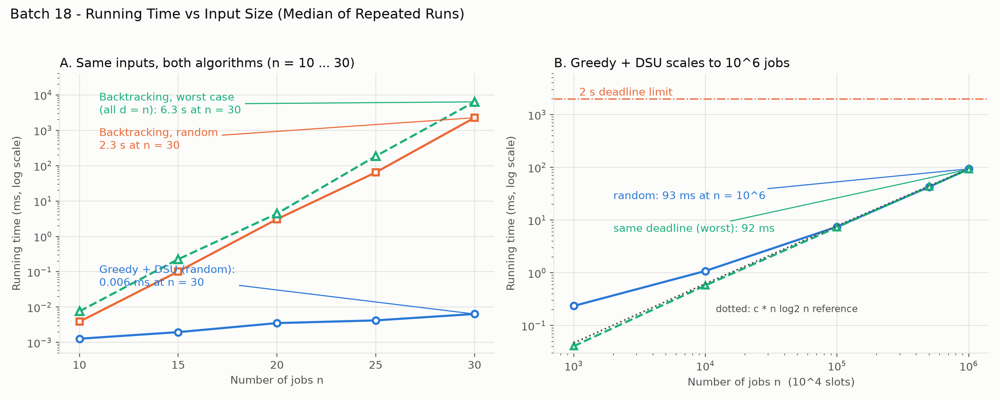

# Batch 18: Nightly Batch Jobs with Deadlines

Course 23I501 – Design and Analysis of Algorithms, PSG College of Technology (2026–27).
The full write-up (all eight components, proof of correctness, empirical analysis, worst-case input, real-world reference) is in **[report.md](report.md)**.

## Team and contributions

| Roll No. | Name | GitHub username | Part presented | Contribution (code, report sections) |
| --- | --- | --- | --- | --- |
| 24I302 | Abirami P C | abikomberi25 | Slides 1–4 | `MainSolution.java`, `EdfBaseline.java`, Report Sec 1, 2-a, 7, 12-a |
| 24I308 | Bharaghave Shi C G | bharaghaveshricg | Slides 9–11 | `RejectedAlternative.java`, `Verify.java`, Report Sec 3, 4 |
| 24I314 | Dhekshika D | dhekshika20 | Slides 12–19 | `SlotFinders.java`, `Q4Benchmark.java`, Report Sec 2-b, 5, 12-b |
| 24I358 | Sowmya P Nagarajan | sowmyapnagarajan | Slides 20–24 | `Benchmark.java`, `GenerateInputs.java`, Report Sec 6, 8, 9 |
| 24I374 | Vinothini | Vinothini1106 | Slides 5–8 | `ChangedRequirement.java`, `plot_timing.py`, Report Sec 10, 11, 13 |

Every report section (1–13) is covered: Sec 1, 2-a, 7, 12-a (Abirami); 3, 4 (Bharaghave); 2-b, 5, 12-b (Dhekshika); 6, 8, 9 (Sowmya); 10, 11, 13 (Vinothini). Each member presents their own slides in the recorded video and commits their own files from their own GitHub account.

## Folder layout

```
Batch_18/
├── README.md               this file
├── report.md               full report
├── slides.pdf
├── analysis_sheet.pdf      one-page analysis sheet with comparison tables
├── code/
│   ├── MainSolution.java         Greedy + DSU (chosen)
│   ├── RejectedAlternative.java  backtracking with feasibility pruning
│   ├── GenerateInputs.java       workload generator
│   ├── Benchmark.java            timing suite, writes results/timing.csv
│   ├── SlotFinders.java, Q4Benchmark.java   four slot-finding structures
│   ├── EdfBaseline.java          earliest-deadline-first comparison
│   ├── ChangedRequirement.java   variable durations: counterexample and DP
│   ├── Verify.java               1000 random tests against brute force
│   ├── plot_timing.py
│   └── RUN.md                    exact commands
└── results/
    ├── timing.csv
    ├── q4_slot_finder_timing.csv
    └── timing_plot.png / .pdf
```

## Summary

| Item | Value |
|---|---|
| Problem | Unit-time job sequencing with deadlines: maximise on-time profit, n = 10^6 jobs, D = 10^4 slots, under 2 s |
| Problem type | Combinatorial optimisation (maximisation) |
| Chosen technique | Greedy by profit, with a disjoint-set union (path compression) to find the latest free slot |
| Key property | Feasible job sets form a matroid, so the greedy choice is optimal (exchange argument) |
| Time / space | O(n log n) / O(n + D) |
| Result on given instance | Profit 230 (schedule J8, J1, J7, J6) |
| Measured at n = 10^6 | About 93 ms end to end (limit 2000 ms) |
| Rejected alternative implemented | Backtracking with feasibility pruning (O(2^n), 6.3 s at n = 30 on the worst input) |
| Changed requirement | Durations of 1–4 hours: greedy fails (10 vs 12), switch to dynamic programming, O(nD) |
| Real-world reference | Gabow and Tarjan (1985); Linux `SCHED_DEADLINE` |

## The problem

A cloud provider runs batch jobs overnight in 1-hour slots. Each job needs exactly one slot and has a deadline and a profit. A job earns its profit only if it finishes by its deadline; late jobs earn nothing. The scheduler must choose which jobs to run and in which slot, to maximise total profit.

| Element | Definition |
|---|---|
| Input | n jobs, each with deadline d_j in 1..D and profit p_j > 0; D one-hour slots |
| Output | A subset S of jobs and distinct slots s(j) with 1 ≤ s(j) ≤ d_j |
| Objective | Maximise the sum of p_j over j in S |
| Scale | n = 10^6 jobs, D = 10^4 slots, scheduler must finish in under 2 s |
| Type | Combinatorial optimisation (unit-time job sequencing with deadlines) |

## Approach in brief

1. Sort the jobs by profit, highest first.
2. For each job, find the **latest free slot at or before its deadline**.
3. If one exists, take it; otherwise reject the job.

The "latest free slot" query is answered by a **disjoint-set union (DSU)** over the slots. A free slot points to itself. When a slot is taken, it is linked to the slot before it, so later searches skip it. With path compression a query follows about one pointer (measured 1.02 hops per job).

**Why greedy is correct.** A set of jobs is schedulable exactly when, for every t, at most t jobs have deadline ≤ t. The schedulable sets therefore form a matroid, and a matroid greedy by weight is optimal. The report proves the three matroid axioms, shows the DSU test accepts a job exactly when the set stays schedulable, and gives an exchange argument for optimality.

## Worked example (8 jobs, 4 slots)

| Job | J1 | J2 | J3 | J4 | J5 | J6 | J7 | J8 |
|---|---|---|---|---|---|---|---|---|
| Deadline | 2 | 1 | 2 | 1 | 3 | 4 | 3 | 4 |
| Profit (Rs thousand) | 100 | 19 | 27 | 25 | 15 | 60 | 40 | 30 |

Processing in profit order: J1 takes slot 2, J6 slot 4, J7 slot 3, J8 slot 1; J3, J4, J2 and J5 are rejected because all four slots are full. Final schedule: **J8, J1, J7, J6** with total profit **230**. This equals the sum of the four largest profits, so it is optimal. The full step-by-step table with the DSU array after every step is in report Section 7.

Earliest-deadline-first, which ignores profit, earns only 194 (ties by input order) or 225 (best tie-break).

## Data structures compared

All four were run on the same sorted input at n = 10^6, D = 10^4 (find phase only; the common sort takes about 76 ms).

| Structure | Cost per query | Space | Find phase, random | Find phase, same deadline | Meets 2 s? |
|---|---|---|---|---|---|
| DSU with path compression (chosen) | about 2 hops amortised | O(D) ints | 2.6 ms | 1.6 ms | Yes |
| Segment tree | O(log D) | 4D ints | 3.9 ms | 2.1 ms | Yes |
| Balanced BST (`TreeSet`) | O(log D) | O(D) objects | 15.3 ms | 5.5 ms | Yes |
| Linear scan | O(D) | O(D) booleans | 739 ms | 2179 ms | No (2.26 s total under contention) |

Only the linear scan fails. DSU is chosen for its simplicity, 40 KB footprint and low constant factors, not because the tree structures miss the limit.

## Why the other techniques do not fit

| Technique | Concrete reason |
|---|---|
| Divide and conquer | Splitting by deadline gives 127 + 100 = 227 on the example, below the optimum 230, because late-deadline jobs need early slots from the other half |
| Dynamic programming | Correct, but O(nD) = 10^10 updates; measured 841 ms at n = 10^5, so about 8.4 s at 10^6 |
| Backtracking (implemented) | When every subset is feasible nothing prunes: 2^(n+1) − 1 nodes; n = 30 takes 6.3 s, n = 40 would take about 1.8 hours |
| Branch and bound (not implemented) | The first dive already reproduces the greedy optimum, so bounding can only confirm it; argued in the report, not measured |

## Complexity

| | Time | Space |
|---|---|---|
| Greedy + DSU | O(n log n), dominated by the sort; O(n + D) with counting sort on bounded profits | O(n + D), about 8 MB at n = 10^6 |
| Backtracking | O(2^n · D) | O(n + D) |
| DP (for comparison) | O(nD) | O(D) |

## Experiments

**Workloads** (`GenerateInputs.java`, fixed seeds):

| Workload | Construction | Purpose |
|---|---|---|
| `random` | deadlines uniform in 1..D, profits uniform in 1..1000 | typical load |
| `same_deadline` | every deadline equals D | maximum contention; with D = n it defeats backtracking pruning |
| `chain` | first D jobs have deadlines D, D−1, …, 1 with descending profit; the rest have deadline D | builds a DSU path of length D that one find must walk before compression |

**Results** (median of 5–9 runs, Java 21, from `results/timing.csv`):

| n | Greedy + DSU, random | Greedy + DSU, chain | Backtracking, random | Backtracking, worst input |
|---|---|---|---|---|
| 10 | 0.001 ms | 0.0003 ms | 0.004 ms | 0.008 ms |
| 20 | 0.004 ms | 0.0004 ms | 3.06 ms | 4.4 ms |
| 30 | 0.006 ms | 0.0004 ms | 2259 ms | 6342 ms |
| 10^5 | 7.5 ms | 0.8 ms | n/a | n/a |
| 10^6 | 93.5 ms | 6.6 ms | n/a | n/a |

At n = 10^6 the whole pipeline takes about 93 ms, roughly 21 times under the 2 s limit. Greedy + DSU follows an n log n curve from n = 10^5 upward; at smaller sizes fixed costs sit above the curve. The chain input is the worst case for the DSU only (one find walks 10,000 pointers, then compression makes the rest cost one hop); it is pre-sorted, so its total time is low. Backtracking agrees with greedy on profit in every comparison but doubles in cost with each extra job.

## Correctness testing

`Verify.java` runs 1000 random instances (n ≤ 12) and checks that the greedy scheduler, the backtracking search and a brute-force enumeration of all subsets return the same profit, and that every schedule respects deadlines and slot limits. `Benchmark.java` also re-checks greedy against backtracking on every comparison size and aborts on any mismatch.

## Changed requirement: jobs lasting 1 to 4 hours

With variable durations the feasible sets are no longer a matroid. With all deadlines equal to D the problem contains 0-1 knapsack, so greedy fails. Counterexample (3-hour window): A = (3 h, deadline 3, profit 10), B = (1 h, deadline 1, profit 6), C = (2 h, deadline 3, profit 6). Greedy takes A and earns 10; the optimum runs B then C and earns 12.

The exact method is dynamic programming over time (Lawler–Moore): sort by deadline, then for each job update `f[t + duration] = max(f[t + duration], f[t] + profit)` for start times that meet the deadline. It runs in O(nD) time and O(D) space, but at n = 10^6 that is about 8.4 s, so meeting 2 s would need parallelism, pruning or approximation. These ideas are described in the report as untested.

## Limitations

- Branch and bound is argued, not implemented or measured.
- The DP for variable durations is checked on the 3-job counterexample and a timing run, not against brute force.
- Timings come from one machine and one instance per size; absolute numbers will differ elsewhere, though the growth shapes should not.
- Greedy + DSU assumes integer deadlines on a fixed slot grid and profits that fit in a 32-bit integer.

## References

- H. N. Gabow and R. E. Tarjan, "A linear-time algorithm for a special case of disjoint set union", *J. Computer and System Sciences* 30(2), 1985, 209–221.
- Cormen, Leiserson, Rivest and Stein, *Introduction to Algorithms*, Section 16.5 (task scheduling as a matroid).
- Linux kernel `SCHED_DEADLINE` documentation (earliest-deadline-first with a constant bandwidth server), which differs from this scheduler: it is preemptive, online and aims to meet every admitted deadline rather than maximise profit.

## How to run

Requires JDK 17+ (tested on 21) and Python 3 with `matplotlib`. Full commands are in [code/RUN.md](code/RUN.md).

```bash
mkdir -p build
javac -d build code/*.java

java -cp build MainSolution          # trace on the 8-job instance (profit 230)
java -cp build Verify                # 1000 random correctness tests
java -cp build Benchmark results     # writes results/timing.csv
java -cp build Q4Benchmark results   # slot-finder comparison at n = 10^6
java -cp build ChangedRequirement    # 1–4 hour jobs: greedy 10 vs optimum 12
python code/plot_timing.py results/timing.csv results/timing_plot
```

## Results



Greedy + DSU follows the n log n curve from n = 10^5 upward and reaches 10^6 jobs in about 93 ms. Backtracking grows exponentially: about 2.3 s on random input and 6.3 s on the worst input at n = 30.

## Presentation

- Video: [Google Drive recording](https://drive.google.com/file/d/1f6Km9zJDVufQWSKNaA3E4R5XOTLLQyHK/view?usp=drive_link) (12.17 minutes)
- Slides: [slides.pdf](slides.pdf)
- Analysis sheet: [analysis_sheet.pdf](analysis_sheet.pdf)
