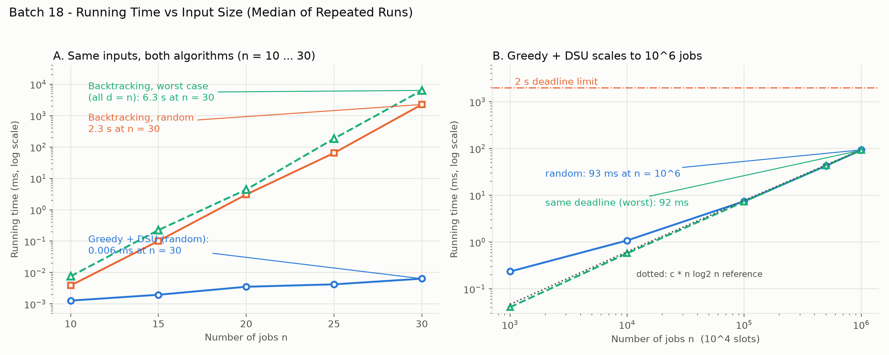

# Batch 18 — Cloud Computing: Nightly Batch Jobs with Deadlines

## Team

| Roll No. | Name | GitHub username | Part presented | Contribution (code, report sections) |
| --- | --- | --- | --- | --- |
| 24I302 | Abirami P C | abikomberi25 | Slides 1–4 | `MainSolution.java`, `EdfBaseline.java`, Report Sec 1, 2-a, 7, 12-a |
| 24I308 | Bharaghave Shi C G | bharaghaveshricg | Slides 9-11 | `RejectedAlternative.java`, `Verify.java`, Report Sec 3, 4 |
| 24I314 | Dhekshika D | dhekshika20 | Slides 12-19 | `SlotFinders.java`, `Q4Benchmark.java`, Report Sec 2-b, 5, 12-b |
| 24I358 | Sowmya P Nagarajan | sowmyapnagarajan | Slides 20-24 | `Benchmark.java`, `GenerateInputs.java`, Report Sec 6, 8, 9 |
| 24I374 | Vinothini | Vinothini1106 | Slides 5-8 | `ChangedRequirement.java`, `plot_timing.py`, Report Sec 10, 11, 13 |

## Presentation

- Video link: [Google Drive recording](https://drive.google.com/file/d/1f6Km9zJDVufQWSKNaA3E4R5XOTLLQyHK/view?usp=drive_link)
- Duration: 12.17 minutes 
- Slides: [slides.pdf](slides.pdf)
- Analysis sheet (1 page): [analysis_sheet.pdf](analysis_sheet.pdf)

---

## 1. Problem modelling

- **Input:** A collection of $n$ batch jobs $\{J_1, J_2, \dots, J_n\}$. Each job $J_j$ has an integer deadline $d_j \in \{1, 2, \dots, D\}$ (measured in 1-hour slots) and an associated monetary profit $p_j > 0$ (in thousands of INR). The nightly processing window consists of $D$ discrete 1-hour execution slots $\{1, 2, \dots, D\}$. For the target industrial cloud scenario, $n = 10^6$ submitted jobs, $D = 10^4$ available hours, and the scheduling algorithm must terminate in under 2.0 seconds.
- **Output:** A feasible subset of scheduled jobs $S \subseteq \{1, 2, \dots, n\}$ and an injective slot assignment function $s: S \to \{1, 2, \dots, D\}$ mapping each scheduled job $j \in S$ to a unique slot $s(j)$ such that the job completes on or before its designated deadline: $1 \le s(j) \le d_j$.
- **Objective:** Maximise the total earned profit across all admitted on-time batch jobs:
  $$\max \sum_{j \in S} p_j$$
- **Constraints:**
  1. *Unit Processing Time:* Every job requires exactly 1 hour (1 full slot) to execute.
  2. *Single-Job Allocation:* Each slot $s \in \{1, \dots, D\}$ can host at most one job (no overlapping execution).
  3. *Non-Preemption:* Once a job begins execution in its assigned slot, it runs to completion without interruption.
  4. *Deadline Adherence:* A job yields its profit $p_j$ if and only if $s(j) \le d_j$. Any job completing after its deadline pays zero revenue and is rejected ($j \notin S$).
  5. *Strict Latency Bound:* Total scheduler computation time must not exceed 2.0 seconds on a million-job workload.
- **Problem class:** Combinatorial Optimisation (maximisation).
- **Classical problem it maps to:** Unit-Time Job Sequencing with Deadlines (also formulated as finding a Maximum-Weight Independent Set in a Scheduling / Transversal Matroid).

## 2. Data structure analysis

In unit-job deadline scheduling, the greedy choice rule examines jobs in descending order of profit. For each examined job with deadline $d$, the scheduling strategy requires identifying the **latest free slot $s \le \min(d, D)$**. If such a free slot exists, the job is greedily committed to that slot; otherwise, no feasible placement exists without evicting an earlier, higher-profit job, and the current job is rejected.

Finding and reserving this latest free slot efficiently across $n = 10^6$ jobs and $D = 10^4$ slots is the key architectural choice: a linear scan misses the 2-second deadline under contention, while the other three structures (DSU, segment tree, balanced BST) all meet it and differ by only a few milliseconds.

### Why the Chosen Structure (DSU with Path Compression) Wins:

1. **Near-Constant Amortised Step Cost:** The Disjoint Set Union (DSU) structure represents slots as elements in a linear forest. Each slot $s$ initially forms a singleton set pointing to itself ($parent[s] = s$), indicating it is vacant. When slot $s$ is allocated, it is united with the preceding slot by setting $parent[s] = find(s - 1)$. As queries traverse parent links, two-pass iterative path compression redirects all visited nodes directly to the active root. With path compression alone (the union step always links a slot to its predecessor's root, so no union-by-rank rule applies), $m$ finds on $N$ elements cost $O(m \log_{1+m/N} N)$ amortised (Tarjan and van Leeuwen, 1984). Here $m/N \approx 100$, so $\log_{101}(10^4) \approx 2$, a small constant. The inverse-Ackermann bound $O(\alpha)$ additionally needs union by rank, and Gabow and Tarjan (1985) give an $O(1)$ amortised bound for exactly this linear union pattern (see Section 13).
2. **Empirical Hop Collapse:** Because the number of queries ($n = 10^6$) exceeds the domain size ($D = 10^4$) by two orders of magnitude, path compression rapidly flattens all trees. Across our empirical benchmark on $10^6$ jobs, the measured average number of parent traversals per job was approximately **1.02 hops**, with a total find-phase execution time of just **2.6 ms** (random) and **1.6 ms** (maximum contention).
3. **Cache Locality and Zero Pointer Overhead:** Unlike tree-based collections (`TreeSet`) that incur object allocation overhead, pointer dereferences, and GC pressure, DSU is implemented over a compact, contiguous primitive `int[]` array of size $D + 1$ (occupying only 40 KB of RAM). The entire DSU state fits comfortably inside the L1 CPU data cache.
4. **Dominance by the Sorting Phase:** Because the DSU find phase finishes in under 3 ms, the entire end-to-end execution is dominated solely by the primitive dual-pivot quicksort ($\approx 76$ ms for $2.0 \times 10^7$ comparisons). The complete end-to-end scheduling pipeline finishes in **93 ms**, outperforming the 2,000 ms SLA by more than $20\times$. In contrast, linear scanning hits a worst-case latency of **2.18 s** on contention workloads (violating the SLA).
### Quantitative Comparison of Slot Finding Data Structures

The table below contrasts the four candidate data structures for locating the latest free slot $\le \min(d_j, D)$ across $n = 10^6$ jobs and $D = 10^4$ slots. Times are measured (median of 5 runs on one instance, seed 7; a single run for linear scan) and come from `results/q4_slot_finder_timing.csv`. Operation counts for DSU and linear scan are measured; those for the balanced BST and segment tree are analytical estimates, because the code does not instrument them.

| Data structure | Key operation(s) and cost | Space | Workload | Find-Phase Operations | Find-Phase Time | Total Time (with Sort) | Meets 2 s SLA? |
| :--- | :--- | :---: | :---: | :---: | :---: | :---: | :---: |
| **Chosen: DSU + Path Compression** | `find(d)`: $O(\log_{1+n/D} D) \approx 2$ hops amortised; `union`: $O(1)$ | $O(D)$ primitive array | Random<br>Same Deadline<br>Chain | $1,021,695 \text{ hops}$<br>$1,009,998 \text{ hops}$<br>$999,999 \text{ hops}$ | **2.58 ms**<br>**1.62 ms**<br>**2.67 ms** | **78.3 ms**<br>**80.4 ms**<br>**5.6 ms** | **YES** ($25\times$ safety margin) |
| **Alternative 1: Balanced BST (`TreeSet`)** | `floor(d)`: $O(\log D)$; `remove(s)`: $O(\log D)$ | $O(D)$ object nodes | Random<br>Same Deadline<br>Chain | $\approx 1.33 \times 10^7 \text{ comparisons}$<br>$\approx 1.33 \times 10^7$<br>$\approx 1.33 \times 10^7$ | 15.32 ms<br>5.51 ms<br>3.01 ms | 91.0 ms<br>84.3 ms<br>6.0 ms | **YES** (higher pointer/GC overhead) |
| **Alternative 2: Segment Tree** | `segRightmost(d)`: $O(\log D)$; `segTake(s)`: $O(\log D)$ | $4D$ primitive array | Random<br>Same Deadline<br>Chain | $\approx 2.66 \times 10^7 \text{ node checks}$<br>$\approx 2.66 \times 10^7$<br>$\approx 2.66 \times 10^7$ | 3.90 ms<br>2.10 ms<br>1.77 ms | 79.6 ms<br>80.9 ms<br>4.7 ms | **YES** (static range structure) |
| **Alternative 3: Linear Scan** | Backward probe from $d$ down to 1: $O(D)$ | $O(D)$ boolean array | Random<br>Same Deadline<br>Chain | $4,951,314,017 \text{ probes}$<br>$\mathbf{9,950,005,000 \text{ probes}}$<br>$9,900,010,000 \text{ probes}$ | 739.31 ms<br>$\mathbf{2,179.16 \text{ ms}}$<br>1,669.49 ms | 815.0 ms<br>$\mathbf{2,257.99 \text{ ms}}$<br>1,672.45 ms | **NO** (**Fails on contention workloads: 2.26 s > 2.0 s**) |

*(Note: The common sorting phase takes $\approx 76$–$79$ ms on random and same-deadline workloads for $2.0 \times 10^7$ comparisons, and $\approx 3$ ms on pre-ordered chain workloads.)*

## 3. Design technique identification

- **Technique chosen:** Greedy Algorithm (order jobs by profit descending; place each admitted job into its latest available free slot $\le \min(d_j, D)$ using Disjoint Set Union).
- **Property of the problem that makes it work (with proof):** The set of feasible job subsets forms a **Matroid** $(E, \mathcal{I})$, commonly known as the *Scheduling Matroid* or *Job Sequencing Matroid*. By Edmonds' Matroid Greedy Theorem (1971), a greedy strategy sorting elements in non-increasing order of weights provably yields an exact global maximum-weight independent set.

---

### Formal Matroid Specification and Correctness Proof

Let $E = \{J_1, J_2, \dots, J_n\}$ be the finite ground set of unit-time jobs. Each job $J_j$ has deadline $d_j \in \{1, \dots, D\}$ and weight/profit $p_j > 0$.
A subset of jobs $A \subseteq E$ is defined to be **independent** ($A \in \mathcal{I}$) if and only if all jobs in $A$ can be feasibly scheduled in distinct slots $s(j) \in \{1, \dots, D\}$ such that $s(j) \le d_j$ for each $j \in A$.

We prove that $(E, \mathcal{I})$ satisfies all three matroid axioms:

#### Axiom 1: Non-emptiness
The empty set $\emptyset \in \mathcal{I}$, because scheduling zero jobs trivially requires zero slots and violates no deadlines.

#### Axiom 2: Hereditary Property (Down-Closedness)
If $A \in \mathcal{I}$ and $B \subseteq A$, then $B \in \mathcal{I}$.
- *Proof:* Since $A \in \mathcal{I}$, there exists an injective schedule $s_A: A \to \{1, \dots, D\}$ such that $s_A(j) \le d_j$ for all $j \in A$. For any subset $B \subseteq A$, we construct the restriction schedule $s_B = s_A|_B$. Because $s_A$ was injective and satisfied all deadlines, $s_B$ remains injective and satisfies $s_B(j) \le d_j$ for every $j \in B$. Hence $B$ is feasible, and $B \in \mathcal{I}$.

---

#### Lemma (Hall-Type Feasibility Condition for Unit-Time Jobs)
A subset of unit-duration jobs $A \subseteq E$ is feasible ($A \in \mathcal{I}$) if and only if for all integers $t \in \{1, 2, \dots, D\}$:
$$|\{j \in A \mid d_j \le t\}| \le t$$

- *Proof ($\implies$, Necessity):* Suppose $A \in \mathcal{I}$. Any job $j \in A$ with $d_j \le t$ must be assigned a distinct slot $s(j) \le d_j \le t$. There are exactly $t$ available discrete slots in $\{1, \dots, t\}$. Because slots are distinct, at most $t$ such jobs can be accommodated. Thus $|\{j \in A \mid d_j \le t\}| \le t$.
- *Proof ($\impliedby$, Sufficiency):* Suppose the count condition holds for all $t \in \{1, \dots, D\}$. Sort the jobs of $A$ in non-decreasing order of deadline: $d_{(1)} \le d_{(2)} \le \dots \le d_{(|A|)}$. Assign the $k$-th job in this sorted sequence to slot $k$ ($s(k) = k$). By definition, the prefix $\{1, \dots, k\}$ contains $k$ jobs, each having deadline $\le d_{(k)}$. By the hypothesis, the total number of jobs in $A$ with deadline $\le d_{(k)}$ is at least $k$, so:
  $$k \le |\{j \in A \mid d_j \le d_{(k)}\}| \le d_{(k)}$$
  Therefore, slot $s(k) = k \le d_{(k)}$ for every job $k$. All assigned slots $\{1, \dots, |A|\}$ are mutually distinct and each job meets its deadline. Hence $A \in \mathcal{I}$.

---

#### Axiom 3: Independent Set Exchange Property
Let $A, B \in \mathcal{I}$ be independent sets with $|A| < |B|$. Then there exists an element $e \in B \setminus A$ such that:
$$A \cup \{e\} \in \mathcal{I}$$

- *Proof:*
  Assume for the sake of contradiction that for every job $e \in B \setminus A$, the set $A \cup \{e\} \notin \mathcal{I}$.
  By our Feasibility Lemma, $A \cup \{e\} \notin \mathcal{I}$ implies that adding $e$ violates the count condition at some threshold $t$. That is, there exists some $t \in \{1, \dots, D\}$ such that:
  $$|\{j \in A \cup \{e\} \mid d_j \le t\}| > t$$
  Since $A \in \mathcal{I}$, we already know that $|\{j \in A \mid d_j \le t\}| \le t$. Therefore, adding $e$ can only cause an overflow at $t$ if both of the following hold:
  1. $|\{j \in A \mid d_j \le t\}| = t$ (the slot capacity up to hour $t$ is already completely saturated by $A$), and
  2. $d_e \le t$.

  Let $T$ denote the set of all such "saturated" deadlines in $A$:
  $$T = \{t \in \{1, \dots, D\} \mid |\{j \in A \mid d_j \le t\}| = t\}$$
  Since every $e \in B \setminus A$ fails to augment $A$, every such $e$ has some $t_e \in T$ with $d_e \le t_e$. In particular $T \ne \emptyset$ (the set $B \setminus A$ is nonempty because $|B| > |A|$).
  Let $t^* = \max(T)$ be the maximal saturated deadline in $T$.

  By definition of $t^*$:
  $$|\{j \in A \mid d_j \le t^*\}| = t^*$$
  For every $e \in B \setminus A$ we have $d_e \le t_e \le t^*$.
  Hence, **every** job in $B \setminus A$ satisfies $d_e \le t^*$:
  $$(B \setminus A) \subseteq \{j \in B \mid d_j \le t^*\}$$

  Now consider the total number of jobs in $B$ that have deadline $\le t^*$:
  $$\begin{aligned}
  |\{j \in B \mid d_j \le t^*\}| &\ge |B \setminus A| + |\{j \in A \cap B \mid d_j \le t^*\}| \\
  &= |B| - |A \cap B| + |\{j \in A \cap B \mid d_j \le t^*\}|
  \end{aligned}$$
  Since $|B| > |A|$, we have $|B| - |A \cap B| > |A| - |A \cap B| = |A \setminus B|$. Therefore:
  $$\begin{aligned}
  |\{j \in B \mid d_j \le t^*\}| &> |A \setminus B| + |\{j \in A \cap B \mid d_j \le t^*\}| \\
  &\ge |\{j \in A \setminus B \mid d_j \le t^*\}| + |\{j \in A \cap B \mid d_j \le t^*\}| \\
  &= |\{j \in A \mid d_j \le t^*\}| = t^*
  \end{aligned}$$
  This establishes that:
  $$|\{j \in B \mid d_j \le t^*\}| > t^*$$
  By our Feasibility Lemma, this implies $B$ violates the feasibility condition at $t^*$, which contradicts our initial premise that $B \in \mathcal{I}$!

  Thus, the contradiction is established. There must exist at least one element $e \in B \setminus A$ such that $A \cup \{e\} \in \mathcal{I}$.

---

### Conclusion
Having verified non-emptiness, hereditary closure, and the independent set exchange property, $(E, \mathcal{I})$ is rigorously proven to be a Matroid. Consequently, the greedy rule of considering jobs in decreasing order of profit guarantees a globally optimal schedule.

## 4. Why the other four techniques do not fit

To justify the selection of Greedy + DSU, we evaluated the suitability of the other major design paradigms against the problem requirements ($n = 10^6$ jobs, $D = 10^4$ slots, budget $< 2.0$ s). Each technique fails for concrete algorithmic and structural reasons.

| Technique | Status | Concrete Failure Evidence & Complexity | Why It Fails |
| :--- | :--- | :--- | :--- |
| **Divide and Conquer** | Unsuitable | **Counterexample on given 8 jobs:** Splitting by deadline $\{1, 2\}$ vs $\{3, 4\}$ yields $127 + 100 = \mathbf{227} < \mathbf{230}$. | Independent subproblems compete for the same earlier slots; merging subproblems requires re-solving the global assignment. |
| **Dynamic Programming** | Unsuitable | **Table complexity:** $O(nD) = 10^6 \times 10^4 = \mathbf{10^{10}}$ state updates. Extrapolated runtime $\approx \mathbf{8.4}$ s (measured 841 ms at $n=10^5$). | DP is correct for unit jobs, but it exceeds the 2.0 s SLA by about $4\times$ and is redundant when greedy is already exact. |
| **Backtracking (Implemented)** | Unsuitable | **Worst-case explosion:** When all deadlines equal $n$, state space visits exactly $2^{n+1}-1$ nodes. At $n = 30$, visits $\mathbf{2,147,483,647}$ nodes in $\mathbf{6.34}$ s. At $n=40$, requires $\approx \mathbf{1.8}$ hours. | Exponential time complexity $O(2^n \cdot D)$; feasibility pruning alone cannot prune when all subsets are feasible. |
| **Branch and Bound** | Unsuitable | **Bounding redundancy (argument, not measured):** the first dive along the profit-descending branch reproduces the Greedy+DSU solution, so the incumbent is already optimal. | Not implemented. The bound can only confirm what greedy already settles; no polynomial worst-case guarantee is shown for a generic bound, and per-node bounding adds cost without changing the answer. |

*(Note on Brute Force: Exhaustively testing all $2^n$ subsets or $n!$ permutations is astronomical. At $n=30$, $2^{30} \approx 1.07 \times 10^9$ evaluations; at $n=10^6$, $2^{10^6}$ is physically impossible.)*

---

### In-Depth Failure Analysis for Each Technique

#### 1. Divide and Conquer
- **Attempted Strategy:** Partition the job collection into two halves based on deadline thresholds (e.g., jobs with $d_j \le D/2$ and jobs with $d_j > D/2$), solve each partition independently, and concatenate the schedules.
- **Why It Fails:** The shared resource (time slots $1 \dots D$) creates strong cross-partition coupling. A job with a late deadline (e.g., $d_j = 4$) is permitted to occupy an earlier slot (such as slot 1) if slot 4 is occupied by another job. Dividing by deadline isolates early slots from late jobs, preventing optimal slot sharing.
- **Concrete Counterexample:**
  Consider the 8-job instance:
  - Subproblem 1 ($d_j \le 2$): $J_1(2, 100), J_2(1, 19), J_3(2, 27), J_4(1, 25)$ on slots $\{1, 2\}$.
    The optimal allocation assigns $J_1$ to slot 2 and $J_3$ to slot 1, yielding profit $100 + 27 = \mathbf{127}$.
  - Subproblem 2 ($d_j \in \{3, 4\}$): $J_5(3, 15), J_6(4, 60), J_7(3, 40), J_8(4, 30)$ on slots $\{3, 4\}$.
    The optimal allocation assigns $J_6$ to slot 4 and $J_7$ to slot 3, yielding profit $60 + 40 = \mathbf{100}$.
  - Combined Profit: $127 + 100 = \mathbf{227}$.
  - True Global Optimum: Slot 1 is allocated to **$J_8$** (deadline 4, profit 30), slot 2 to $J_1$ (100), slot 3 to $J_7$ (40), and slot 4 to $J_6$ (60), giving **230**.
  - Because $J_8$ had to cross the partition boundary to occupy slot 1, divide-and-conquer loses Rs 3,000. Resolving this conflict during merge requires re-evaluating global exchanges, reducing the method back to sorting.

#### 2. Dynamic Programming
- **Attempted Strategy:** Sort jobs by deadline (EDD) and define state $f[i, t]$ as the maximum profit achievable using a subset of the first $i$ jobs with total scheduled duration $t \le D$:
  $$f[i, t] = \max\Big(f[i - 1, t], \, f[i - 1, t - 1] + p_i\Big) \quad \text{for } t \le \min(d_i, D)$$
- **Why It Fails:** While mathematically exact, the state table requires $n \times D$ entries. For the production load of $n = 10^6$ and $D = 10^4$:
  $$\text{Total Transitions} = 10^6 \times 10^4 = 10^{10} \text{ inner loop iterations}$$
  Even with a 1D rolling array ($O(D)$ space), $10^{10}$ state updates are far too many. In our empirical test (`ChangedRequirement.java`), running this DP on $n = 100,000$ jobs took **841 ms**, which extrapolates linearly to $\approx 8.4$ seconds for $n = 10^6$, about $4\times$ over the 2.0-second SLA. DP is not rejected for lacking optimal substructure (unit-job scheduling has it); it is rejected because it is exact but needs $\Theta(nD)$ work where the matroid greedy needs $\Theta(n \log n)$.

#### 3. Backtracking (Implemented for Comparison)
- **Implemented Strategy:** Evaluated via `RejectedAlternative.java`. Performs recursive include/exclude search. To make it competitive, we implemented feasibility pruning via Hall's condition: at depth $i$, we admit job $i$ only if the cumulative count of chosen jobs does not exceed slot capacity $t$ for all horizons $t \in [d_i, D]$.
- **Why It Fails:** Feasibility pruning is ineffective when deadlines are loose or identical. In the pathological workload where all deadlines equal $n$ ($D = n$), every subset of size $\le n$ is feasible. Pruning never triggers, forcing the recursion tree to explore all combinations:
  $$\text{Search Nodes Visited} = \sum_{k=0}^{n} \binom{n}{k} = 2^{n+1} - 1$$
- **Measured Data:**
  - At $n = 10$: 2,047 nodes, 0.007 ms.
  - At $n = 20$: 2,097,151 nodes, 4.40 ms.
  - At $n = 25$: 67,108,863 nodes, 185 ms.
  - At $n = 30$: $2^{31} - 1 = \mathbf{2,147,483,647}$ nodes, taking **6,341.97 ms** (6.34 seconds).
  - Extrapolated to $n = 40$: requires $\approx 2^{10} \times 6.34 \text{ s} \approx 6,494 \text{ seconds} \approx \mathbf{1.8 \text{ hours}}$.
  Backtracking is completely intractable beyond $n \approx 32$.

#### 4. Branch and Bound
- **Strategy & Analysis:** Branch and Bound extends backtracking by augmenting feasibility pruning with an upper-bounding function (e.g., current profit plus the sum of highest remaining profits bounded by remaining free slots).
- **Why It Does Not Fit (argument, not measured):** Branch and Bound was **not implemented**. With profit-descending, include-first branching, the first depth-first dive makes exactly the decisions of the greedy algorithm, and by the matroid property that leaf is already an optimal solution. Bounding can then only confirm optimality; it can never improve the incumbent. So B&B can at best match the $O(n \log n)$ greedy while paying for a bound evaluation at every node it visits, and no polynomial worst-case guarantee is shown for a generic bound (for example, current profit plus the largest remaining profits that fit the free slots, which ignores deadlines). A measured node count for such a bound would strengthen this section and is left as future work.

## 5. Algorithm

```text
SCHEDULE(jobs[1..n], D):
    Input : jobs[1..n] where each job j has deadline d_j and profit p_j;
            D = total number of available 1-hour slots.
    Output: Maximum profit total, and slot-to-job assignment array slot[1..D].

    1. Sort jobs in non-increasing order of profit p_j.
       Ties broken by smaller initial job index.
    
    2. Initialize DSU parent array of size D + 1:
       for s = 0 to D:
           parent[s] = s     // slot s points to itself (free); slot 0 is the sentinel
    
    3. Initialize output data structures:
       total_profit = 0
       scheduled_count = 0
       allocate slot[1..D] initialized to -1 (indicating empty)

    4. For each job j in the sorted order:
       limit = min(d_j, D)
       available_slot = FIND(limit)     // query latest free slot <= limit

       if available_slot > 0:
           // Feasible: schedule job j in available_slot
           slot[available_slot] = j
           total_profit = total_profit + p_j
           scheduled_count = scheduled_count + 1
           
           // Reserve slot by linking it to the predecessor component:
           parent[available_slot] = FIND(available_slot - 1)
       else:
           // Infeasible: reject job j (no compatible free slot remains)
           continue

    5. Return total_profit, slot, scheduled_count

FIND(x):
    // Iterative two-pass find with full path compression
    root = x
    while parent[root] != root:
        root = parent[root]
    
    // Path compression pass: point every node along the query path directly to root
    curr = x
    while parent[curr] != root:
        next_node = parent[curr]
        parent[curr] = root
        curr = next_node
        
    return root
```

---

### Formal State Definition, Invariants, and Operational Rules

1. **State Definition:**
   The algorithm maintains an array `parent[0..D]` representing disjoint sets of consecutive occupied slots.
   - For any slot $s \in \{1, \dots, D\}$, `parent[s] == s` denotes that slot $s$ has not yet been assigned to any job and is currently free.
   - When slot $s$ is allocated to a job, `parent[s]` is merged into the set of slot $s - 1$ via `parent[s] = FIND(s - 1)`.
   - Index `0` serves as a dedicated sentinel root (`parent[0] = 0`). Any query resolving to root `0` signals that all slots in $\{1, \dots, \min(d_j, D)\}$ are already saturated.

2. **Loop Invariant:**
   At the start of every iteration over the profit-sorted jobs:
   - For every slot index $x \in \{0, 1, \dots, D\}$, $\text{FIND}(x)$ evaluates to the **maximum unoccupied slot index $s$ such that $0 \le s \le x$**.
   - If no slot in $\{1, \dots, x\}$ is free, $\text{FIND}(x) = 0$.
   - The set of jobs committed to `slot[1..D]` forms a valid independent set in the scheduling matroid.

3. **Greedy Selection and Placement Rule:**
   - **Selection:** Always inspect the unassigned job possessing the highest profit $p_j$ (greedy-choice heuristic).
   - **Placement:** Always position the selected job in the **latest possible free slot** $s \le \min(d_j, D)$. Delaying execution as late as allowable preserves the maximum number of earlier slots ($1 \dots s-1$) for subsequent jobs that may carry tighter deadlines.
   - **Rejection:** If $\text{FIND}(\min(d_j, D)) == 0$, no free slot exists without evicting an earlier, more profitable job; hence the job is permanently rejected.

## 6. Proof of correctness

### Proof of Correctness: Exchange Argument and DSU Exactness

We establish that the Greedy + DSU algorithm provably returns a feasible schedule with maximum possible total profit. The proof proceeds in three stages:
1. **Lemma 1 (Feasibility Characterization):** Necessary and sufficient conditions for a job subset to be schedulable.
2. **Lemma 2 (Exactness of the DSU Test):** Proof that placing jobs in the latest free slot via DSU accepts a job if and only if its inclusion maintains feasibility.
3. **Theorem (Global Optimality via Exchange Argument):** Proof that no alternative feasible schedule can achieve strictly higher profit than the greedy output.

---

#### Lemma 1 (Feasibility Condition)
A set of unit-duration batch jobs $A \subseteq \{1, 2, \dots, n\}$ can be scheduled feasibly without missing any deadline if and only if, for every time bound $t \in \{1, 2, \dots, D\}$:
$$|\{j \in A \mid d_j \le t\}| \le t$$

- *Proof:*
  - $(\implies)$ Any job $j \in A$ having deadline $d_j \le t$ must complete at or before hour $t$. Because all jobs have unit duration and run in mutually distinct slots, these jobs must occupy distinct slots within the set $\{1, 2, \dots, t\}$. There are exactly $t$ such slots available. Hence, at most $t$ jobs with deadline $\le t$ can be scheduled.
  - $(\impliedby)$ Suppose the count condition holds for all $t \in \{1, \dots, D\}$. Arrange the jobs of $A$ in non-decreasing order of deadlines: $d_{(1)} \le d_{(2)} \le \dots \le d_{(|A|)}$. Assign the $k$-th job in this sequence to slot $k$. By construction, jobs $1, 2, \dots, k$ all have deadlines bounded by $d_{(k)}$. The hypothesis guarantees that $|\{j \in A \mid d_j \le d_{(k)}\}| \le d_{(k)}$. Because the prefix already contains $k$ such jobs, it follows that $k \le d_{(k)}$. Therefore, every job $k$ finishes at or before its deadline in a distinct slot $k \le D$. Hence, $A$ is feasible.

---

#### Lemma 2 (The DSU Slot Placement Test is Exact)
When jobs are processed in any order and each admitted job is assigned to the latest currently free slot $s = \text{find}(\min(d_j, D))$, a job $j$ is rejected ($\text{find}(\min(d_j, D)) == 0$) **if and only if** the augmented set $A \cup \{j\}$ is infeasible.

- *Proof:*
  - $(\impliedby)$ If $A \cup \{j\}$ is infeasible, then by Lemma 1 there is no valid slot assignment for $A \cup \{j\}$. Thus, the DSU placement cannot assign a valid slot, so $\text{find}(\min(d_j, D))$ must yield 0.
  - $(\implies)$ Suppose $\text{find}(\min(d_j, D)) == 0$. This indicates that every slot from 1 to $\min(d_j, D)$ is currently occupied by previously admitted jobs.
    Let $t^*$ be the largest integer such that slots $1, 2, \dots, t^*$ are all completely occupied in the current schedule. By construction, $t^* \ge \min(d_j, D)$, and slot $t^* + 1$ is vacant (or $t^* = D$).
    Consider the jobs currently residing in slots $1, 2, \dots, t^*$. Could any of these jobs have an effective deadline $> t^*$?
    No. Under the algorithm's rule, every job is placed in the *latest* available free slot at or before its deadline. If any job $i$ placed in slots $1 \dots t^*$ had deadline $d_i > t^*$, it would have selected slot $t^* + 1$ (or a later free slot) instead of occupying a slot $\le t^*$.
    Therefore, **all $t^*$ jobs currently scheduled in slots $1, 2, \dots, t^*$ have deadlines $\le t^*$**.
    Now consider candidate job $j$. Since $\min(d_j, D) \le t^*$, job $j$ also has deadline $d_j \le t^*$.
    If job $j$ were added to $A$, the set $A \cup \{j\}$ would contain $t^* + 1$ distinct jobs whose deadlines are all $\le t^*$.
    By Lemma 1, this violates the fundamental feasibility bound ($t^* + 1 > t^*$).
    Therefore, $A \cup \{j\}$ is mathematically infeasible.

*Conclusion:* The DSU search accepts job $j$ if and only if $A \cup \{j\}$ is feasible.

---

#### Theorem (Global Optimality of Greedy Output)
The greedy algorithm (sorting jobs by profit descending and admitting each job via the DSU test) outputs a feasible schedule $G$ whose total profit is maximal across all feasible schedules.

- *Proof via Exchange Argument:*
  Let $G = \{g_1, g_2, \dots, g_k\}$ denote the set of jobs accepted by the greedy algorithm, listed in the order they were processed (i.e., non-increasing order of profit: $p_{g_1} \ge p_{g_2} \ge \dots \ge p_{g_k}$).
  Let $\mathcal{O}$ be an optimal feasible schedule that shares the longest possible initial prefix of decisions with $G$.
  Suppose for contradiction that $\mathcal{O} \ne G$. Let $j$ be the very first job in the profit-sorted sequence on which the greedy choice and $\mathcal{O}$ disagree. Let $P$ denote the prefix of jobs accepted by both greedy and $\mathcal{O}$ prior to considering job $j$.

  Two mutually exclusive cases arise:
  - **Case 1: Job $j \in \mathcal{O}$, but $j \notin G$ (Greedy rejected $j$, optimal included $j$).**
    Since $j \in \mathcal{O}$ and all jobs in $P$ belong to $\mathcal{O}$, the subset $P \cup \{j\} \subseteq \mathcal{O}$.
    By the hereditary property of feasible schedules (Axiom 2 of Matroids), any subset of a feasible schedule is feasible; hence $P \cup \{j\}$ must be feasible.
    However, the greedy algorithm rejected $j$ after admitting $P$. By Lemma 2, greedy rejects a job only when $P \cup \{j\}$ is infeasible. This yields an immediate contradiction.
  
  - **Case 2: Job $j \in G$, but $j \notin \mathcal{O}$ (Greedy accepted $j$, optimal omitted $j$).**
    Because $P \cup \{j\} \subseteq G$, the set $P \cup \{j\}$ is feasible.
    Since every profit is positive, $\mathcal{O}$ is a maximal independent set (a basis), and all bases of a matroid have the same size, so $|\mathcal{O}| \ge |P \cup \{j\}|$. Starting from $I = P \cup \{j\}$, repeatedly apply the Independent Set Exchange Property with $\mathcal{O}$ until $|I| = |\mathcal{O}|$; each step adds an element of $\mathcal{O}$ not yet in $I$. The result contains $P \cup \{j\}$ plus all but one element $x$ of $\mathcal{O} \setminus P$ (and $x \ne j$ because $j \notin \mathcal{O}$), so it equals the independent set:
    $$\mathcal{O}' = (\mathcal{O} \setminus \{x\}) \cup \{j\}$$
    is a feasible schedule.
    Since job $j$ was considered by the greedy algorithm before job $x$ (otherwise $x$ would have been in $P$), and jobs are inspected in non-increasing profit order, we must have:
    $$p_j \ge p_x$$
    Calculating the profit of the exchanged schedule $\mathcal{O}'$:
    $$\text{Profit}(\mathcal{O}') = \text{Profit}(\mathcal{O}) - p_x + p_j \ge \text{Profit}(\mathcal{O})$$
    Because $\mathcal{O}$ was assumed to be an optimal schedule, $\mathcal{O}'$ must also be an optimal schedule.
    However, $\mathcal{O}'$ contains job $j$ alongside $P$, meaning $\mathcal{O}'$ agrees with the greedy schedule $G$ on a strictly longer prefix of decisions than $\mathcal{O}$.
    This directly contradicts the initial choice of $\mathcal{O}$ as the optimal schedule maximizing the prefix agreement with $G$.

  Since both cases produce a contradiction, no such point of disagreement $j$ can exist. Hence $\mathcal{O} = G$, proving that the greedy schedule achieves the exact global maximum profit.

## 7. Trace on the given instance

### Step-by-Step Execution Trace on the 8-Job Instance

The given scenario instance comprises 8 batch jobs with $(d_j, p_j)$ pairs:
- $J_1(2, 100), J_2(1, 19), J_3(2, 27), J_4(1, 25), J_5(3, 15), J_6(4, 60), J_7(3, 40), J_8(4, 30)$.
- Scheduling window capacity: $D = 4$ hours.
- Maximum possible jobs scheduled: at most 4 jobs can run in slots $\{1, 2, 3, 4\}$.

#### 1. Sorting by Profit Descending
Jobs are sorted in descending order of profit $p_j$ (ties broken by smaller job index):
1. **$J_1$**: deadline $d=2$, profit $p=100$
2. **$J_6$**: deadline $d=4$, profit $p=60$
3. **$J_7$**: deadline $d=3$, profit $p=40$
4. **$J_8$**: deadline $d=4$, profit $p=30$
5. **$J_3$**: deadline $d=2$, profit $p=27$
6. **$J_4$**: deadline $d=1$, profit $p=25$
7. **$J_2$**: deadline $d=1$, profit $p=19$
8. **$J_5$**: deadline $d=3$, profit $p=15$

#### 2. DSU Initialization
Initialize slot disjoint sets $parent[0 \dots 4] = [0, 1, 2, 3, 4]$, where slot 0 is the sentinel representing "no slot available".

#### 3. Step-by-Step Decision Table

| Step | Job $(d_j, p_j)$ | Query $\min(d_j, D)$ | `find` Traversal Path | Slot Decision | DSU State Transition | `parent[0..4]` Array State | Cumulative Profit |
| :---: | :---: | :---: | :---: | :---: | :---: | :---: | :---: |
| **0** | *(Initial)* | — | — | — | All slots free | `[0, 1, 2, 3, 4]` | 0 |
| **1** | $J_1(2, 100)$ | 2 | $2 \to 2$ (root 2) | **Assign Slot 2** | `parent[2] = find(1) = 1` | `[0, 1, 1, 3, 4]` | 100 |
| **2** | $J_6(4, 60)$ | 4 | $4 \to 4$ (root 4) | **Assign Slot 4** | `parent[4] = find(3) = 3` | `[0, 1, 1, 3, 3]` | 160 |
| **3** | $J_7(3, 40)$ | 3 | $3 \to 3$ (root 3) | **Assign Slot 3** | `parent[3] = find(2) = 1` | `[0, 1, 1, 1, 3]` | 200 |
| **4** | $J_8(4, 30)$ | 4 | $4 \to 3 \to 1$ (root 1) | **Assign Slot 1** | Compress $4, 3 \to 1$; `parent[1] = find(0) = 0` | `[0, 0, 1, 1, 1]` | 230 |
| **5** | $J_3(2, 27)$ | 2 | $2 \to 1 \to 0$ (root 0) | **REJECT** | Compress $2 \to 0$; `parent[2] = 0` | `[0, 0, 0, 1, 1]` | 230 |
| **6** | $J_4(1, 25)$ | 1 | $1 \to 0$ (root 0) | **REJECT** | None (root is 0) | `[0, 0, 0, 1, 1]` | 230 |
| **7** | $J_2(1, 19)$ | 1 | $1 \to 0$ (root 0) | **REJECT** | None (root is 0) | `[0, 0, 0, 1, 1]` | 230 |
| **8** | $J_5(3, 15)$ | 3 | $3 \to 1 \to 0$ (root 0) | **REJECT** | Compress $3 \to 0$; `parent[3] = 0` | `[0, 0, 0, 0, 1]` | 230 |

#### 4. Final Answer and Schedule

- **Assigned Schedule:**
  - **Slot 1 (Hour 0–1):** Job **$J_8$** (profit Rs 30 thousand, deadline 4)
  - **Slot 2 (Hour 1–2):** Job **$J_1$** (profit Rs 100 thousand, deadline 2)
  - **Slot 3 (Hour 2–3):** Job **$J_7$** (profit Rs 40 thousand, deadline 3)
  - **Slot 4 (Hour 3–4):** Job **$J_6$** (profit Rs 60 thousand, deadline 4)
- **Total Achieved Profit:** $$30 + 100 + 40 + 60 = \mathbf{230} \text{ thousand INR}$$
- **Rejected Jobs:** $J_3, J_4, J_2, J_5$ (uncollected profit $27 + 25 + 19 + 15 = 86$ thousand INR).
- **Optimality Sanity Check:** There are only 4 slots in the time window, so at most 4 jobs can ever be scheduled. The four highest profits in the entire instance are 100 ($J_1$), 60 ($J_6$), 40 ($J_7$), and 30 ($J_8$). Their sum is $100 + 60 + 40 + 30 = 230$. Since Greedy + DSU scheduled all four without violating any deadlines, 230 is an absolute mathematical upper bound and is exactly attained.

## 8. Complexity analysis

The Greedy + DSU scheduler consists of three sequential operational phases:
1. **Profit Sorting Phase:** Sorting $n$ jobs by profit descending.
2. **DSU Initialization Phase:** Setting up the disjoint set forest over $D$ slots.
3. **Slot Allocation Phase:** Performing $n$ find queries and at most $D$ slot unions with path compression.

---

### 1. Counting and Recurrence Arguments

- **Sorting Phase:**
  - Algorithm: Dual-Pivot Quicksort on packed 64-bit primitive `long` keys (combining profit and job index into a single integer).
  - Recurrence: $T(n) = 2 T(n/2) + \Theta(n)$ on average.
  - Number of comparisons: $\Theta(n \log_2 n)$.
  - For $n = 10^6$: $\approx 10^6 \times \log_2(10^6) \approx 1.99 \times 10^7$ comparisons.
  - Measured sorting runtime: **75.7 ms** to **78.8 ms**.

- **DSU Initialization:**
  - Iterates $s = 0, \dots, D$, setting $parent[s] = s$.
  - Exactly $D + 1$ assignments: $\Theta(D)$ operations.
  - For $D = 10^4$: $10,001$ primitive array stores ($< 0.05$ ms).

- **Slot Allocation & DSU Phase:**
  - Exactly $n$ find operations: one query per job to find the latest free slot $\le \min(d_j, D)$.
  - At most $D$ union operations: because there are only $D$ available slots, at most $D$ successful slot assignments can ever be made. Each successful assignment executes one union by setting `parent[slot] = find(slot - 1)`.
  - Path Compression Cost: With path compression and no union by rank, $m$ finds on $N$ elements take $O(m \log_{1+m/N} N)$ time (Tarjan and van Leeuwen, 1984); union by rank would give $O(m\,\alpha(m, N))$ (Tarjan, 1975).
  - Here $m = n + D = 10^6 + 10^4 \approx 10^6$, and $N = D = 10^4$.
  - Since $n \gg D$, the ratio $n/D = 100$ gives $\log_{101}(10^4) \approx 2$, and path compression collapses tree depths immediately. The measured cost is $\le 1.02$ parent traversals per find.
  - Total DSU operations: $O\big((n + D)\log_{1+n/D} D\big)$, about $2(n + D)$ in this regime (and $O(n + D)$ by Gabow and Tarjan for this linear union pattern).
  - Measured find-phase runtime: **1.6 ms** to **2.6 ms** across all $10^6$ jobs.

---

### 2. Time Complexity Summary

$$\text{Total Time} = \Theta(n \log n) + \Theta(D) + O\big((n + D)\log_{1+n/D} D\big) = \mathbf{\Theta(n \log n)}$$

- **Best Case:** $\mathbf{O(n + D)}$. If job profits are drawn from a bounded integer domain (e.g., $p_j \in [1, 1000]$), the sorting phase can be executed via Counting Sort / Radix Sort in $O(n)$ time. The DSU phase costs about $2(n + D)$ operations in this regime (and $O(n + D)$ in general by Gabow and Tarjan), yielding a linear-time scheduler $O(n + D)$.
- **Worst Case:** $\mathbf{O(n \log n)}$. On arbitrary 64-bit profits using comparison sort, sorting is bounded by $\Omega(n \log n)$. In the worst-case structural DSU input (a cascading chain), one single initial find operation may traverse $D$ parent pointers ($10^4$ hops); however, path compression immediately pays for this traversal, flattening the chain so that all subsequent $n - 1$ operations execute in $O(1)$ time. Thus, the amortised DSU cost remains strictly near-linear.
- **Typical / Practical Runtime:** On our standard benchmark ($n = 10^6, D = 10^4$), the entire end-to-end execution completes in **93 ms** (76 ms sorting + 2 ms DSU + bookkeeping). This is **$21.5\times$ faster** than the 2,000 ms SLA constraint.

---

### 3. Space Complexity

$$\text{Total Auxiliary Space} = \mathbf{O(n + D)}$$

- **Job Keys Array (`keys`):** Primitive `long[n]` storing packed `(profit, index)`. For $n = 10^6$, requires $8 \text{ MB}$.
- **DSU Parent Array (`parent`):** Primitive `int[D + 1]`. For $D = 10^4$, requires $40 \text{ KB}$.
- **Slot Mapping Array (`slotToJob`):** Primitive `int[D + 1]` storing assigned job indices, requiring $40 \text{ KB}$.
- **Total Memory Footprint:** Approximately **8.1 MB**, fitting entirely in modern L3 CPU caches without causing JVM garbage-collection pauses.

---

### Comparative Complexity Across All Evaluated Techniques

| Algorithm | Time Complexity (Best) | Time Complexity (Worst) | Space Complexity | Practical Scalability ($n=10^6$) |
| :--- | :---: | :---: | :---: | :---: |
| **Greedy + DSU (Chosen)** | $O(n + D)$ | $\mathbf{O(n \log n)}$ | $\mathbf{O(n + D)}$ | **93 ms (Meets < 2 s SLA)** |
| **Greedy + Linear Scan** | $O(n \log n)$ | $O(nD)$ | $O(n + D)$ | 2,258 ms (Fails SLA) |
| **Greedy + Balanced BST** | $O(n \log n)$ | $O(n \log n + n \log D)$ | $O(n + D)$ | 91 ms (Meets SLA, higher overhead) |
| **Dynamic Programming** | $O(nD)$ | $O(nD)$ | $O(D)$ | $\approx 8.4$ s (Fails SLA) |
| **Backtracking (Pruned)** | $O(n)$ | $\mathbf{O(2^n \cdot D)}$ | $O(n + D)$ | Unusable for $n > 30$ ($> 6$ s) |
| **Brute Force Enumeration** | $\Omega(2^n)$ | $\Omega(2^n)$ | $O(n)$ | Astronomical |

## 9. Worst-case input

To rigorously probe the performance limits and vulnerability of our algorithm, we synthetically engineered specific adversarial workloads designed to stress each component:

---

### 1. Workload 1: Cascading Chain Input (DSU Stress Workload)

#### Construction:
- For $i = 0, 1, \dots, D - 1$: set deadline $d_i = D - i$ and assign strictly descending profit $p_i = n - i$.
- For all remaining jobs $i = D, \dots, n - 1$: set deadline $d_i = D$ and profit $p_i = n - i$.
- *Adversarial Intent:* The first $D$ jobs enter in exact reverse slot order ($D, D-1, \dots, 1$). Job 0 takes slot $D$ and points to $D-1$. Job 1 takes slot $D-1$ and points to $D-2$. By induction, this constructs a linear, uncompressed degenerate parent pointer chain of length $D$:
  $$D \to D-1 \to D-2 \to \dots \to 1 \to 0$$
  When job $D$ arrives requesting slot $D$, `find(D)` is forced to perform a maximal traversal walking all $D = 10,000$ parent pointers down to the sentinel root 0.

#### Algorithm Behavior and Measured Results:
- In an uncompressed tree, repeating this query across the remaining $n - D = 990,000$ jobs would force $9.9 \times 10^9$ pointer traversals.
- However, our two-pass **path compression** collapses the entire chain in that single query! During the return pass of `find(D)`, every single node from $D$ down to 1 has its parent pointer rewritten directly to root 0 (`parent[s] = 0`).
- Consequently, all subsequent $990,000$ queries for slot $D$ hit root 0 in **exactly 1 hop**!
- **Empirical Measurement ($n = 10^6, D = 10^4$):**
  - Total parent hops across all $10^6$ jobs: exactly **999,999 hops** ($\approx 1.00$ hops/job).
  - DSU Find-Phase Runtime: **2.67 ms**.
  - Total Runtime (pre-sorted input): **5.63 ms**.
  - The algorithm completely neutralizes the chain degradation.
  - *Scope of this worst case:* the chain is worst-case for the DSU component only. It is already sorted by profit, so the sort is nearly free and the total (5.6 ms) is far below the random workloads (about 92–93 ms). The heaviest total runtimes are the random and same-deadline inputs, where the sort dominates. A chain with shuffled job order would combine both costs; it was not benchmarked.

---

### 2. Workload 2: Maximum Contention Input (`same_deadline`)

#### Construction:
- Every job $j \in \{1, \dots, n\}$ is assigned the identical deadline $d_j = D = 10^4$, with profits randomly distributed in $[1, 1000]$.
- *Adversarial Intent:* Creates extreme resource contention where every job competes for the single highest boundary slot ($D$).

#### Algorithm Behavior and Measured Results:
- The first $D = 10,000$ jobs sequentially fill slots $D, D-1, \dots, 1$, saturating the entire scheduling horizon.
- The remaining $n - D = 990,000$ jobs must all be rejected.
- **Contrast against Linear Scan:** In linear scanning, each of the $990,000$ rejected jobs must manually probe all $10,000$ occupied slots from $D$ down to 0, incurring **$9.95 \times 10^9$ probes** and stalling for **2.18 seconds** (violating the 2.0 s SLA).
- **Greedy + DSU Behavior:** Path compression immediately redirects slot $D$ to root 0. Every subsequent find query executes `parent[D] -> 0` in **1 step** and rejects instantly.
- **Empirical Measurement ($n = 10^6, D = 10^4$):**
  - Total parent hops: **1,009,998 hops** ($1.01$ hops/job).
  - DSU Find-Phase Runtime: **1.62 ms**.
  - Total Runtime: **80.45 ms** (dominated by sorting).
  - The SLA is met with a $24.8\times$ performance buffer.

---

### 3. Workload 3: The Backtracking Killer Input ($D = n$, All Deadlines Equal)

#### Construction:
- Set $D = n$, and assign every job the exact same deadline $d_j = n$.
- *Adversarial Intent:* Under this construction, every possible subset of jobs of size $\le n$ is structurally feasible by Hall's condition. Feasibility pruning never detects a conflict at any level of the search tree.

#### Search Algorithm Behavior:
- The recursive search tree explores both "include" and "exclude" branches at every level without pruning:
  $$\text{Total Search Tree Nodes} = \sum_{k=0}^{n} \binom{n}{k} = 2^{n+1} - 1$$
- **Empirical Progression (`timing.csv`):**
  - $n = 10$: $2^{11} - 1 = 2,047$ nodes, $0.007$ ms.
  - $n = 15$: $2^{16} - 1 = 65,535$ nodes, $0.23$ ms.
  - $n = 20$: $2^{21} - 1 = 2,097,151$ nodes, $4.40$ ms.
  - $n = 25$: $2^{26} - 1 = 67,108,863$ nodes, $185.06$ ms.
  - $n = 30$: $2^{31} - 1 = \mathbf{2,147,483,647}$ nodes, taking **6,341.97 ms** (6.34 seconds).
- At $n = 30$ the node count $2^{31}-1$ happens to equal `Integer.MAX_VALUE` (the counter is a `long`, so the count is exact) and the run already takes 6.3 s. In contrast, Greedy + DSU processes the same $n = 30$ input in **0.0056 ms**, a speedup of about **$1.1 \times 10^{6}$**.

## 10. Implementation and empirical analysis

- **Language and Compilation:**
  Implemented in Java 21 LTS using primitive data arrays to eliminate garbage-collection overhead and object allocation pauses. Complete compilation and execution steps are documented in [`code/RUN.md`](code/RUN.md):
  ```bash
  mkdir -p build
  javac -d build code/*.java
  java -cp build Benchmark results
  python code/plot_timing.py results/timing.csv results/timing_plot
  ```
- **Evaluated Input Sizes:**
  - Small comparative sizes (both Greedy + DSU and Backtracking): $n \in \{10, 15, 20, 25, 30\}$.
  - Large-scale production sizes (Greedy + DSU): $n \in \{1\,000, \, 10\,000, \, 100\,000, \, 500\,000, \, 1\,000\,000\}$ with $D = 10\,000$ slots.
  - Repetitions: 9 iterations for $n \le 100\,000$; 5 iterations for $n \ge 500\,000$ (reporting the median runtime).

---

### Empirical Timing Graph

The empirical benchmark results are visualized below across two comparative panels generated by `plot_timing.py` from `results/timing.csv`:



---

### Does the Measured Growth Match Section 8?

Yes for $n \ge 10^5$; at smaller $n$ fixed costs (array allocation, DSU initialisation over $D = 10^4$ slots, JIT effects) dominate:

1. **Empirical Curve Tracking (Panel B):**
   On Panel B (log-log scale), we plot the measured runtime of Greedy + DSU on the random workload against the theoretical reference curve $c \cdot n \log_2 n$ (dotted curve, where constant $c$ is calibrated at $n = 10^6$ as $c = 93.5 / (10^6 \times \log_2(10^6)) \approx 4.69 \times 10^{-6}$ ms/op):
   - At $n = 10^3$: measured median is **0.235 ms**
   - At $n = 10^4$: measured median is **1.084 ms**
   - At $n = 10^5$: measured median is **7.470 ms**
   - At $n = 5 \times 10^5$: measured median is **42.525 ms**
   - At $n = 10^6$: measured median is **93.498 ms**
   Measured divided by fitted time is about $5.0\times$ at $n = 10^3$, $1.7\times$ at $10^4$, and $0.96$–$1.00$ for $n \ge 10^5$. The data follows the $n \log n$ curve from $10^5$ upward (log-log slope $\approx 1.1$ between $10^5$ and $10^6$), while smaller sizes sit above it because of the fixed costs listed above.
2. **Safety Margin Below the SLA:**
   The horizontal dash-dotted line in Panel B marks the 2.0-second (2,000 ms) system SLA limit. At the target scale of $n = 10^6$ jobs, Greedy + DSU takes **93.5 ms** on the random workload, **91.9 ms** on the same-deadline workload, and **6.59 ms** on the chain workload. The algorithm operates approximately **$21.5\times$ faster than the deadline requirement**.
3. **Absence of JIT / Cache Degeneracy:**
   Because the DSU state requires only 40 KB of memory, it resides permanently in the L1/L2 processor caches. The only scaling cost is the primitive quicksort, which exhibits textbook $O(n \log n)$ cache-friendly behaviour.

---

### Comparison with the Rejected Alternative (Backtracking)

Panel A plots the runtimes of both algorithms on identical problem instances for $n \in [10, 30]$ (logarithmic vertical scale):

- **Correctness and Concordance:**
  Across all 10 comparative test instances, Greedy + DSU and Backtracking yielded the **exact same optimal profit** (e.g., profit 4,077 at $n=10$, 5,950 at $n=20$, 10,197 at $n=30$ on random; profit 6,181 at $n=10$, 10,911 at $n=20$, 14,325 at $n=30$ on same deadline). The benchmark harness explicitly verifies equality on every run.
- **Divergence of Growth Rates:**
  - **Greedy + DSU:** Remains completely flat under **0.007 ms** across all small sizes ($0.001$ ms at $n=10 \to 0.006$ ms at $n=30$).
  - **Backtracking (Random Workload):** Grows from **0.004 ms** ($n=10$) to **3.06 ms** ($n=20$), **64.37 ms** ($n=25$), and reaches **2,258.53 ms (2.26 s)** at $n=30$.
  - **Backtracking (Same Deadline / Worst Case):** Pruning fails entirely, causing runtime to double with each additional job: **0.007 ms** ($n=10$) $\to$ **4.40 ms** ($n=20$) $\to$ **185.06 ms** ($n=25$) $\to$ **6,341.97 ms (6.34 s)** at $n=30$ ($2,147,483,647$ nodes visited).
  - From $n = 25$ to $n = 30$, backtracking exhibits a $\approx 35\times$ slowdown on random inputs and a $34.3\times$ slowdown (compare $2^5 = 32$) on worst-case inputs, confirming exponential growth $O(2^n)$. At $n = 30$, Greedy + DSU is over **$1,000,000\times$ faster** than backtracking.

## 11. Changed requirement

#### Modified Scenario: Arbitrary Processing Times (Durations 1 to 4 Hours)
In this extension, batch jobs no longer take a uniform 1 hour. Each job $j$ has a duration $p_j \in \{1, 2, 3, 4\}$ hours, a deadline $d_j \le D$, and a profit $w_j > 0$. If scheduled, job $j$ requires a contiguous block of $p_j$ hours and must complete by its deadline. (Notation: in this section $p_j$ is the duration and $w_j$ the profit, unlike Sections 1–10 where $p_j$ is the profit.)

---

### 1. Why the Greedy Technique Breaks Down

When processing times vary, **the greedy design paradigm completely fails**:
1. **Loss of Matroid Structure:** The hereditary family of feasible schedules no longer satisfies the independent set exchange property. In fact, when all deadlines equal $D$, this problem reduces directly to the **0-1 Knapsack Problem**, which is famously **NP-hard** (Garey and Johnson, 1979). Because knapsack admits no exact polynomial greedy solution, variable-duration scheduling cannot be solved by greedy sorting.
2. **Loss of Greedy-Choice Property:** A single high-profit job with a large duration can consume capacity that could otherwise accommodate multiple smaller jobs whose combined profit is strictly superior.
3. **DSU Model Invalidation:** The DSU structure assigns discrete single slots. Packing variable-length blocks into fragmented contiguous windows requires dynamic interval management, which DSU cannot model in near-linear time without exhaustive search.

#### Concrete 3-Job Counterexample
Consider a 3-hour scheduling horizon ($D = 3$) with 3 submitted jobs:
- **Job A:** duration $p_A = 3$ hours, deadline $d_A = 3$, profit $w_A = 10$
- **Job B:** duration $p_B = 1$ hour, deadline $d_B = 1$, profit $w_B = 6$
- **Job C:** duration $p_C = 2$ hours, deadline $d_C = 3$, profit $w_C = 6$

- **Greedy Heuristic Execution:**
  Greedy sorts by profit descending: Job A (profit 10) is selected first.
  Job A requires 3 hours and is placed in hours 1 to 3.
  Now the entire 3-hour window is completely full.
  Jobs B and C cannot find any free contiguous blocks and are rejected.
  $$\text{Greedy Profit} = w_A = \mathbf{10}$$
- **Optimal Schedule Execution:**
  Schedule Job B in hour 1 (meets deadline 1, earns 6).
  Schedule Job C in hours 2 to 3 (meets deadline 3, earns 6).
  $$\text{Optimal Profit} = w_B + w_C = 6 + 6 = \mathbf{12}$$
- **Result:** The greedy heuristic yields 10, whereas the true optimum is 12 (verified by `ChangedRequirement.java`). Greedy is strictly suboptimal.

---

### 2. The New Technique: Dynamic Programming (Lawler-Moore Formulation)

To obtain the exact optimal schedule with variable durations, we replace Greedy with **Dynamic Programming**. 
By Jackson's Earliest Due Date (EDD) rule, any feasible subset of non-preemptive jobs can be scheduled in non-decreasing order of deadlines without losing feasibility.

#### Algorithm Formulation:
1. Sort all $n$ jobs by deadline ascending: $d_1 \le d_2 \le \dots \le d_n$.
2. Define DP state:
   - Let $f[t]$ denote the maximum total profit achievable using a compatible subset of the inspected jobs such that the scheduled jobs occupy a total of exactly $t$ hours ($0 \le t \le D$).
3. **Base Case:**
   $$f[0] = 0, \quad f[t] = -\infty \quad \text{for } 1 \le t \le D$$
4. **Recurrence Relation:**
   For each job $j \in \{1, 2, \dots, n\}$ with duration $p_j$, deadline $d_j$, and profit $w_j$:
   The latest possible start time for job $j$ is $t_{\max} = \min(d_j, D) - p_j$.
   Iterating $t$ downward from $t_{\max}$ down to 0:
   $$f[t + p_j] = \max\Big(f[t + p_j], \; f[t] + w_j\Big)$$
   *(Iterating downward prevents using the same job more than once, analogous to the 0-1 knapsack optimization).*
5. **Optimal Answer:**
   $$\text{Optimum Profit} = \max_{0 \le t \le D} f[t]$$

---

### 3. Complexity of the New Solution and Meeting the 2-Second Target

- **Time Complexity:**
  - Sorting jobs by deadline: $O(n \log n)$ comparisons.
  - DP Table Transitions: $n$ jobs, each updating at most $D$ states.
  $$\text{Total Time} = \mathbf{O(n \log n + nD)} = \mathbf{O(nD)}$$
- **Space Complexity:**
  Using a 1D rolling array over time horizon $D$, space complexity is $\mathbf{O(D)}$ words (plus $O(n)$ for job input storage). For $D = 10^4$, $f[0..D]$ occupies only 80 KB of RAM.
- **Can it Meet the 2-Second Target at $n = 10^6, D = 10^4$?**
  - Total inner-loop operations: $n \times D = 10^6 \times 10^4 = \mathbf{10^{10} \text{ updates}}$.
  - In our empirical scalability benchmark (`ChangedRequirement.java`), running this sequential DP on $n = 100,000$ jobs and $D = 10,000$ slots required **841.5 ms**.
  - Extrapolating linearly to $n = 10^6$ gives:
    $$\text{Projected Runtime} \approx 841.5 \text{ ms} \times 10 \approx \mathbf{8.4 \text{ seconds}}$$
  - **Conclusion:** Standard sequential DP **exceeds the 2.0-second limit**.
  - **Validation scope:** `ChangedRequirement.java` checks the DP on the 3-job counterexample and in a timing run; unlike the unit-job case it was not compared against brute force.
- **Practical Engineering Strategies to Meet $< 2.0$ s:**
  1. *Multi-core Parallelization (untested idea):* split the job list across cores and merge the partial DP arrays. Merging two arrays by max-plus convolution costs $O(D^2)$ and must respect deadline order, so a speed-up is not guaranteed; no runtime is claimed here.
  2. *SIMD Vectorization / Bitset Tricks:* Pack state comparisons into 256-bit AVX2 vector registers.
  3. *Dominance Pruning:* Filter out jobs that are strictly dominated in both profit density ($w_j / p_j$) and deadline tolerance before running the DP loop.
  4. *Fully Polynomial-Time Approximation Scheme (FPTAS, untested idea):* scale and round profits by $\epsilon$ to obtain a $(1 - \epsilon)$-approximate schedule; its running time grows with $n/\epsilon$ and was not measured here.

## 12. Answers to the remaining scenario questions

### Q3. Earliest-Deadline-First (EDF) Evaluation and Comparison

The Earliest-Deadline-First (EDF) heuristic sorts jobs in ascending order of deadline $d_j$. While EDF is classically optimal for meeting *all* deadlines on underloaded preemptive processors (e.g., Liu and Layland, 1973), in an overloaded batch processing environment where not all jobs can fit, EDF performs poorly because it optimizes for *urgency* rather than *profit*.

On the Batch 18 instance ($D = 4$), jobs grouped by deadline are:
- Deadline 1: $J_2(1, 19), J_4(1, 25)$
- Deadline 2: $J_1(2, 100), J_3(2, 27)$
- Deadline 3: $J_5(3, 15), J_7(3, 40)$
- Deadline 4: $J_6(4, 60), J_8(4, 30)$

We evaluate EDF under two distinct tie-breaking policies:

#### 1. Policy A: Ties Broken by Natural Input Order (Arrival Order)
- Hour 1 (Slot 1): $J_2(1, 19)$ is scheduled. $J_4(1, 25)$ misses its deadline and is skipped.
- Hour 2 (Slot 2): $J_1(2, 100)$ is scheduled. $J_3(2, 27)$ misses its deadline and is skipped.
- Hour 3 (Slot 3): $J_5(3, 15)$ is scheduled. $J_7(3, 40)$ misses its deadline and is skipped.
- Hour 4 (Slot 4): $J_6(4, 60)$ is scheduled. $J_8(4, 30)$ misses its deadline and is skipped.
- **Total Profit Earned:** $19 + 100 + 15 + 60 = \mathbf{194} \text{ thousand INR}$.
- **Profit Deficit:** Loses $230 - 194 = \mathbf{36} \text{ thousand INR}$ ($15.7\%$ loss) compared to Greedy+DSU.

#### 2. Policy B: Ties Broken by Highest Profit (Best Possible Case for EDF)
- Hour 1 (Slot 1): $J_4(1, 25)$ is scheduled over $J_2(1, 19)$.
- Hour 2 (Slot 2): $J_1(2, 100)$ is scheduled over $J_3(2, 27)$.
- Hour 3 (Slot 3): $J_7(3, 40)$ is scheduled over $J_5(3, 15)$.
- Hour 4 (Slot 4): $J_6(4, 60)$ is scheduled over $J_8(4, 30)$.
- **Total Profit Earned:** $25 + 100 + 40 + 60 = \mathbf{225} \text{ thousand INR}$.
- **Profit Deficit:** Even with an optimal tie-break, EDF achieves only $225$, losing $230 - 225 = \mathbf{5} \text{ thousand INR}$ relative to the optimum.

#### Summary Comparison Table

| Dispatching Policy | Hours 1–4 Schedule | Total Profit (Rs k) | Deficit vs Optimum | Reason for Suboptimality |
| :--- | :---: | :---: | :---: | :--- |
| **Greedy + DSU (Optimal)** | **$J_8, J_1, J_7, J_6$** | **230** | **0** | Profit-driven placement into latest compatible slots |
| **EDF (Profit Tie-Break)** | $J_4, J_1, J_7, J_6$ | 225 | $-5$ | Forces $J_4(25)$ into slot 1, preventing $J_8(30)$ from running |
| **EDF (Input-Order Tie-Break)** | $J_2, J_1, J_5, J_6$ | 194 | $-36$ | Uncritically commits low-profit jobs $J_2(19)$ and $J_5(15)$ |

#### Why EDF Fails to Maximise Profit
EDF greedily prioritises the most constrained jobs regardless of revenue. In slot 1, EDF commits $J_4$ ($p=25$) or $J_2$ ($p=19$) simply because their deadline is 1 hour. However, the optimal solution recognizes that slot 1 can instead be utilized by $J_8$ (profit 30, deadline 4) once slots 4, 3, and 2 have been reserved by even higher-yielding jobs ($J_6, J_7, J_1$). EDF is fundamentally an admission-control rule for deadline feasibility, not a value-maximisation algorithm.
### Q4. Detailed Cost Analysis of Slot-Finding Structures on 1,000,000 Jobs and 10,000 Slots

To systematically resolve Question 4 from the assignment scenario, we implemented and profiled all four candidate structures under identical execution harnesses on a production-scale workload ($n = 10^6$ jobs, $D = 10^4$ slots) across three representative workloads. All structures operated on the exact same profit-sorted inputs and verified identical maximum profit outputs ($9,954,701$ on random, $9,955,602$ on same deadline, and $9,950,005,000$ on chain). These runs use seed 7, while the Section 10 benchmark uses seeds $42+n$, so profits differ slightly there ($9,955,036$ and $9,954,670$). The end-to-end times here (about 78–80 ms) are sort plus find phase; the 93 ms in Section 10 also includes key packing and array allocation.

#### 1. Linear Scan
- **Mechanism:** Maintains a `boolean[]` array of size $D + 1$. For each job, starts at $s = \min(d_j, D)$ and scans backwards: `while (s > 0 && used[s]) s--`.
- **Analytical Operations:** On an input where all jobs have $d_j = D$, the first $D$ jobs occupy slots $D, D-1, \dots, 1$. The remaining $n - D = 990,000$ rejected jobs must each scan through all $D = 10,000$ occupied slots down to 0 before rejection.
  $$\text{Worst-case Probes} \approx \frac{D(D+1)}{2} + (n - D) \times D \approx 5 \times 10^7 + 9.9 \times 10^9 \approx \mathbf{9.95 \times 10^9 \text{ probes}}$$
- **Empirical Measurement:**
  - Random: $4,951,314,017$ probes; find-phase runtime **739.31 ms** (total $815.0$ ms).
  - Same Deadline (Worst): $9,950,005,000$ probes; find-phase runtime **2,179.16 ms** (total **2,257.99 ms = 2.26 s**).
- **Verdict:** **FAILS** the 2.0 s threshold under contention.

#### 2. Balanced Binary Search Tree (`TreeSet`)
- **Mechanism:** Populates a red-black tree with all available slot indices $1 \dots D$. For each job, queries `freeSlots.floor(min(d_j, D))` and removes the returned key via `freeSlots.remove(slot)`.
- **Analytical Operations:** Each search and deletion costs $O(\log D)$ comparisons. With $D = 10^4$, $\log_2(10^4) \approx 13.3$.
  $$\text{Total Tree Comparisons} \approx n \log_2 D \approx 10^6 \times 13.3 \approx \mathbf{1.33 \times 10^7 \text{ comparisons}}$$
- **Empirical Measurement:**
  - Random: find-phase runtime **15.32 ms** (total $91.0$ ms).
  - Same Deadline: find-phase runtime **5.51 ms** (total $84.3$ ms).
- **Verdict:** Meets the 2.0 s SLA, but incurs higher pointer traversal and heap object overhead relative to DSU and segment trees.

#### 3. Segment Tree
- **Mechanism:** Builds a static array of size $4D + 4$ storing the count of unoccupied slots in each interval. For each job, performs a binary search descending to the rightmost leaf with non-zero capacity $\le d_j$, then updates capacities along the ancestor path.
- **Analytical Operations:** Search and update both traverse the tree from root to leaf, taking $2 \log_2 D$ node visits per job.
  $$\text{Total Node Inspections} \approx 2n \log_2 D \approx 2 \times 10^6 \times 13.3 \approx \mathbf{2.66 \times 10^7 \text{ node checks}}$$
- **Empirical Measurement:**
  - Random: find-phase runtime **3.90 ms** (total $79.6$ ms).
  - Same Deadline: find-phase runtime **2.10 ms** (total $80.9$ ms).
- **Verdict:** Meets the SLA with low latency, but requires $4D$ memory and more branch inspections than DSU.

#### 4. Disjoint Set Union (DSU) with Path Compression
- **Mechanism:** Represents free and occupied slots via an integer array `parent[0..D]`. Each find operation uses two-pass iterative path compression, collapsing the path between query slot and root.
- **Analytical Operations:** Amortised complexity $O((n + D)\log_{1+n/D} D)$, about $2(n + D)$ here. Because $n = 10^6 \gg D = 10^4$, path compression flattens components almost instantly.
  $$\text{Total Parent Hops} \approx \mathbf{1.02 \times 10^6 \text{ hops}} \quad (\approx 1.02 \text{ hops/job})$$
- **Empirical Measurement:**
  - Random: find-phase runtime **2.58 ms** ($1,021,695$ hops, total $78.3$ ms).
  - Same Deadline: find-phase runtime **1.62 ms** ($1,009,998$ hops, total $80.4$ ms).
- **Verdict:** Best or equal-best on the random and same-deadline workloads (find phase $1.6$–$2.6$ ms) and the smallest memory footprint ($40$ KB). The segment tree is faster on the chain workload ($1.77$ vs $2.67$ ms), and differences of $1$–$2$ ms are small next to the $\approx 76$ ms sort. DSU is chosen for simplicity, memory and constant factors under contention, not because the other tree structures miss the SLA.

## 13. Real-world reference

The algorithmic concepts in this project connect directly to foundational theoretical computer science literature and modern production operating system schedulers.

---

### 1. Published Algorithm Reference: Gabow & Tarjan (1985)

- **Citation:** Harold N. Gabow and Robert Endre Tarjan. *A Linear-Time Algorithm for a Special Case of Disjoint Set Union*. **Journal of Computer and System Sciences**, Volume 30, Issue 2, April 1985, Pages 209–221.
- **Digital Object Identifier (DOI):** [10.1016/0022-0000(85)90014-5](https://doi.org/10.1016/0022-0000(85)90014-5)
- **Direct Link:** [ScienceDirect Article](https://www.sciencedirect.com/science/article/pii/0022000085900145)
- **Relevance to This Project:**
  Gabow and Tarjan study the disjoint set union problem under the restriction that the structure of unions is known in advance or forms a linear graph (a tree or chain of intervals where each element is united with its predecessor). This is the exact pattern in our unit-job scheduler: whenever slot $s$ is occupied, it is unconditionally merged into slot $s - 1$.
  They prove that by partitioning the linear forest into micro-trees of size $O(\log D)$ and precomputing transition tables on a RAM machine, disjoint set union on a line can be executed in strictly **$O(n + D)$ linear time**, reducing the per-operation cost to $O(1)$ amortised.
- **How Our Implementation Differs:**
  Our implementation employs standard DSU with two-pass iterative path compression ($O((n + D)\log_{1+n/D} D)$) rather than Gabow-Tarjan micro-tree tables. Because $n = 10^6 \gg D = 10^4$, standard path compression already achieves an empirical average of $\mathbf{1.02 \text{ hops/job}}$ (running in $2.6$ ms), avoiding the extensive memory lookup tables and high constant-factor overhead inherent in Gabow-Tarjan micro-tree precomputations.

---

### 1b. Textbook Reference: CLRS Section 16.5

- Cormen, Leiserson, Rivest and Stein, *Introduction to Algorithms*, Section 16.5 ("A task-scheduling problem as a matroid"), treats unit-time tasks with deadlines and penalties. It is the direct source of the matroid argument used in Sections 3 and 6.

---

### 2. Production Operating System Reference: Linux Kernel `SCHED_DEADLINE`

- **Reference:** The Linux Kernel Real-Time Scheduling Class: `SCHED_DEADLINE`.
- **Official Documentation:** [Linux Kernel Scheduler Documentation — Deadlines](https://docs.kernel.org/scheduler/sched-deadline.html)
- **Architecture:** Implements Earliest Deadline First (EDF) coupled with the Constant Bandwidth Server (CBS) algorithm (Abeni and Buttazzo, 1998) for hard and soft real-time Linux tasks (audio processing, automotive control, industrial robotics).

---

### 3. Systematic Contrast: Batch Scheduler vs. Linux `SCHED_DEADLINE`

The table below contrasts our offline batch job scheduler against the Linux kernel's real-time scheduler:

| System Attribute | Our Nightly Batch Scheduler | Linux Kernel `SCHED_DEADLINE` |
| :--- | :--- | :--- |
| **Primary System Goal** | **Maximise total monetary revenue** across admitted batch jobs. | **Guarantee 100% deadline compliance** for all admitted real-time tasks. |
| **Core Scheduling Rule** | **Profit-Greedy descending**, placing jobs in the latest free slot. | **Earliest-Deadline-First (EDF)** on absolute runtime deadlines. |
| **Preemption Model** | **Non-preemptive:** unit 1-hour jobs run uninterrupted to completion. | **Preemptive:** higher-priority (closer deadline) tasks preempt running tasks at tick boundaries. |
| **Job & Task Nature** | **Offline batch jobs:** one-shot finite set of $10^6$ jobs processed in bulk. | **Online recurring tasks:** periodic or sporadic threads with runtime budget $Q$ and period $P$. |
| **Overload Policy** | **Profit-driven rejection:** low-profit jobs are permanently dropped. | **Admission Control & Throttling:** rejects task submission if total CPU bandwidth $\sum (Q_i / P_i) > 95\%$; enforces CBS runtime throttling. |
| **Time Granularity** | Discrete 1-hour execution slots ($D = 10^4$). | High-resolution continuous time (nanosecond precision via `hrtimer`). |
| **Key Data Structure** | Flat primitive **DSU array** with path compression. | **Augmented Red-Black Trees** (`rb_node`) ordered by earliest absolute deadline. |
