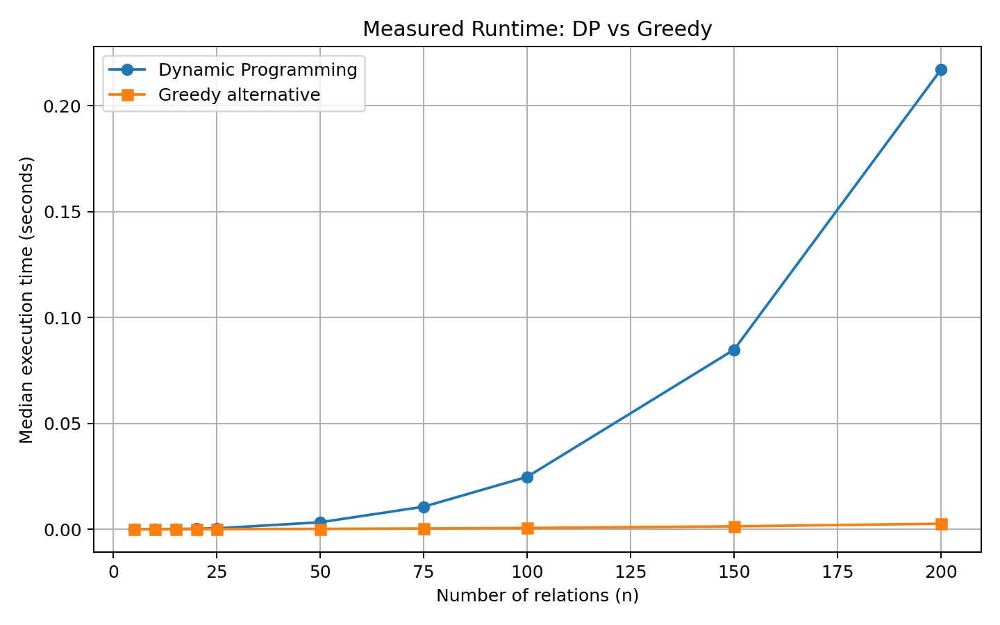

# Batch 3 — Database Systems: Ordering Joins in a Query Optimiser

## Team

| Roll No. | Name | GitHub username | Part presented | Contribution (code, report sections) |
|---|---|---|---|---|
| 24i360 | Srikesav M | srikesav09 | Problem modelling and data structures | Problem modelling, Q1, data structure analysis, report integration |
| 24i307 | Asraf M | asrafit | Design technique identification | Technique selection, rejection of other four techniques, Q3, alternative implementation |
| 24i330 | Mazin J | 24i330 | Algorithm and correctness | Main algorithm, pseudocode, correctness proof, main implementation |
| 24i363 | Stalin K | stalinkaruna77-eng | Trace and complexity analysis | Q2, complete trace, complexity analysis, worst-case input |
| 24i368 | Tarun Kumar KPS | Username pending | Extended scenario and empirical analysis | Q4, Q5, changed requirement, benchmarking and timing results |

## Presentation

- Video link: Pending
- Duration: Pending (maximum 12:00)
- Slides: [slides.pdf](slides.pdf)

---

## 1. Problem Modelling

- **Input:**
  - A sequence of five relations: R1, R2, R3, R4 and R5.
  - Dimension array: `p = [40, 20, 30, 10, 30, 15]`.
  - Each relation Ri has dimensions `(p[i-1], p[i])`.

- **Output:**
  - The optimal parenthesisation (join order) of the five relations.
  - The minimum total join cost.

- **Objective:**
  - Minimise the total computational cost of joining all five relations.
  - The cost of joining two intermediate subchains `Ri...Rk` and `R(k+1)...Rj` is:
    `p[i-1] * p[k] * p[j]`.

- **Constraints:**
  - All five relations must be joined.
  - The original order of relations must be preserved.
  - Only adjacent subchains can be combined.
  - Join operations are associative, so different parenthesisations produce the same logical result.
  - The total cost is the sum of the costs of all intermediate joins.

- **Problem class (decision / optimisation / enumeration):**
  - **Optimisation problem**, because the objective is to find the join order that produces the minimum total cost among all possible valid parenthesisations.

- **Classical problem it maps to:**
  - **Matrix Chain Multiplication (MCM)**.
  - Similar to MCM, the problem involves finding the optimal parenthesisation of a sequence while minimising the total multiplication/join cost.
  - It can be solved using Dynamic Programming by storing the minimum cost of every possible continuous subchain.

## 2. Data Structure Analysis

| Data structure | Key operation(s) and cost | Space | Behaviour at the scale in the scenario |
|---|---|---|---|
| Chosen: Two-Dimensional Array | Access and update DP entries: O(1). Used to store and retrieve minimum costs and optimal split positions. | O(n²) | Efficiently stores all continuous subchain costs. Suitable for the given 5-table problem and moderate-sized join chains. |
| Alternative 1: Hash Map | Search, insertion and update: Average O(1), using subchain indices as keys. | O(n²) for all possible subchains | Supports memoisation, but introduces hashing overhead and is less convenient for displaying a complete DP table. |
| Alternative 2: Adjacency List | Traverse neighbouring relations: O(degree of vertex). | O(V + E) | Suitable for representing join relationships in arbitrary join graphs, but unnecessary for the given fixed chain of five relations. |

**Why the chosen structure wins:**

A two-dimensional array is the most suitable data structure because our problem requires storing the minimum join cost for every possible continuous subchain. It provides constant-time access and updates, supports bottom-up Dynamic Programming, and allows easy reconstruction of the optimal join order using a separate split table. It is simpler and more appropriate for the given chain-based problem than a hash map or adjacency list.

## 3. Design technique identification

- Technique chosen:
- Property of the problem that makes it work (with proof):

## 4. Why the other four techniques do not fit

Give concrete evidence for each: a counterexample, a subproblem count, a state-space size, or a missing bound. One-line answers such as "not efficient" earn no marks.

| Technique | Why it is unsuitable here (evidence) |
|---|---|
| | |
| | |
| | |
| | |

## 5. Algorithm

Pseudocode, with the state definition / recurrence / selection rule / pruning or bounding rule as applicable.

```text

```

## 6. Proof of correctness

Exchange argument, induction, loop invariant, or proof that pruning never discards an optimal solution.

## 7. Trace on the given instance

Show every intermediate table, tree level, merge step or bound. State the final answer.

## 8. Complexity analysis

- Recurrence or counting argument:
- Time (best / worst / typical):
- Space:

## 9. Worst-case input

The input you constructed, and how your algorithm behaves on it.

## 10. Implementation and empirical analysis

- Language and how to run: See [code/RUN.md](code/RUN.md)
- Input sizes used (at least five):
- Plot: 
- Does the measured growth match Section 8? Explain any deviation.
- Comparison with the rejected alternative:

## 11. Changed requirement

Answer the last question of your scenario: how the solution changes, whether the technique still holds, and the new complexity.

## 12. Remaining Scenario Questions

### Q1. Count the possible join orders for 5 tables and 15 tables. Why is trying them all impractical?

The number of possible ways to fully parenthesise a chain of n relations is given by the Catalan number C(n-1).

**Catalan Number Formula:**

C(m) = (1 / (m + 1)) × (2m)! / (m! × m!)

**For 5 tables:**

- Number of relations = 5
- Possible join orders = C(5 - 1) = C(4)
- C(4) = 14

Therefore, there are **14 possible join orders** for 5 tables.

**For 15 tables:**

- Number of relations = 15
- Possible join orders = C(15 - 1) = C(14)
- C(14) = 2,674,440

Therefore, there are **2,674,440 possible join orders** for 15 tables.

**Comparison:**

| Number of Tables | Possible Join Orders |
|---|---:|
| 5 | 14 |
| 10 | 4,862 |
| 12 | 58,786 |
| 15 | 2,674,440 |

**Why is enumeration impractical?**

- The number of possible join orders grows rapidly according to Catalan numbers.
- Every possible parenthesisation must be generated and evaluated.
- The cost of every join order must be calculated and compared.
- As the number of tables increases, the computational effort becomes very high.
- For 15 tables alone, more than 2.6 million possible join orders must be considered.

**Conclusion:**

Enumerating all possible join orders becomes computationally expensive as the number of tables increases. Dynamic Programming avoids repeatedly solving the same subproblems and finds the optimal join order in O(n³) time and O(n²) space for a chain of n relations.

## 13. Real-world reference

One real system, library or published paper that uses this approach, and how it differs from your version. Include a link.

---

**Note:** Individual contributions are documented through the team contribution table, GitHub commit history and recorded presentation.