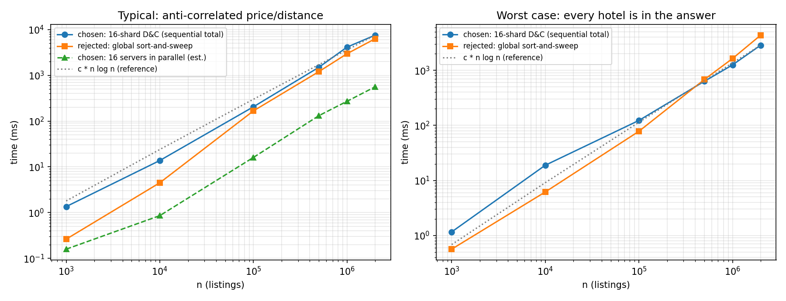

# Batch 4 — Travel: the "best value" hotel strip

Technique chosen: **Divide and Conquer** (price-range shards, merged with one number per shard).
Folder contents: `README.md` (this report), `slides.pdf`, `code/`, `results/`. Run instructions: [`code/RUN.md`](code/RUN.md).

Scenario in one line: up to 2×10⁶ listings, each (price ₹, distance km); show every hotel that no other hotel beats on both; the strip is re-ranked every 5 minutes; listings sit on 16 servers by price range.

---

## 1. Problem modelling

**Input:** a multiset of n ≤ 2×10⁶ listings H = {(pᵢ, dᵢ)}, pᵢ = price in ₹, dᵢ = distance to the venue in km. Listings change price every 5 minutes.

**Output:** S ⊆ H, the set of hotels not dominated by any other hotel, listed by increasing price.

**Dominance:** h dominates g ⇔ p_h ≤ p_g ∧ d_h ≤ d_g ∧ (p_h, d_h) ≠ (p_g, d_g). (Two listings with identical price *and* distance are equivalent; one representative is kept.)

**Objective:** there is no single scalar to optimise. We want *all* minimal elements of the partial order "dominates" on (price, distance), i.e. the Pareto front, with both attributes minimised.

**Constraints:** n up to 2×10⁶; recompute within the 5-minute refresh window; data is range-sharded by price over 16 servers; a third attribute (rating) may be added later.

**Problem class:** enumeration (report every Pareto-optimal element; the output size h is not known in advance and ranges from 1 to n).

**Classical problem it maps to:** 2-D maxima / minima of a vector set, also called the *skyline* or *Pareto front* problem (Kung–Luccio–Preparata 1975).

### Q1 — Claim: the answer set sorted by price has strictly decreasing distance

*Proof.* Let a ≠ b be in S with p_a ≤ p_b. Suppose d_a ≤ d_b. Then p_a ≤ p_b, d_a ≤ d_b and (p_a, d_a) ≠ (p_b, d_b), so a dominates b, contradicting b ∈ S. Hence d_a > d_b whenever p_a ≤ p_b. In particular no two answer hotels share a price (otherwise the cheaper-or-equal one would need both d_a > d_b and d_b > d_a). So the prices in S are distinct, and for any two hotels in S the one with the lower price has the strictly larger distance. Sorted by price, distance is therefore strictly decreasing. ∎
*Corollary:* h ≤ number of distinct prices and h ≤ number of distinct distances.

---

## 2. Data structure analysis

| Data structure | Key operation(s) and cost | Space | Behaviour at the scale in the scenario |
|---|---|---|---|
| **Chosen:** per-shard balanced BST (treap / B-tree) keyed by (price, distance), each node storing the **minimum distance in its subtree**; one tree per server | price change = delete + insert, **O(log m)** (m ≈ n/16 = 125 000 → ~17 levels). Skyline read-out: repeatedly "descend to the leftmost node whose distance < current minimum": **O(h log m)** for answer size h | O(m) per server (≈ 50 B/node → ≈ 6 MB per server, ≈ 100 MB in total) | Measured answer size on 2×10⁶ anti-correlated listings: h ≈ 17–23. A refresh that touches u listings costs O(u log m + h log m) instead of touching all 2×10⁶ |
| Alternative 1: sorted array per shard + cached local skyline | one price change = O(m) shift; full rebuild after a refresh: re-sort O(m log m) (O(m) if nearly sorted), then one sweep | O(m), ≈ 16 B/listing → ≈ 32 MB total | Rebuild of all 16 shards in parallel ≈ 0.56 s (estimate, below). Fine for a 5-minute window, but every small update costs a full pass |
| Alternative 2: binary heap or hash table | hash: O(1) update but **no order** → skyline needs a full sort O(n log n) or O(n²) pairwise tests. Heap: O(1) cheapest hotel, but the front needs all n pops, O(n log n), destroying the heap | O(n) | A heap can only answer "cheapest" and a hash only "this listing"; neither answers "next hotel to the right that is closer than the last one" |

**Why the chosen structure wins:** the answer is tiny (h ≈ 20 vs n = 2×10⁶), so the cost of a refresh should be proportional to the number of changes and the answer size, not to n. The subtree-minimum augmentation lets the tree jump straight to the next skyline point (it is exactly the sweep's "next hotel with distance below the running minimum"), so each answer hotel costs O(log m) rather than a scan of everything between it and its predecessor.

*Honest scope note:* `code/` implements and times the **batch/rebuild path** (sorted arrays per shard, the structure of Alternative 1) because that is what the cold-start and the worst-case comparison need. The augmented tree is the recommended structure for incremental refresh and is analysed, not benchmarked. If most prices change in every cycle (u ≈ n) a rebuild costs the same O(m log m) and the sorted-array path is just as good.

---

## 3. Design technique identification

**Technique chosen:** **Divide and Conquer** — split the listings by price range, solve every range independently, combine with one number per range.

**Property of the problem that makes it work (with proof): independent subproblems with an O(1) combine.**

*Lemma (decomposition).* Let P be split into price ranges P₁, …, P_k such that every price in Pᵢ is ≤ every price in Pⱼ for i < j (ties at a boundary are resolved by splitting the (price, distance)-sorted order, see §6). Let mⱼ = min distance over the local skyline of Pⱼ. Then

 Sky(P) = ⋃ⱼ { g ∈ Sky(Pⱼ) : d_g < min(m₁, …, mⱼ₋₁) }.

*Proof.*
(⊆) Let g ∈ Sky(P), g ∈ Pⱼ. Nothing in Pⱼ dominates g, so g ∈ Sky(Pⱼ). If some lower range i < j contained h with d_h ≤ d_g, then p_h ≤ p_g and (p_h, d_h) ≠ (p_g, d_g) (a lower range with equal price is excluded by the tie rule), so h would dominate g. Hence every hotel in lower ranges is strictly farther than g, in particular d_g < mᵢ for all i < j (the minimum-distance hotel of Pᵢ is itself non-dominated, so mᵢ equals the minimum distance of Pᵢ).
(⊇) Let g ∈ Sky(Pⱼ) with d_g < mᵢ for all i < j. A hotel in a lower range has distance ≥ mᵢ > d_g, so it cannot dominate g. A hotel in a higher range has price ≥ p_g and, by the tie rule, cannot dominate g. A hotel in Pⱼ cannot dominate g because g ∈ Sky(Pⱼ). So g ∈ Sky(P). ∎

So the k subproblems share nothing except the single number "smallest distance seen in cheaper ranges". That is exactly the property that lets 16 servers work with no communication until the final combine.

---

## 4. Why the other four techniques do not fit

| Technique | Why it is unsuitable here (evidence) |
|---|---|
| **Greedy** | *Two readings, stated honestly.* (a) **Scalarised greedy** ("rank by w·price + (1−w)·distance and take the best"): on the instance the answer is H6, H4, H2, H5, H7, H3, H9, but **H5 (3900, 1.8) lies above the chord H2–H7** (at price 3900 the chord has distance 2.5 − 1.6·(800/1500) = 1.647 < 1.8), so no weighting w ≥ 0 ever ranks H5 first. A fixed-weight greedy can only return the convex-hull hotels and loses H5, a legitimate best-value choice for a user who weights price and distance differently. (b) **Sort-and-sweep** is a greedy that *is* correct for two attributes (I prove it, it equals my merge step, and I implement it as the rejected alternative). I reject it as the *main* technique because it needs one global total order of 2×10⁶ rows on one machine, restarts from scratch after any price change, and its state (one number) is wrong as soon as a third attribute exists: with A = (₹1000, 3 km, rating 4.5) and B = (₹2000, 5 km, rating 4.9) the sweep drops B (distance 5 ≥ 3) although B is not dominated (`rejected_alternative.py` prints this). |
| **Backtracking** | Include/exclude decision tree has 2ⁿ leaves (2¹⁰ = 1 024 for the instance, 2^(2 000 000) at scale). Even with the best pruning rule "skip a hotel if a chosen one dominates it", every hotel must be compared with the others: n(n−1)/2 ≈ 2×10¹² pair tests at n = 2×10⁶ (45 for the instance). At 10⁹ tests/s that is ≈ 2 000 s ≈ 33 min on one core, far beyond the 5-minute window, versus < 8 s measured for the chosen method. |
| **Dynamic programming** | DP pays off only through reused subproblems. The natural recurrence Sky(i) = Sky(i−1) ⊕ [hotel i if d_i < last distance] has n subproblems, each used exactly once. The D&C recursion tree has 2n − 1 nodes, all different intervals: for the instance 19 nodes, 19 distinct, **0 repeats**, so a memo table is never hit. A DP over (i, current-minimum) would have up to n² states, strictly worse than n. |
| **Branch and bound** | B&B needs an objective to bound. This is an enumeration problem; the answer can be all n hotels (worst-case input of §9), so no bound can prune anything: on that input B&B would still visit n of n nodes. The only bound-like test available, "distance ≥ best so far", *is* the sweep step. |

---

## 5. Algorithm

**State definition.** `Sky(lo, hi)` = non-dominated hotels among `S[lo:hi]`, where S is the input sorted by (price, distance) with identical listings collapsed. It is returned as a list with strictly increasing price and strictly decreasing distance (§1).

**Recurrence.** `Sky(i, i+1) = [S[i]]`; for `mid = (lo+hi)//2`:

 `Sky(lo, hi) = Sky(lo, mid) ++ { g ∈ Sky(mid, hi) : g.dist < last(Sky(lo, mid)).dist }`

Because `Sky(mid, hi)` has strictly decreasing distance, the surviving hotels form a **suffix** of it; the cut position is found by binary search.

```text
DC(S, lo, hi):                                  # S sorted by (price, dist), no duplicates
    if hi - lo == 1: return [S[lo]]
    mid  <- (lo + hi) // 2
    SL   <- DC(S, lo, mid)                      # independent subproblem
    SR   <- DC(S, mid, hi)                      # independent subproblem
    m    <- SL.last.dist                        # smallest distance on the cheaper side
    cut  <- first index in SR with SR[cut].dist < m      # binary search (dist decreasing)
    return SL ++ SR[cut:]

SHARDED(listings on servers 1..16, ranges ordered by price):
    in parallel, on server j:  L_j <- DC(sort_and_dedupe(shard_j))         # local skyline
    m <- +infinity;  result <- []
    for j = 1 .. 16 (coordinator, price order):
        cut <- first index in L_j with dist < m
        result <- result ++ L_j[cut:]
        m <- min(m, L_j.last.dist)
    return result
```

Selection/pruning rule: "a hotel survives a merge iff its distance is strictly below the smallest distance on the cheaper side". Nothing else is ever discarded.

---

## 6. Proof of correctness

**Claim.** `DC(S, lo, hi)` returns exactly the non-dominated hotels of `S[lo:hi]`, by increasing price.

**Induction on hi − lo.** *Base:* one hotel is non-dominated within itself. *Step:* assume `SL`, `SR` are correct. Every element of `S[lo:mid]` precedes every element of `S[mid:hi]` in (price, distance) order, so the Lemma of §3 applies to the two ranges (ties handled below), giving `Sky = SL ∪ {g ∈ SR : d_g < m_L}` with m_L the minimum distance in `SL`. Since `SL` has strictly decreasing distance (§1), that minimum is its last element, which is what the code reads. Because `SR` also has strictly decreasing distance, the elements with d < m_L are a suffix, so the binary-search cut keeps exactly them. Order by price is preserved by concatenation. ∎

**Ties at the split.** If l ∈ left and r ∈ right have equal price, sorted order gives d_l ≤ d_r, and l ≠ r (duplicates were removed), so l dominates r; the rule drops r because d_r ≥ d_l ≥ m_L. The converse, r dominating l, would need d_r ≤ d_l, i.e. equality, i.e. a duplicate. So the rule is exact at boundaries.

**Sharded version.** Price-range shards have disjoint price ranges, so the Lemma applies directly; each local skyline is correct by the induction above and the combine loop is the Lemma's formula (m is the running prefix minimum). Empirically, 3000 random cases with many ties and duplicates (prices and distances drawn from 1..12) agree with the O(n²) definition-based oracle for k = 1, 2, 3, 16 shards (`python3 main_solution.py --selftest`), and the benchmark asserts chosen = rejected output at every size.

---

## 7. Trace on the given instance

Sorted by (price, distance): H6(2500, 5.5), H4(2800, 4.0), H10(3000, 4.2), H2(3100, 2.5), H8(3300, 2.8), H5(3900, 1.8), H1(4200, 1.9), H7(4600, 0.9), H3(5600, 0.4), H9(6100, 0.3).

Recursion tree, split at `(lo+hi)//2` (actual output of `python3 main_solution.py --instance`, indentation = depth, children are printed before their parent):

```text
    merge SL=[H6] | SR=[H4]        m=5.5  dropped=[]     -> [H6, H4]
      merge SL=[H2] | SR=[H8]      m=2.5  dropped=[H8]   -> [H2]
    merge SL=[H10] | SR=[H2]       m=4.2  dropped=[]     -> [H10, H2]
  merge SL=[H6, H4] | SR=[H10, H2] m=4.0  dropped=[H10]  -> [H6, H4, H2]
    merge SL=[H5] | SR=[H1]        m=1.8  dropped=[H1]   -> [H5]
      merge SL=[H3] | SR=[H9]      m=0.4  dropped=[]     -> [H3, H9]
    merge SL=[H7] | SR=[H3, H9]    m=0.9  dropped=[]     -> [H7, H3, H9]
  merge SL=[H5] | SR=[H7, H3, H9]  m=1.8  dropped=[]     -> [H5, H7, H3, H9]
merge SL=[H6, H4, H2] | SR=[H5, H7, H3, H9]  m=2.5  dropped=[]  -> [H6, H4, H2, H5, H7, H3, H9]
```

Reading two steps by hand: in the second line H8 (2.8 km) meets m = 2.5 from H2 (₹3100 ≤ ₹3300, 2.5 ≤ 2.8) and is dropped; in the fourth line H10 (4.2 km) meets m = 4.0 from H4 and is dropped. In the last line m = 2.5 and every right-side hotel (1.8, 0.9, 0.4, 0.3) is below it, so all survive.

**Final answer (7 hotels):** H6, H4, H2, H5, H7, H3, H9 — distances 5.5 > 4.0 > 2.5 > 1.8 > 0.9 > 0.4 > 0.3, strictly decreasing as §1 predicts. **Dominated:** H10 (by H4), H8 (by H2), H1 (by H5).

**Same instance on 3 price shards** (< ₹3200 | ₹3200–4500 | ≥ ₹4500; stands in for the 16 servers):

| shard | local skyline | m in | kept | dropped |
|---|---|---|---|---|
| 1: H6, H4, H10, H2 | H6, H4, H2 | ∞ | H6, H4, H2 | — |
| 2: H8, H5, H1 | H8, H5 | 2.5 | H5 | H8 |
| 3: H7, H3, H9 | H7, H3, H9 | 1.8 | H7, H3, H9 | — |

Same 7 hotels.

---

## 8. Complexity analysis

**Counting argument / recurrence.** Sorting: O(n log n) (done locally per shard). D&C: T(n) = 2T(n/2) + O(c(n)), where c is the merge cost: a binary search O(log h) plus copying the output list, ≤ n. In the worst case T(n) = 2T(n/2) + Θ(n); by the Master theorem (a = 2, b = 2, f(n) = Θ(n) = Θ(n^(log_b a)), case 2) T(n) = Θ(n log n). Recursion tree: log₂ n levels × ≤ n/2 copied elements per level.

| | Time |
|---|---|
| **Best** | Θ(n) after sorting, when the answer is tiny and merges copy nothing; Θ(n) overall if the input is already price-ordered |
| **Worst** | Θ(n log n): unsorted input, or every hotel in the answer (§9) so every merge copies everything |
| **Typical** | Θ(n log n), dominated by the sort. For independent attributes the expected answer size is O(log n) (Bentley, Kung, Schkolnick, Thompson 1978), measured h = 17–23 for n up to 2×10⁶ on anti-correlated data, so merges are negligible |
| **Sharded, k = 16 servers** | local Θ((n/k) log(n/k)) in parallel + combine Θ(k log h + h) → ≈ 1/k of the sequential time |

**Space:** Θ(n) for the input plus Θ(n) for the copies produced by merges (Θ(h) beyond the input in the typical case); recursion depth Θ(log n). Per server Θ(n/k).

---

## 9. Worst-case input

`generate_inputs.py --mode worst --n N`: price_i = i, distance_i = (N − i)/1000, i = 1..N. Price rises exactly as distance falls, so **no hotel dominates another and the answer is all N hotels**. Every merge has `cut = 0`: the left side's minimum distance is larger than every right-side distance, nothing is dropped, and each level copies N/2 elements → N·log₂N/2 element copies in total, the Θ(n log n) worst case of §8. Measured: for N = 2 000 000 the output has 2 000 000 hotels, and both methods return it (benchmark asserts equality). This input arrives sorted by price (Timsort then sorts in O(n)), so it isolates the merge cost; an unsorted anti-chain adds the same Θ(n log n) sort to both methods.

---

## 10. Implementation and empirical analysis

**Language and how to run:** Python 3.12; see [`code/RUN.md`](code/RUN.md).
**Input sizes used:** 1 000, 10 000, 100 000, 500 000, 1 000 000, 2 000 000 (six sizes; the last is the scenario maximum).
**Plot:** `results/timing_plot.png` (log–log; left: anti-correlated price/distance, a realistic hotel market; right: the §9 worst case).



Typical input (anti-correlated), `results/timing.csv`; n ≤ 5·10⁵ best of 3, larger sizes a single run on a one-core machine:

| n | answer size | chosen, sequential total (ms) | rejected sort-and-sweep (ms) | chosen / rejected | chosen, 16 servers in parallel, estimate (ms) |
|---|---|---|---|---|---|
| 1 000 | 17 | 1.35 | 0.26 | 5.2 | 0.16 |
| 10 000 | 18 | 13.8 | 4.5 | 3.1 | 0.86 |
| 100 000 | 21 | 205 | 167 | 1.23 | 16.1 |
| 500 000 | 23 | 1 499 | 1 205 | 1.24 | 131 |
| 1 000 000 | 21 | 4 136 | 2 968 | 1.39 | 271 |
| 2 000 000 | 17 | 7 560 | 6 309 | 1.20 | 563 |

Worst case (`results/timing_worst_case.csv`), chosen vs rejected in ms: n = 10⁵: 123 vs 78; 5·10⁵: 632 vs 681; 10⁶: 1 256 vs 1 640; 2·10⁶: 2 867 vs 4 361.

**Does the measured growth match Section 8?** Largely yes. Between n = 10⁵ and 2×10⁶ (×20) the chosen method's time grows ×36.8 on typical data, a log–log slope of 1.20; n log n predicts 1.08. On the worst case the slope is 1.05. Normalised time t/(n log₂n) stays in 0.10–0.21 µs for the typical input (flat to within a factor of two across three orders of magnitude), so the growth is Θ(n log n)-shaped, not quadratic. Deviations: (i) at small n fixed costs (building 16 shard lists, function calls) dominate, hence the 3–5× gap at n ≤ 10⁴; (ii) above 5·10⁵ the sorts exceed the CPU cache and the sizes ≥ 10⁶ are single runs, so the slope drifts up to 1.2 (the rejected method's slope is 1.21 on typical and 1.34 on worst-case data for the same reason, plus GC pauses on 2×10⁶ tuples); (iii) in the worst case the D&C is *faster* than the sweep at large n only because its merges are list concatenations executed in C while the sweep loop runs in the interpreter — a constant-factor effect of Python, not a better asymptotic bound.

**Comparison with the rejected alternative.** On one core the chosen method is 1.2–1.4× *slower* than sort-and-sweep on typical data (the extra cost is the partition pass and 16 small solves); I am not claiming a sequential win. Its advantage is structural: with 16 servers each doing only its own shard, the estimated wall-clock at n = 2×10⁶ is 0.56 s versus 6.3 s for the global sweep, an 11× speed-up (ideal 16×; the gap is the combine step and the slowest shard). The estimate is `max(shard times) + combine`, measured on one core, and excludes network and straggler effects beyond the slowest shard.

---

## 11. Changed requirement — a third attribute, guest rating (higher is better)

**Does the method still work? Yes, divide and conquer still works; the one-number merge does not.** Dominance now needs price ≤, distance ≤, rating ≥. The decomposition still holds (hotels in higher price ranges still cannot dominate lower ones, ties again resolved by sorted order), but the information a lower range passes upward is no longer one number: a right-side hotel r is dominated iff some left-side hotel has distance ≤ d_r **and** rating ≥ r_r, i.e. the left side must pass a *staircase* in (distance, rating).

**Implemented merge (`dc_skyline_3d` in `main_solution.py`).** Keep every skyline list sorted by distance. To merge SL and SR, scan both lists in increasing distance (left first on ties), keep `best` = highest rating among left hotels seen so far, output every left hotel, and output a right hotel iff its rating > `best`. That is O(|SL| + |SR|) per merge, and the output is again sorted by distance, ready for the next level. Hence

 T(n) = 2T(n/2) + O(n) ⇒ **O(n log n)** including the initial sort by price (the classical 3-D maxima bound of Kung–Luccio–Preparata). Space O(n). Verified against an O(n²) oracle on 3000 random 3-D cases including ties (`--selftest`). I did not benchmark the 3-D version.

**Across the 16 shards** the coordinator can no longer carry one number; it carries the staircase of the cheaper shards' skylines (size ≤ their combined answer size, expected O(log² n) for independent attributes), so the combine costs O(h log h) rather than O(h + k). Still tiny next to n.

**What breaks in sort-and-sweep:**
1. *The invariant is false.* "Keep a hotel iff its distance is below the running minimum" discards hotels that are far but better rated. Example: A = (₹1000, 3 km, 4.5), B = (₹2000, 5 km, 4.9): the sweep drops B, but B is non-dominated (`python3 rejected_alternative.py` prints both answers).
2. *It needs a 2-D state.* The sweep must maintain the staircase of (distance, rating) of everything seen, in a balanced BST, so each hotel costs O(log h) instead of O(1): total O(n log n) after the sort instead of O(n).
3. *The answer is no longer a chain.* §1's "distance strictly decreasing with price" no longer holds (A, B above have price, distance and rating all increasing), so the binary-search "suffix cut" and the one-number prefix-min merge across shards are gone, and the answer can be larger (Θ(n) in the worst case, as before, and typically larger than in 2-D).

---

## 12. Answers to the remaining scenario questions

(Q1 → §1, Q2 → §7, Q4 → §2, Q5 → §11.)

### Q3 — 16 servers sharded by price range: how the method uses this, and comparison with one global sort-and-sweep

**How the method uses the sharding.** A price-range shard is precisely one "left/right" piece of the divide step, taken 16-way instead of 2-way (§3 Lemma). Each server sorts and solves its own ≈ n/16 listings with no communication and returns only its local skyline (≈ 20 hotels) plus its minimum distance. The coordinator then does the 16-step prefix-minimum combine of §5: O(k log h + h). Data moved: O(k·h) ≈ a few hundred rows, instead of O(n) = 2×10⁶ rows. This only works because the shards are *ranges* of the attribute the order is built on; with hash sharding every server would hold hotels from every price band and the combine would need a staircase merge of all lists.

**Comparison with a single sort-and-sweep over all listings.**

| | Single global sort-and-sweep | Sharded D&C (chosen) |
|---|---|---|
| Needs | all 2×10⁶ rows on one machine in one total order | only local data per server |
| Time | Θ(n log n) sequential: 6.3 s measured at n = 2×10⁶ | Θ((n/k) log(n/k)) in parallel + O(k log h + h): ≈ 0.56 s estimated (11×) |
| Network | ship or shuffle 2×10⁶ rows | ship ≈ 16 × 20 rows |
| After a price change | re-sort and re-sweep everything | recompute only the shards that changed (or update their trees), then re-run the 16-step combine |
| Failure | restart the whole job | redo one shard |
| Single core | **faster** by 1.2–1.4× (measured) | extra partition cost |
| Third attribute | breaks (§11) | still works, O(n log n) |

Caveats: the sharded method is only as fast as its slowest shard, so range boundaries should be chosen from price quantiles (not equal-width ranges) to keep the shards balanced; and for exactly two attributes the sweep *over the shard summaries* is the same computation as the coordinator's combine — the sweep is the degenerate form of the same idea, not a wrong one.

---

## 13. Real-world reference

**H. T. Kung, F. Luccio, F. P. Preparata, "On Finding the Maxima of a Set of Vectors", *Journal of the ACM* 22(4):469–476, 1975.** <https://doi.org/10.1145/321906.321910> — gives the divide-and-conquer algorithm for maximal (non-dominated) vectors, O(n log n) for 2 and 3 dimensions and O(n logᵈ⁻² n) for higher d. Database systems adopted the same problem as the *skyline operator* (Börzsönyi, Kossmann, Stocker, ICDE 2001, pp. 421–430), and parallel/partitioned variants split the data across processors, compute local skylines and merge, e.g. "Efficient parallel skyline processing using hyperplane projections" (ACM SIGMOD 2011, <https://doi.org/10.1145/1989323.1989333>). Hotel search (price vs distance to the beach) is the standard motivating example in the skyline literature.

**How mine differs:** (1) I treat exactly two attributes, which allows the one-number merge and a binary-search suffix cut; KLP and the skyline systems handle d dimensions with a more complex merge. (2) I partition by **one attribute's range**, which matches the scenario's existing price-range shards; the cited parallel work studies partitioning schemes that keep local skylines small for arbitrary data distributions. (3) The sharded combine and the augmented-BST refresh are tailored to this scenario's 5-minute re-ranking; KLP is a one-shot, single-machine, in-memory algorithm. (4) I added a 3-D merge by distance-sorted lists following KLP's idea but verified only against a brute-force oracle, not benchmarked.

---

## 14. Team Contributions and Presentation

### 14.1 Team Contributions

| Member | Roll Number | Contribution |
|---|---|---|
| Member 1 | 24I365 | Input generation and test datasets (`generate_inputs.py`). |
| Member 2 | 24I319 | Main Divide and Conquer algorithm design and implementation (`main_solution.py`). |
| Member 3 | 25I463 | Alternative algorithm implementation and comparison (`rejected_alternative.py`). |
| Member 4 | 24I320 | Testing, benchmarking, and performance analysis (`timing.csv`, `timing_plot.png`). |
| Member 5 | 24I352 | README documentation, execution instructions (`RUN.md`), slides, and presentation coordination. |

### 14.2 Presentation

**Presentation Slides (PDF):** [View Slides](https://drive.google.com/file/d/18cHyUZ3MDTD6pssMBnWClsrsfHp8Fcj5/view?usp=sharing)

**Demo Video:** [Watch Demo](https://drive.google.com/file/d/1BXYzt6xk-MJUs7nPgKmPtfe9tOTnEzJW/view?usp=sharing)
