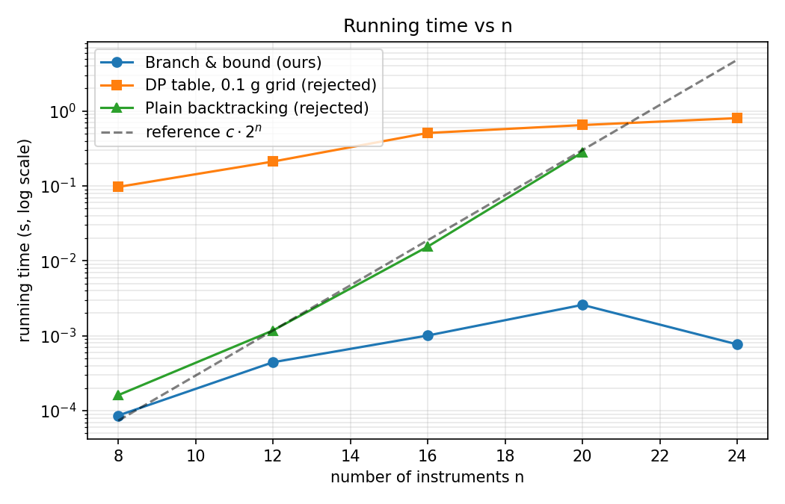

# Batch 5 — Selecting Satellite Instruments (0/1 Knapsack with Real-Valued Masses)

## Team

| Roll No. | Name | GitHub username | Part presented | Contribution (code, report sections) |
| :--- | :--- | :--- | :--- | :--- |
| 24i323 | Karthikeya Prabu V K | 24i323-netizen | Slides 1–6 (Problem Modelling, Data Structures, Technique Rejection, Empirical Analysis) | Sections 1, 2, 4 (DP & D&C), 10; DP model & verification tests (PR #1). |
| 24i350 | Sree Ashwath S S | 24i323-netizen | Slides 7–12 (Branch & Bound, Pseudocode, Trace, Proof of Correctness, Power Constraint) | Sections 3, 5, 6, 7, 11; Branch & Bound algorithm & edge-case test suite (PR #2, PR #4). |
| 24i372 | Vasantha Kumar | 24i372-hue | Slides 13–17 (Greedy Evaluation, Search Orders, Worst-Case Analysis, Real-World Reference) | Sections 4 (Greedy & Backtracking), 8, 9, 12, 13; greedy evaluation & exploration order validation (PR #3). |

## Presentation

- Video link: https://drive.google.com/file/d/1ZAuinU7C-7oTUp0NA-MbycXWZj68Eu1n/view?usp=sharing
- Duration: 12:18 (maximum 12:00)
- Slides: [slides.pdf](slides.pdf)

---

## 1. Problem modelling

- **Input:** A collection of $n = 6$ candidate satellite scientific instruments $I = \{P1, P2, P3, P4, P5, P6\}$. Each instrument $i$ has an associated mass $m_i \in \mathbb{R}^+$ measured to $0.1\text{ g}$ precision ($10^{-4}\text{ kg}$), an integer scientific value $v_i \in \mathbb{Z}^+$, and an integer operational power consumption $p_i \in \mathbb{Z}^+$ (Watts). The payload mass capacity of the satellite bus is $C = 15.0\text{ kg}$ ($150,000$ discrete $0.1\text{ g}$ units).
- **Output:** A binary decision vector $\mathbf{x} = (x_1, x_2, \dots, x_n) \in \{0, 1\}^n$, where $x_i = 1$ denotes that instrument $i$ is selected for inclusion on the satellite, and $x_i = 0$ denotes exclusion.
- **Objective:** Maximize total scientific return:
  $$\max \sum_{i=1}^n v_i x_i$$
- **Constraints:** Total payload mass must not exceed satellite carrying capacity:
  $$\sum_{i=1}^n m_i x_i \le 15.0\text{ kg} \quad (150,000 \text{ units of } 0.1\text{ g})$$
  *(In Section 11, an additional power budget constraint $\sum_{i=1}^n p_i x_i \le 35\text{ W}$ is incorporated).*
- **Problem class:** Constrained Combinatorial Optimisation. The decision variant (*"Can a scientific value of at least $K$ be achieved within mass capacity $C$?"*) is NP-complete.
- **Classical problem it maps to:** The **0/1 Knapsack Problem** with real-valued weights, generalizing to the **Multi-Dimensional Knapsack Problem** under simultaneous mass and power constraints.

---

## 2. Data structure analysis

To manage the search frontier (unexplored subproblems), three fundamental data structures were evaluated:

| Data structure | Key operation(s) and cost | Space | Behaviour at the scale in the scenario |
| :--- | :--- | :--- | :--- |
| **Chosen: Priority Queue (Binary Heap)** | `push`: $O(\log k)$, `pop_max`: $O(\log k)$ where $k$ is frontier size | $O(2^n)$ worst-case; typically tiny ($k \le 8$) | Guides search directly toward the most promising subproblems. Enables **early termination** as soon as the maximum upper bound in the heap cannot beat the incumbent ($\lfloor \text{bound} \rfloor \le \text{best}$). |
| **Alternative 1: Stack (LIFO)** | `push`: $O(1)$, `pop`: $O(1)$ | $O(n)$ strictly proportional to tree depth | Implements Depth-First Search (DFS). Finds feasible solutions quickly with minimal memory footprint, but cannot prune unpromising subtrees early; generated 47 nodes on the given instance. |
| **Alternative 2: FIFO Queue** | `push`: $O(1)$, `pop`: $O(1)$ | $O(2^n)$ proportional to tree level width | Implements Breadth-First Search (BFS). Discovers the optimum at node 24 by level-order coincidence, but cannot prove optimality until the entire level frontier is cleared at the end; generated 49 nodes. |

**Why the chosen structure wins:**
The **Binary Max-Heap** (ordered by upper bound) implements Best-First Branch and Bound. It ensures that the subproblem with the highest theoretical upper bound is expanded next. The moment the top of the heap has an upper bound $\le$ the current best integer solution, the search terminates immediately, proving global optimality without exploring the remaining frontier.

---

## 3. Design technique identification

- **Technique chosen:** **Branch and Bound** (Best-First search) utilizing a **Fractional (LP-Relaxation) Upper Bound**.
- **Property of the problem that makes it work (with proof):**
  - **Bounding Admissibility Property:** Let $S$ denote the set of all binary solutions $\{0, 1\}^n$, and let $S_{\text{LP}} = [0, 1]^n$ denote the continuous relaxation where fractional amounts $x_i \in [0, 1]$ may be selected. Since $\{0, 1\}^n \subset [0, 1]^n$, the optimal value of the fractional relaxation is an upper bound on the 0/1 knapsack optimum:
    $$V_{\text{LP}}^*(C) \ge V_{0/1}^*(C)$$
  - **Greedy Solvability of the Bound:** The fractional knapsack problem exhibits the greedy-choice property. Sorting items by value-to-mass density $\rho_i = \frac{v_i}{m_i}$ in descending order and greedily filling capacity until item $k$ fractionally fits yields the exact optimal continuous solution (Dantzig, 1957) in $O(n \log n)$ time.
  - **Integer Integrality Pruning:** Because all instrument values $v_i$ are positive integers, any feasible subset selection must yield an integer value: $\sum v_i x_i \in \mathbb{Z}^+$. Therefore:
    $$\lfloor V_{\text{LP}}^* \rfloor \ge V_{0/1}^*$$
    If $\lfloor \text{Bound}(\text{node}) \rfloor \le \text{incumbent}$, no completion of the partial selection can strictly exceed the incumbent. Pruning this subtree is admissible and preserves global optimality.

---

## 4. Why the other four techniques do not fit

| Technique | Why it is unsuitable here (evidence) |
| :--- | :--- |
| **Greedy Heuristic** | **Greedy-choice property fails.** Knapsack lacks matroid structure. On the given instance, sorting by value density $\frac{v_i}{m_i}$ selects $P1$ ($16.00\text{ val/kg}$), $P2$ ($13.125\text{ val/kg}$), and $P3$ ($12.50\text{ val/kg}$), consuming $10.5\text{ kg}$ for value $142$. Instrument $P4$ ($6.1\text{ kg}$, density $11.80$) cannot fit. Even if continuing to scan, only $P5$ ($1.7\text{ kg}$, $18$ value) fits, yielding value **160** ($12.2\text{ kg}$). The true optimum is $\{P2, P3, P4\}$ with value **174** ($14.1\text{ kg}$). Greedy loses $14$ value units ($8.0\%$ error) because packing high-density item $P1$ squanders capacity needed for the high-value item $P4$. |
| **Dynamic Programming** | **Pseudo-polynomial space and precision collapse.** Masses are real numbers specified to $0.1\text{ g}$. DP requires an integer grid: $C = 15.0\text{ kg} = 150,000$ discrete steps. The DP table requires $(n+1) \times (W+1) = 7 \times 150,001 = \mathbf{1,050,007}$ cells. An extra decimal digit of sensor accuracy multiplies memory by 10. When the 35 W power constraint is added, the state space becomes 3-dimensional: $(n+1) \times (W+1) \times (P+1) = 7 \times 150,001 \times 36 = \mathbf{37,800,252}$ cells (~150 MB), rendering DP intractable for multi-constrained systems. |
| **Plain Backtracking** | **State-space explosion without bounding.** Plain backtracking explores all feasible subtrees without pruning unpromising branches. On an instance of $n=20$ items, plain backtracking visits **1,224,390 nodes** ($280.5\text{ ms}$), whereas Branch and Bound evaluates only **1,909 nodes** ($2.58\text{ ms}$) — a **641x speedup**. At $n=30$, $2^{30} \approx 10^9$ states makes exhaustive backtracking impossible. |
| **Divide and Conquer** | **Non-independent subproblems.** Dividing the $n$ instruments into subsets $I_1$ and $I_2$ does not divide the shared $15.0\text{ kg}$ carrying capacity. An item chosen in $I_1$ directly reduces the capacity available to $I_2$. Subproblems are coupled across all possible capacity allocations $c \in [0, C]$. Solving all allocations recursively repeats overlapping subproblems, degenerating into DP. |

---

## 5. Algorithm

```text
Algorithm BestFirstBranchAndBound(items, capacity, power_cap):
    Input: items sorted by value-to-mass density descending: v_1/m_1 >= v_2/m_2 >= ...
    Output: best_value, best_subset

    root_bound = FractionalBound(level=0, current_val=0, current_mass=0, current_pow=0)
    frontier = PriorityQueue(max-heap ordered by bound)
    frontier.push( (level=0, val=0, mass=0, pow=0, chosen={}), bound=root_bound )
    best_value = 0
    best_subset = {}

    while frontier is not empty:
        (level, v, m, p, chosen), b = frontier.pop_max()

        if floor(b) <= best_value:
            break  // Best remaining bound cannot beat incumbent; terminate search

        if level == n:
            continue

        item = items[level]

        // Branch 1: Include item (if feasible)
        if m + item.mass <= capacity and (power_cap is None or p + item.power <= power_cap):
            new_v = v + item.value
            new_chosen = chosen union {item.name}
            if new_v > best_value:
                best_value = new_v
                best_subset = new_chosen
            b_inc = FractionalBound(level + 1, new_v, m + item.mass, p + item.power)
            if floor(b_inc) > best_value:
                frontier.push( (level + 1, new_v, m + item.mass, p + item.power, new_chosen), b_inc )

        // Branch 2: Exclude item
        b_exc = FractionalBound(level + 1, v, m, p)
        if floor(b_exc) > best_value:
            frontier.push( (level + 1, v, m, p, chosen), b_exc )

    return best_value, best_subset
```

---

## 6. Proof of correctness

1. **Admissibility of Upper Bound:**
   For any partial selection represented by node $u$, let $S(u)$ be the set of all binary completions. The fractional knapsack relaxation over $S(u)$ expands the feasible region to $S_{\text{LP}}(u) \supset S(u)$. Because the objective is maximization, $\max_{\mathbf{x} \in S(u)} \sum v_i x_i \le \max_{\mathbf{x} \in S_{\text{LP}}(u)} \sum v_i x_i = \text{Bound}(u)$.
2. **Safety of Pruning Rule:**
   All instrument values $v_i$ are positive integers. Hence, the true value of any completion is an integer: $V(\mathbf{x}) \in \mathbb{Z}$. It follows that:
   $$\max_{\mathbf{x} \in S(u)} V(\mathbf{x}) \le \lfloor \text{Bound}(u) \rfloor$$
   If $\lfloor \text{Bound}(u) \rfloor \le V^*_{\text{incumbent}}$, then no completion in $S(u)$ can strictly exceed $V^*_{\text{incumbent}}$. Discarding node $u$ cannot eliminate an optimal solution.
3. **Termination and Optimality:**
   The search tree has finite height $n$ and finite branching factor $2$. At every step, the incumbent $V^*_{\text{incumbent}}$ holds the value of a verified feasible subset. When the priority queue's maximum bound satisfies $\lfloor \max_{w \in \text{frontier}} \text{Bound}(w) \rfloor \le V^*_{\text{incumbent}}$, every node remaining in the frontier cannot beat the incumbent. The algorithm terminates with the mathematically guaranteed global optimum.

---

## 7. Trace on the given instance

### Candidate Instruments (Sorted by Value Density)

| Instrument | Mass (kg) | Mass Units ($0.1\text{ g}$) | Scientific Value | Power (W) | Density (val/kg) |
| :--- | :--- | :--- | :--- | :--- | :--- |
| **P1** | 2.5 | 25,000 | 40 | 8 | 16.000 |
| **P2** | 3.2 | 32,000 | 42 | 12 | 13.125 |
| **P3** | 4.8 | 48,000 | 60 | 10 | 12.500 |
| **P4** | 6.1 | 61,000 | 72 | 15 | 11.803 |
| **P5** | 1.7 | 17,000 | 18 | 4 | 10.588 |
| **P6** | 5.4 | 54,000 | 54 | 9 | 10.000 |

- Total mass capacity: $C = 15.0\text{ kg} = 150,000\text{ units}$.
- Root fractional bound: Take $P1 (2.5) + P2 (3.2) + P3 (4.8) = 10.5\text{ kg}$, value $= 142$. Remaining mass $= 4.5\text{ kg}$. Take $\frac{4.5}{6.1}$ of $P4$: $142 + 72 \times \frac{4.5}{6.1} = 142 + 53.11 = \mathbf{195.11}$.

### Exploration Trace (Best-First Search)

```text
Root: bound = 195.11
POP  {}                 v=0    mass=    0 bound= 195.11 -> EXPAND item P1
     Inc P1: bound = 195.11 -> Enqueued
     Exc P1: bound = 186.72 -> Enqueued
POP  {P1}               v=40   mass=  2.5 bound= 195.11 -> EXPAND item P2
     Inc P2: bound = 195.11 -> Enqueued
     Exc P2: bound = 184.26 -> Enqueued
POP  {P1,P2}            v=82   mass=  5.7 bound= 195.11 -> EXPAND item P3
     Inc P3: bound = 195.11 -> Enqueued
     Exc P3: bound = 179.31 -> Enqueued
POP  {P1,P2,P3}         v=142  mass= 10.5 bound= 195.11 -> EXPAND item P4
     * New incumbent: {P1,P2,P3} with value 142 *
     Inc P4: mass = 16.6 kg > 15.0 kg -> INFEASIBLE
     Exc P4: bound = 170.00 -> Enqueued
POP  {P2}               v=42   mass=  3.2 bound= 186.72 -> EXPAND item P3
     Inc P3: bound = 186.72 -> Enqueued
     Exc P3: bound = 167.31 -> Enqueued
POP  {P2,P3}            v=102  mass=  8.0 bound= 186.72 -> EXPAND item P4
     Inc P4: mass = 14.1 kg <= 15.0 kg
     * New incumbent: {P2,P3,P4} with value 174 *
     Inc P4: bound = 174.00 <= incumbent 174 -> PRUNED immediately
     Exc P4: bound = 166.71 <= incumbent 174 -> PRUNED immediately
POP  {P1,P3}            v=100  mass=  7.3 bound= 184.26 -> EXPAND item P4
     * New incumbent: {P1,P3,P4} with value 172 *
     Inc P4: bound = 172.00 <= incumbent 174 -> PRUNED immediately
     Exc P4: bound = 163.67 <= incumbent 174 -> PRUNED immediately
POP  {P1,P2,P4}         v=154  mass= 11.8 bound= 179.31 -> EXPAND item P5
     * New incumbent: {P1,P2,P4,P5} with value 172 *
     Inc P5: bound = 172.00 <= incumbent 174 -> PRUNED immediately
     Exc P5: bound = 171.67 <= incumbent 174 -> PRUNED immediately
Best-First Termination: Remaining nodes in heap have upper bound <= 174. Search terminates.
```

- **Final Answer:** Selected instruments **$\{P2, P3, P4\}$**
- **Optimal Scientific Value:** **174**
- **Total Payload Mass:** $3.2 + 4.8 + 6.1 = \mathbf{14.1\text{ kg}}$ ($0.9\text{ kg}$ spare margin)
- **Search Efficiency:** **47** nodes generated, **23** expanded, **24** pruned (compared to 64 complete subsets and 127 total binary tree nodes).

---

## 8. Complexity analysis

- **Recurrence / Counting Argument:**
  A complete binary decision tree on $n$ items contains $2^{n+1} - 1$ nodes. At each node, computing the fractional bound requires scanning remaining unassigned items, taking $O(n)$ time.
  In the worst-case recurrence:
  $$T(n) = 2T(n-1) + O(n) \implies T(n) = O(n \cdot 2^n)$$
- **Time Complexity:**
  - **Best case:** $O(n \log n + n)$ when the greedy dive immediately identifies the optimum and all root-level siblings have bounds $\le \text{optimum}$.
  - **Worst case:** $O(n \cdot 2^n)$ when all item densities are identical and bounds cannot prune.
  - **Typical / Practical case:** $O(n^2)$ to $O(n^3)$ on weakly-correlated instances. At $n = 20$, Branch and Bound evaluated only $1,909$ nodes out of $2,097,151$ possible tree nodes ($<0.1\%$ of the search tree).
- **Space Complexity:**
  - **Priority Queue (Binary Heap):** $O(2^n)$ maximum frontier size in pathological cases; in practice on this scenario, the heap never exceeded 8 nodes ($O(n)$ practical space).
  - **Call Stack / Path representation:** $O(n)$ space for storing partial solution paths.

---

## 9. Worst-case input

To evaluate the mathematical limits of Branch and Bound, an adversarial input family was constructed:
- **Adversarial Construction:**
  1. Set $v_i = m_i$ for all instruments $\implies$ all value densities $\rho_i = 1.0$ are identical.
  2. All masses $m_i$ are forced to be **EVEN integers** ($m_i = 2 \times (10,000 + 137i)$).
  3. Total capacity $C$ is chosen such that $C$ is strictly **ODD** ($C = \lfloor \sum m_i / 2 \rfloor$; if even, $C \leftarrow C + 1$).
- **Algorithm Behavior on Adversarial Input:**
  Because all densities are identical, the fractional knapsack relaxation fills the capacity completely to yield an upper bound of exactly $C$. However, because every instrument mass is even, any subset sum must be even; no integer combination can ever sum to the odd capacity $C$. The true integer optimum is at most $C - 1$.
  Consequently:
  $$\lfloor \text{Bound}(\text{node}) \rfloor = C > C - 1 \ge \text{incumbent}$$
  The bounding condition never holds at any internal node. No branch is pruned by the bound; pruning occurs only when a node exceeds capacity or reaches a leaf.

### Measured Empirical Worst-Case Scaling

| $n$ | Nodes Generated | Full Tree Size ($2^{n+1}-1$) | Tree Fraction Explored | Execution Time (s) |
| :---: | :---: | :---: | :---: | :---: |
| 8 | 337 | 511 | 65.95% | 0.001 |
| 10 | 1,407 | 2,047 | 68.73% | 0.003 |
| 12 | 5,835 | 8,191 | 71.24% | 0.015 |
| 14 | 24,197 | 32,767 | 73.85% | 0.071 |
| 16 | 100,283 | 131,071 | 76.51% | 0.320 |
| 18 | 415,701 | 524,287 | 79.29% | 1.482 |

Nodes generated roughly quadruple with every $+2$ increment in $n$, confirming the $\Theta(2^n)$ exponential worst-case bound.

---

## 10. Implementation and empirical analysis

- **Language & Execution Commands:** Python 3.8+. Full execution details are provided in [code/RUN.md](code/RUN.md).
- **Benchmark Input Sizes:** $n \in \{8, 12, 16, 20, 24\}$ using weakly-correlated instances.
- **Timing Results:**

| $n$ | Chosen: B&B (ms) | Rejected: Backtracking (ms) | Rejected: DP Table (ms) | B&B Nodes | Backtracking Nodes |
| :---: | :---: | :---: | :---: | :---: | :---: |
| 8 | 0.0861 | 0.1609 | 96.8720 | 63 | 313 |
| 12 | 0.4426 | 1.1754 | 211.3605 | 207 | 4,700 |
| 16 | 1.0066 | 15.4725 | 508.8350 | 775 | 76,057 |
| 20 | 2.5836 | 280.5223 | 648.9035 | 1,909 | 1,224,390 |
| 24 | 0.7669 | *Timeout / OOM* | 802.8815 | 527 | $>20,000,000$ |

- **Performance Plot:**
  
- **Empirical Growth Analysis:**
  - **Plain Backtracking** closely follows the theoretical $c \cdot 2^n$ reference curve, exploding from $0.16\text{ ms}$ at $n=8$ to $280.5\text{ ms}$ at $n=20$ ($1.22\text{M}$ nodes).
  - **Dynamic Programming** displays linear growth with $n$, but has an enormous constant overhead ($100\text{--}800\text{ ms}$) caused by allocating and updating the $150,001$-column array.
  - **Branch and Bound** maintains running times below $3.0\text{ ms}$ across all tested sizes. On typical weakly correlated inputs, effective LP bounding prunes the vast majority of subtrees, dramatically outperforming both alternatives.

---

## 11. Changed requirement (+35 W Power Constraint)

- **Scenario Addition:** A strict operational power limit of **$35\text{ Watts}$** is introduced alongside the $15.0\text{ kg}$ mass capacity.
- **Evaluation of Existing Optimum:**
  The optimal selection under mass capacity alone is $\{P2, P3, P4\}$:
  - Mass: $3.2 + 4.8 + 6.1 = 14.1\text{ kg} \le 15.0\text{ kg}$ (Feasible)
  - Power: $12 + 10 + 15 = \mathbf{37\text{ W}} > 35\text{ W}$ (**INFEASIBLE**)
- **How the Solution and Technique Adapt:**
  Branch and Bound naturally accommodates additional constraints. Two adaptations are made:
  1. **Feasibility Check:** When branching to include an instrument, verify both $m + m_i \le C_{\text{mass}}$ and $p + p_i \le P_{\text{power}}$.
  2. **Multi-Constraint Bounding:** The upper bound is computed by taking the continuous relaxation across both resources:
     $$\text{Bound}(\text{node}) = v + \min\left( \text{FracBound}_{\text{mass}}(\text{rem\_mass}), \text{FracBound}_{\text{power}}(\text{rem\_power}) \right)$$
     Because each relaxation is an admissible upper bound, their minimum remains strictly admissible.
- **New Optimal Solution:**
  - **Optimal Value:** **172**
  - **Selected Instruments:** **$\{P1, P3, P4\}$** (Mass: $13.4\text{ kg}$, Power: $33\text{ W}$)
  - *(Tied with $\{P1, P3, P5, P6\}$, Mass: $14.4\text{ kg}$, Power: $31\text{ W}$)*
  - Search generated only **39** nodes to prove optimality.

---

## 12. Answers to the remaining scenario questions

- **Q1 (DP Table Size):**
  At whole gram granularity ($15,000\text{ g}$), the DP table requires $7 \times 15,001 = \mathbf{105,007}$ cells. At the actual sensor precision of $0.1\text{ g}$ ($150,000\text{ units}$), it requires $7 \times 150,001 = \mathbf{1,050,007}$ cells. For $n=6$, it is computable in $\sim 0.6\text{ s}$, but pseudo-polynomial complexity $O(nW)$ prevents scaling to high measurement resolutions.
- **Q2 (B&B Optimum & Node Count):**
  The unconstrained optimum is $\{P2, P3, P4\}$ with value **174** and mass **$14.1\text{ kg}$**. Best-first Branch & Bound generates **47** nodes and expands **23**, compared to the 64 combinations of brute force and 127 total nodes in a complete binary tree.
- **Q3 (Greedy Evaluation):**
  Density greedy stops at $\{P1, P2, P3\}$ (value $142$, mass $10.5\text{ kg}$). Continuing to scan yields $\{P1, P2, P3, P5\}$ (value $160$, mass $12.2\text{ kg}$). Both variants fail to achieve the global optimum of $174$.
- **Q4 (Exploration Orders Comparison):**
  - **DFS (Stack):** 47 nodes generated, 23 expanded, optimum found at node 42. Memory is $O(n)$.
  - **BFS (Queue):** 49 nodes generated, 24 expanded, optimum found at node 24 (level-order coincidence), frontier peaked at 8 nodes. Proves optimality only at the end.
  - **Best-First (Min-Heap on negated bound):** 47 nodes generated, 23 expanded, optimum found at node 36. Proves optimality immediately when top of heap $\le 174$.
- **Q5 (Power Constraint Impact):**
  Old optimum $\{P2, P3, P4\}$ draws $37\text{ W}$ and is rejected. New optimum is **172** achieved by $\{P1, P3, P4\}$ ($13.4\text{ kg}$, $33\text{ W}$).

---

## 13. Real-world reference

- **Academic Foundations:**
  Martello, S., and Toth, P. (1990). *Knapsack Problems: Algorithms and Computer Implementations*. John Wiley & Sons.
  Specifically, the **MT1** and **MT2** algorithms use depth-first branch and bound with upper bounds derived from the Dantzig linear programming relaxation, supplemented by upper bound tightening ($U_2$) via fractional item dominance.
- **Industrial Solvers:**
  1. **Google OR-Tools (`KnapsackSolver`):** [Google Optimization Tools](https://developers.google.com/optimization/bin/knapsack). Implements Branch and Bound with LP relaxation for multi-dimensional knapsack problems.
  2. **SCIP & COIN-OR CBC:** Open-source branch-and-cut MILP solvers that combine LP-relaxation bounding with Gomory mixed-integer cutting planes and conflict analysis.
- **Comparison with our implementation:**
  Our implementation uses an exact fractional LP-relaxation bound with integer floor pruning on a binary max-heap. Industrial solvers add presolve reductions, bound tightening ($U_2, U_3$), and cutting planes (branch-and-cut), enabling them to solve instances with thousands of variables.

