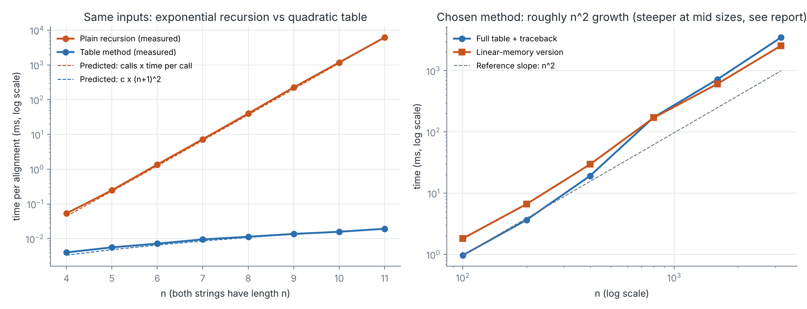

# Batch 6 — Genomics: aligning DNA reads to detect variants

## Team

| Roll No. | Name | GitHub username | Part presented | Contribution (code, report sections) |
| --- | --- | --- | --- | --- |
| 24I315 | Eswari S | `eswari-selvaraj` | Slides 1–3: problem modelling, data structures | Report Sections 1–2; `code/generate_inputs.py` |
| 25I462 | Chamilayah R | `chamilayah` | Slides 10–12: complexity, worst case, linear memory, affine gaps | Report Sections 8, 9, 11 and Q4 in Section 12; `code/linear_space.py`, `code/affine_gap.py` |
| 25I464 | Kaniga V | `kaniga05` | Slides 7–9: algorithm, trace, proof | Report Sections 5–7 (Q1); `code/main_solution.py` |
| 25I465 | Purnimaa V S | `purnimaavs` | Slides 4–6: technique and rejection of the other four | Report Sections 3–4 and Q2, Q3 in Section 12; `code/rejected_alternative.py` |
| 25I466 | Vijith S | `Vijith26` | Slides 13–15: implementation, reference, summary | Report Sections 10 and 13; `code/run_timing.py`, `code/RUN.md`, `results/`, `slides.pdf`, `analysis_sheet.pdf`, pull request |

Each member commits their own files from their own GitHub account; the commit history is the evidence for this table.

## Presentation

- Video link: `https://drive.google.com/file/d/1i2UFk9_p7hYHuIMNk66XUZUPcD3yEIsQ/view?usp=sharing`
- Duration: `11:36` (maximum 12:00)
- Slides: [slides.pdf](slides.pdf) (one-page comparison tables: [analysis_sheet.pdf](analysis_sheet.pdf))

---

## 1. Problem modelling

- **Input:** a reference region R = r1…rm and a read Q = q1…qn over {A, C, G, T} (m ≈ n ≈ 150; 4 × 10^8 reads per run). Costs: match 0, substitution 1, insertion 1, deletion 1.
- **Output:** the minimum alignment cost and one alignment achieving it, written as edit operations: match (M), substitution (S), insertion of a read base (I), deletion of a reference base (D). Each S, I or D is a candidate variant.
- **Objective:** minimise the total cost of the edit operations over all alignments of R with Q.
- **Constraints:** every base of R and of Q is used exactly once and in order (no reordering); costs are non-negative.
- **Problem class (decision / optimisation / enumeration):** optimisation. We need the minimum cost and a witness; it is not a yes/no question and we do not list all alignments.
- **Classical problem it maps to:** edit distance (Levenshtein) / global sequence alignment (Wagner–Fischer 1974; Needleman–Wunsch 1970).
- **Scale:** one read needs 151 × 151 = 22,801 cells; one run needs about 9.1 × 10^12 cell updates.

## 2. Data structure analysis

We use a two-dimensional array D of size (m+1) × (n+1); `D[i][j]` is the minimum cost of aligning the first i reference bases with the first j read bases.

| Data structure | Key operation(s) and cost | Space | Behaviour at the scale in the scenario |
| --- | --- | --- | --- |
| **Chosen: 2-D array** | Read/update a cell O(1); fill Θ(mn); traceback O(m+n) | (m+1)(n+1) cells: 22,801 per read (≈ 22 KB at 1 byte per cell) | Fits in L1/L2 cache for 150-base reads; 4 × 10^8 reads ≈ 9.1 × 10^12 cell updates. At 10^6 × 10^6 bases: 10^12 cells ≈ 4 TB (impossible) |
| Alternative 1: hash map memo (top-down) | O(1) expected per lookup, bigger constant (hashing, pointers); fill Θ(mn) | same 22,801 entries but tens of bytes each (≈ 1 MB or more per read) | Slower and more memory per read than the array; far above 4 TB at genome scale |
| Alternative 2: two rolling rows | O(1) per cell; fill Θ(mn) | 2 × 151 cells ≈ 300 bytes | Cheapest memory (≈ 8 MB at 10^6 bases) but **forgets the path**, so it cannot report the edit operations |
| Alternative 3: recursion stack, no table | Θ(c^n), c ≈ 5.83 (Section 4) | O(m+n) stack | Unusable beyond n ≈ 11 |
| Alternative 4: rolling rows + divide the path (Section 12, Q4) | O(1) per cell; fill ≤ 2mn | O(n) | Works at 10^6 bases (≈ 8 MB) and still recovers the alignment |

**Why the chosen structure wins:** for a 150-base read the full array is small enough to live in cache, gives O(1) access, and keeps the information needed for the traceback that the lab requires. Rolling rows lose the path and so fail the requirement "report the actual edit operations". At 10^6 bases the full array is impossible, so we switch to alternative 4 (Section 12, Q4).

## 3. Design technique identification

- **Technique chosen:** Dynamic Programming.
- **Property of the problem that makes it work (with proof):**

**Chosen technique: Dynamic Programming.** Two properties make it work.

**(a) Optimal substructure.** Let `ed(i,j)` be the minimum cost of aligning `R[1..i]` with `Q[1..j]`. Take an optimal alignment A of these prefixes. Its last column is exactly one of: (1) `ri` paired with `qj` (match or substitution), (2) `ri` paired with a gap (deletion), (3) a gap paired with `qj` (insertion). Remove that column. What remains is an alignment of the corresponding shorter prefixes. It must itself be optimal: if a cheaper alignment of those prefixes existed, putting the removed column back would give an alignment of `R[1..i]`, `Q[1..j]` cheaper than A, contradicting A's optimality (cut-and-paste argument). Hence

`ed(i,j) = min( ed(i−1,j−1) + s(ri,qj), ed(i−1,j) + 1, ed(i,j−1) + 1 )`, with `ed(i,0)=i`, `ed(0,j)=j`, and `s = 0` if `ri = qj`, otherwise 1.

**(b) Overlapping subproblems.** There are only (m+1)(n+1) distinct subproblems `(i,j)`, but the recursion reaches each one from many parents. Measured on two strings of length 4, the plain recursion makes 481 calls for just 25 distinct subproblems; subproblem (2,2) is solved 13 times (table in Section 4).

## 4. Why the other four techniques do not fit

| Technique | Why it is unsuitable here (evidence) |
| --- | --- |
| Greedy | Counterexample: Reference ACGT, Read CGT. Left-to-right "match else substitute" costs **4** (S S S D); the true minimum is **1** (delete A, then three matches). Three false variants. |
| Divide and Conquer | Splitting by the last column gives T(n) = 3T(n−1) + O(1) = Θ(3^n), not the a·T(n/b) form; splitting at the middle needs the unknown crossing column in the read, and the sub-calls overlap. Subproblems are not independent: for two strings of length 4 the recursion solves 25 distinct subproblems in 481 calls, subproblem (2,2) 13 times. |
| Backtracking | The straightforward recursion makes 481 calls at n = 4, 72,958 at n = 7, 12,146,179 at n = 10 and ≈ 10^113.7 at n = 150 (growth 3 + 2√2 ≈ 5.83 per base), against 22,801 table cells at n = 150. |
| Branch and Bound | The only cheap bound is cost so far + |remaining length gap|, which equals the cost so far when the lengths are equal. Measured nodes on random reads: 243 / 1,050 / 3,416 at n = 6 / 8 / 10 against 49 / 81 / 121 table cells, still growing about 1.8–2× per base. A tight bound would need the table itself. |

Details and measurements:

### Greedy: rejected by counterexample

The fast aligner works left to right: match if equal, otherwise substitute (leftover bases are indels).

| Reference | Read | Greedy cost | True minimum | Greedy edit operations |
|---|---|---|---|---|
| GATTACA | GCATGCA | 3 | 3 | S at positions 2, 3, 5 (agrees; the instance happens to have an optimal alignment with substitutions only) |
| **ACGT** | **CGT** | **4** | **1** | S, S, S, D (three false substitutions plus a deletion) |

On ACGT / CGT the optimal alignment is one deletion of A followed by three matches. Greedy locks in the wrong pairing at the first base (A vs C) and can never undo it, so it reports four variants where there is one. In a diagnostic lab this means false-positive variant calls. The greedy-choice property fails: a locally cheapest choice does not extend to a globally optimal solution. (It agreeing with the optimum on GATTACA is a coincidence and proves nothing.)

### Divide and Conquer: rejected for duplicated subproblems

Splitting the problem by its last column gives three subproblems of size (m−1, n−1), (m−1, n), (m, n−1): a recurrence T(n) = 3T(n−1) + O(1), not the form T(n) = aT(n/b) + f(n), so there is no shrink-by-a-factor and the Master theorem does not apply; it solves to Θ(3^n) or worse. Splitting at the middle of the reference instead needs the unknown crossing point k in the read, so all n+1 candidate k must be tried, and the sub-calls for different k overlap. The subproblems are **not independent**. The count of times each subproblem `(i,j)` is solved in the plain recursion for two strings of length 4:

| i \ j | 0 | 1 | 2 | 3 | 4 |
|---|---|---|---|---|---|
| 0 | 63 | 88 | 32 | 8 | 1 |
| 1 | 88 | 63 | 25 | 7 | 1 |
| 2 | 32 | 25 | **13** | 5 | 1 |
| 3 | 8 | 7 | 5 | 3 | 1 |
| 4 | 1 | 1 | 1 | 1 | 1 |

Total 481 calls (the table sums to 481) for 25 distinct subproblems. Divide and conquer is used *inside* the linear-memory version (Q4), but only on top of the table method, never instead of it.

### Backtracking: rejected for exponential blow-up

The straightforward recursion tries all three last-column choices at every state. Its call count satisfies `T(i,j) = 1 + T(i−1,j−1) + T(i−1,j) + T(i,j−1)`, `T(0,·) = T(·,0) = 1`. Measured and computed:

| n (both strings) | Table cells | Recursion calls |
|---|---|---|
| 4 | 25 | 481 |
| 7 (the instance) | 64 | 72,958 |
| 10 | 121 | 12,146,179 |
| 11 | 144 | 67,570,078 |
| 150 | 22,801 | ≈ 10^113.7 |

The growth rate is 3 + 2√2 ≈ 5.83 per extra base (this is the Delannoy-number recurrence). 10^113.7 calls per read cannot be run, whatever the hardware.

### Branch and Bound: rejected for a weak bound

The only cheap admissible lower bound is `g + |(m−i) − (n−j)|` (cost so far plus the length gap still to be absorbed by indels). When both strings have the same length, the second term is 0, so the bound is just the cost so far and prunes only after the cost has already reached the incumbent. We measured a depth-first branch and bound seeded with the greedy cost as incumbent (average of 5 random equal-length pairs per size):

| n | B&B nodes expanded | Table cells | Plain recursion calls |
|---|---|---|---|
| 6 | 243 | 49 | 13,483 |
| 8 | 1,050 | 81 | 398,593 |
| 10 | 3,416 | 121 | 12,146,179 |

B&B is far better than raw recursion, and on the instance it expands only 55 nodes (the greedy incumbent is already optimal there), but on random reads its node count is already ~28× the number of table cells at n = 10 and still grows geometrically (roughly ×1.8–2 per extra base in these runs), while the table grows as n². Reads that come from the wrong locus, adapters or contamination are exactly the inputs on which the bound is weakest, and the aligner cannot assume they are absent. A tight bound would need the table itself (circular).

## 5. Algorithm

```
ALIGN(R[1..m], Q[1..n]):
    D[i][0] ← i·DEL            for i = 0..m          // delete i reference bases
    D[0][j] ← j·INS            for j = 0..n          // insert j read bases
    for i ← 1 to m:
        for j ← 1 to n:
            diag ← D[i-1][j-1] + (0 if R[i] = Q[j] else SUB)
            up   ← D[i-1][j]   + DEL
            left ← D[i][j-1]   + INS
            D[i][j] ← min(diag, up, left)
    // traceback (tie-break order: diagonal, deletion, insertion)
    i ← m; j ← n; ops ← empty list
    while i > 0 or j > 0:
        if i>0 and j>0 and D[i][j] = D[i-1][j-1] + s(R[i],Q[j]):
            prepend (M or S) ; i ← i-1; j ← j-1
        else if i>0 and D[i][j] = D[i-1][j] + DEL:
            prepend D ; i ← i-1
        else:
            prepend I ; j ← j-1
    return D[m][n], ops
```

**State definition:** `D[i][j]` = minimum cost to align `R[1..i]` with `Q[1..j]`. **Recurrence:** as in Section 3. Code: `code/main_solution.py`.

## 6. Proof of correctness

**Theorem.** After the fill loop, `D[i][j] = ed(i,j)` for all 0 ≤ i ≤ m, 0 ≤ j ≤ n.

*Proof by induction on i + j.* Base: `ed(i,0) = i·DEL` (the only alignment deletes all i bases) and `ed(0,j) = j·INS`, which is what the initialisation stores. Step: let i, j ≥ 1 and assume the claim for all pairs with smaller sum. By the cut-and-paste argument in Section 3, an optimal alignment of `R[1..i]`, `Q[1..j]` ends in one of three column types, and the rest is an optimal alignment of the corresponding prefixes, whose costs are `D[i−1][j−1]`, `D[i−1][j]`, `D[i][j−1]` by the induction hypothesis. These three cells have a smaller index sum and are computed before `(i,j)` in row-major order (loop invariant: when `D[i][j]` is computed, all three are final). The recurrence takes the minimum over all three options, and every alignment falls into one of them, so `D[i][j] = ed(i,j)`. ∎

**Traceback correctness.** Invariant: at each step the pair (i,j) satisfies "the operations already emitted cost exactly `D[m][n] − D[i][j]`". Initially (i,j) = (m,n) and nothing is emitted. If the diagonal test holds, `D[i][j] = D[i−1][j−1] + s`, so emitting that operation keeps the invariant after moving to (i−1,j−1); likewise for the deletion and insertion tests. At least one test holds because `D[i][j]` was set to the minimum of the three candidates (on the boundary, `D[i][0] = D[i−1][0] + DEL` and `D[0][j] = D[0][j−1] + INS`). Each step decreases i + j, so the loop ends at (0,0) where the emitted cost equals `D[m][n] − 0`, i.e. the emitted operations form an alignment of cost `ed(m,n)`. ∎

## 7. Trace on the given instance

Rows are reference prefixes, columns are read prefixes. Row 0 and column 0 are the initialisation; every other cell is `min(diag, up, left)`.

|   | – | G | C | A | T | G | C | A |
|---|---|---|---|---|---|---|---|---|
| **–** | 0 | 1 | 2 | 3 | 4 | 5 | 6 | 7 |
| **G** | 1 | 0 | 1 | 2 | 3 | 4 | 5 | 6 |
| **A** | 2 | 1 | 1 | 1 | 2 | 3 | 4 | 5 |
| **T** | 3 | 2 | 2 | 2 | 1 | 2 | 3 | 4 |
| **T** | 4 | 3 | 3 | 3 | 2 | 2 | 3 | 4 |
| **A** | 5 | 4 | 4 | 3 | 3 | 3 | 3 | 3 |
| **C** | 6 | 5 | 4 | 4 | 4 | 4 | 3 | 4 |
| **A** | 7 | 6 | 5 | 4 | 5 | 5 | 4 | 3 |

Worked cells (to show the rule):

- D[1][1]: G=G, diag = 0+0 = 0; up = 1+1 = 2; left = 1+1 = 2 → **0**.
- D[2][2] (A vs C): diag = 0+1 = 1; up = D[1][2]+1 = 2; left = D[2][1]+1 = 2 → **1**.
- D[3][4] (T vs T): diag = D[2][3]+0 = 1; up = 2+1 = 3; left = 2+1 = 3 → **1**.
- D[7][7] (A vs A): diag = D[6][6]+0 = 3; up = D[6][7]+1 = 5; left = D[7][6]+1 = 5 → **3**.

**Minimum alignment cost = 3.**

**Traceback.** Start at (7,7) and, at each cell, take the first test that holds (diagonal, then deletion, then insertion):

| Cell | Tested | Operation | Moves to |
|---|---|---|---|
| (7,7) A/A | D=3 = D[6][6]+0 = 3+0 | M | (6,6) |
| (6,6) C/C | 3 = D[5][5]+0 = 3+0 | M | (5,5) |
| (5,5) A/G | 3 = D[4][4]+1 = 2+1 | S (A>G) | (4,4) |
| (4,4) T/T | 2 = D[3][3]+0 = 2+0 | M | (3,3) |
| (3,3) T/A | 2 = D[2][2]+1 = 1+1 | S (T>A) | (2,2) |
| (2,2) A/C | 1 = D[1][1]+1 = 0+1 | S (A>C) | (1,1) |
| (1,1) G/G | 0 = D[0][0]+0 | M | (0,0) |

Read from the start of the strings to the end:

```
Ref : G A T T A C A
      |     |   | |
Read: G C A T G C A
Ops : M S S M S M M        cost 0+1+1+0+1+0+0 = 3
```

Variants reported (1-based reference positions): position 2 A>C, position 3 T>A, position 5 A>G.

**Co-optimal alignments.** The table has 4 optimal paths (found by `main_solution.py`): `MSSMSMM`, `MIMDMSMM`, `MIMMDSMM`, `MIMMSDMM`, all cost 3. We report the first because the tie-break prefers the diagonal. With affine gaps (Section 13) the first one is the only survivor.

## 8. Complexity analysis

- **Recurrence or counting argument:** states = (m+1)(n+1), each computed from 3 neighbours in O(1), so the fill is Θ(mn). Plain recursion: T(i,j) = 1 + T(i−1,j−1) + T(i−1,j) + T(i,j−1).
- **Time (best / worst / typical):** best = worst = Θ(mn) because the work does not depend on the content of the strings; typical production practice is banded, O(kn), for reads with at most k edits.
- **Space:** Θ(mn) with traceback; Θ(min(m,n)) for the cost only; Θ(n) for the linear-memory version (Section 12, Q4).

**Time.** There are (m+1)(n+1) states and each is computed with 3 candidates in O(1), so the fill is Θ(mn); the traceback is O(m+n). The running time does not depend on the content of the strings, so best case = worst case = Θ(mn). For one read, mn = 22,500 (22,801 cells); for 4 × 10^8 reads, about 9.1 × 10^12 cell updates. At an assumed 10^9 cell updates per second per core (scalar code; our Python is far slower, SIMD code far faster) that is about 9,100 core-seconds, roughly 2.5 core-hours.

**Space.** Θ(mn) for the table (needed for traceback); Θ(min(m,n)) if only the cost is wanted; Θ(n) for the linear-memory version (Q4).

**Practical case.** Reads that really belong to the region have few edits. If the true cost is at most k, the optimal path never leaves the band |i − j| ≤ k (a path that ends k+1 diagonals away needs at least k+1 indels). Computing only that band costs O(kn); for k = 10 that is about 3,150 cells instead of 22,801 (≈ 7× fewer) and gives the same answer whenever the band is wide enough. This is how production tools speed up this same recurrence (Section 13). Bit-parallel versions (Myers 1999) compute the cost in O(⌈m/w⌉·n) for word size w.

**Recursion comparison.** `T(i,j) = 1 + T(i−1,j−1) + T(i−1,j) + T(i,j−1)` grows like the central Delannoy numbers, Θ((3+2√2)^n / √n).

## 9. Worst-case input

Because the table method is input-independent, the worst case is *every* input; the one that removes any chance of shortcuts is a read that shares no base with the reference, e.g. `A^n` against `C^n` (every diagonal costs 1, the minimum is n, no zero-cost cells). Measured at n = 1600 (fill time only, same 2.57 million cells each):

| Input | Min cost | Fill time (ms) |
|---|---|---|
| identical | 0 | 426 |
| mutated (~3% edits) | 47 | 389 |
| random pair | 846 | 799 |
| all-mismatch `A^n` vs `C^n` | 1600 | 441 |

The operation count is identical in all four rows. The time differences come from the Python interpreter (for example, integers above 255 are separate objects and allocate, which the random pair has many of); they are not an algorithmic effect. For the rejected methods the worst case is genuinely input-dependent: the plain recursion makes the same 481 calls for any two strings of length 4 (it never prunes), and B&B is worst on reads that do not belong to the region.

## 10. Implementation and empirical analysis

- **Language and how to run:** Python 3, no compilation; see [code/RUN.md](code/RUN.md).
- **Input sizes used (at least five):** n = 4, 5, 6, 7, 8, 9, 10, 11 (table method vs recursion, same inputs); n = 100, 200, 400, 800, 1600, 3200 (scaling of the chosen method); n = 1600 for the worst-case comparison.
- **Plot:** see below and `results/timing_plot.png`.
- **Comparison with the rejected alternative:** the plain recursion (backtracking) is timed on the same inputs as the table method; at n = 11 it is about 320,000× slower.

Code: `code/` (see `code/RUN.md`). Chosen method: `main_solution.py`; rejected alternative used for timing: the plain recursion in `rejected_alternative.py`. Inputs: `generate_inputs.py` (seeded, reproducible). Results are in `results/`: `timing.csv` (required format plus call counts), `timing_scaling.csv`, `worst_case.csv`, `memory_demo.csv`, `timing_plot.png`. 500 random string pairs were also checked: table method, linear-memory version, recursion and branch and bound all return the same cost, and every reconstructed alignment reproduces both strings.



**Left panel: chosen method vs recursion (n = 4..11, same inputs).**

| n | Table method (ms) | Recursion (ms) | Recursion calls |
|---|---|---|---|
| 4 | 0.0040 | 0.053 | 481 |
| 5 | 0.0056 | 0.246 | 2,524 |
| 6 | 0.0072 | 1.356 | 13,483 |
| 7 | 0.0095 | 7.272 | 72,958 |
| 8 | 0.0113 | 39.8 | 398,593 |
| 9 | 0.0137 | 224.8 | 2,193,844 |
| 10 | 0.0157 | 1,172.9 | 12,146,179 |
| 11 | 0.0192 | 6,175.4 | 67,570,078 |

The recursion curve is a straight line on the log axis, matching the derived exponential (the dashed prediction is `calls × time-per-call` with the per-call time fitted at n = 11; it also follows the points at smaller n, where calls grow by about 5.5× per step and time by 5.3×). The table method grows slowly, matching (n+1)². At n = 11 the recursion is about 320,000× slower.

**Right panel: scaling of the chosen method (mutated reads, one run each at the larger sizes).**

| n | Cells | Full table (ms) | Linear memory (ms) | µs per cell (full) |
|---|---|---|---|---|
| 100 | 10,201 | 0.97 | 1.82 | 0.095 |
| 200 | 39,195 | 3.65 | 6.62 | 0.093 |
| 400 | 159,999 | 19.2 | 29.6 | 0.120 |
| 800 | 639,999 | 173 | 170 | 0.271 |
| 1,600 | 2,568,004 | 721 | 608 | 0.281 |
| 3,200 | 10,268,808 | 3,489 | 2,560 | 0.340 |

**Comparison with theory and deviations.** Doubling n should multiply the time by about 4. We see 3.8× (100→200), 5.3× (200→400), 9.0× (400→800), 4.2× (800→1600) and 4.8× (1600→3200): the overall growth is quadratic but the cost per cell rises from 0.095 to 0.34 µs. The most likely reason is memory: the full table in Python is a list of lists of integer objects, so at 640,000 cells and above it no longer fits in the CPU cache and allocates many objects, while the linear-memory version keeps working on small rows that stay cached. This is also why the linear-memory version, theoretically up to 2× slower, ended up faster (ratio 0.73) at n = 3200. We have not profiled the cause, so this is an explanation, not a measurement; in compiled code with 1-byte cells the effect would be much smaller. Single-run timings at large n also carry timing noise.

## 11. Changed requirement

The last question of the scenario: *Biologists say one long gap is likelier than many short gaps: opening a gap costs 3, extending it costs 1. Revise your method. How much extra storage does it need?*

**Convention used.** A gap of length k costs `3 + (k−1)·1` (the first gap base costs 3, each further base costs 1). If your course means `3 + k`, set `open_=4` in `affine_gap.py`.

A single table is no longer enough: the cost of adding a gap base depends on whether the previous column was also a gap, so `D[i][j]` alone loses information (optimal substructure only holds once the *state of the last column* is part of the subproblem). Use three tables:

- `M[i][j]`: best cost with the last column a match or substitution,
- `X[i][j]`: best cost with the last column a deletion,
- `Y[i][j]`: best cost with the last column an insertion.

```
M[i][j] = s(ri,qj) + min(M, X, Y)[i-1][j-1]
X[i][j] = min( M[i-1][j] + 3,  X[i-1][j] + 1,  Y[i-1][j] + 3 )
Y[i][j] = min( M[i][j-1] + 3,  Y[i][j-1] + 1,  X[i][j-1] + 3 )
answer  = min( M, X, Y )[m][n]
```

The traceback follows the state (M, X or Y) as well as (i,j). Run on the instance, the answer is **cost 3** with `MSSMSMM`. The other three co-optimal alignments of Section 7 all cost 7 now (each needs an insertion and a deletion, 3 + 3, plus one substitution), so affine gaps pick the substitution-only alignment uniquely. The three tables (∞ shown as `.`):

```
M (match/substitution)            X (deletion)                      Y (insertion)
      -   G   C   A   T   G   C   A     -   G   C   A   T   G   C   A     -   G   C   A   T   G   C   A
-     0   .   .   .   .   .   .   .     .   .   .   .   .   .   .   .     .   3   4   5   6   7   8   9
G     .   0   4   5   6   6   8   9     3   6   7   8   9  10  11  12     .   6   3   4   5   6   7   8
A     .   4   1   3   5   6   7   7     4   3   6   7   8   9  10  11     .   7   6   4   5   6   7   8
T     .   5   4   2   3   6   7   8     5   4   4   6   8   9  10  10     .   8   7   7   5   6   7   8
T     .   6   5   5   2   4   7   8     6   5   5   5   6   9  10  11     .   9   8   8   8   5   6   7
A     .   7   6   5   6   3   5   6     7   6   6   6   5   7   9  10     .  10   9   9   8   8   6   7
C     .   8   6   7   6   6   3   6     8   7   7   7   6   6   8   9     .  11  10   9  10   9   9   6
A     .   9   8   6   8   7   7   3     9   8   8   8   7   7   6   9     .  12  11  11   9  10  10   9
```

Final cell: min(M=3, X=9, Y=9) = 3.

**Extra storage.** Three tables instead of one: 3 × 22,801 = 68,403 cells per read instead of 22,801, i.e. **two additional tables (3× the storage)**; the time per cell also grows about 3× (three candidates for each of three tables, instead of three candidates for one). With linear memory it is three rows instead of one: still O(n) (the Myers–Miller 1988 version of Hirschberg handles affine gaps). A general gap cost `γ(k)` would need O(m+n) look-back per cell, Θ(mn(m+n)) time; the affine form brings it back to Θ(mn).

**Does the technique still hold?** Yes. It is still dynamic programming; only the state grows from (i,j) to (i, j, last column type), the number of states from (m+1)(n+1) to 3(m+1)(n+1), and optimal substructure and overlapping subproblems still hold. Greedy, backtracking, divide and conquer and branch and bound remain rejected for the same reasons.

## 12. Answers to the remaining scenario questions

**Question 1 (minimum cost and edit operations):** answered in full in Section 7: minimum cost **3**, operations `M S S M S M M`, every intermediate table value shown, four co-optimal alignments.

**Question 2 (fast left-to-right aligner):** Section 4, Greedy. Cost 3 on GATTACA / GCATGCA (equal to the optimum by coincidence), but cost **4** on ACGT / CGT where the optimum is **1**.

**Question 3 (straightforward recursion):** Section 4, Backtracking. The recursion makes **481 calls** for two strings of length 4 (the count does not depend on the letters), against 25 distinct subproblems, i.e. 25 cells in the table method. The table method computes each subproblem once, in Θ(mn) time; the recursion recomputes subproblems, e.g. (2,2) 13 times, giving a count that grows by ≈ 5.83× per extra base.

**Question 4: linear memory for two 10^6-base genomes.**

The full table needs 10^12 cells ≈ 4 TB (4-byte cells). To keep only O(n) memory while still recovering the alignment, use the **divide-and-conquer path recovery of Hirschberg (1975)** on top of the same recurrence (`code/linear_space.py`):

1. Split the reference at its middle row `mid = m/2`.
2. Compute the last row of the table for `R[1..mid]` against `Q` forward, keeping only two rows; and the same for the reversed `R[mid+1..m]` against reversed `Q`.
3. The optimal path crosses row `mid` at the column k that minimises `forward[k] + backward[n−k]`.
4. Recurse on `(R[1..mid], Q[1..k])` and `(R[mid+1..m], Q[k+1..n])`; stop when a part has one reference base (tiny table).

*Space:* two rows plus the recursion depth O(log m) plus the output path: O(n + m). With 10^6 bases that is a few MB instead of 4 TB.
*Time:* the work at recursion level ℓ is Σ(sub-areas) = mn/2^ℓ, so the total is mn(1 + 1/2 + 1/4 + …) ≤ 2mn, i.e. still Θ(mn), at most 2× the table method. For 10^6 × 10^6 that is about 2 × 10^12 cell updates (about 33 minutes at the assumed 10^9 per second per core).
*Measured memory (n = 1000, Python peak allocation):* full table 25,513 KB, linear-memory version 87 KB.
*Measured time:* the ratio linear/full was 1.87, 1.81, 1.54 at n = 100, 200, 400 (consistent with ≤ 2×), and then 0.98, 0.84, 0.73 at n = 800, 1600, 3200 (see Section 10 for why the full table slows down).

## 13. Real-world reference

**BWA-MEM (Li, 2013, arXiv:1303.3997) and minimap2 (Li, 2018, *Bioinformatics* 34(18))** are widely used aligners that finish with this same dynamic program. **Difference from our version:** they first find short exact "seeds" (BWA-MEM with an FM-index, minimap2 with minimizers) to decide *where* in the genome a read belongs, and then run a **banded, SIMD-vectorised dynamic program with affine gap costs** (local, Smith–Waterman style, in minimap2's case through the `ksw2` library) only in a small window around each seed; ours is a global, unbanded, unit-cost alignment of a read against a given region. For reference, the linear-memory idea is Hirschberg (1975) and its affine-gap version is Myers–Miller (1988); the three-table affine recurrence is Gotoh (1982); the bit-parallel cost-only variant is Myers (1999) (used in the Edlib library). *(Please check the citation details against the papers before submission.)*

Links: BWA-MEM, Li (2013), https://arxiv.org/abs/1303.3997 · minimap2, Li (2018), *Bioinformatics* 34(18), https://arxiv.org/abs/1708.01492

## Limitations and notes

- Timings are from CPython on one machine; the shapes, not the absolute values, are the finding.
- The affine-gap convention (first gap base costs 3) is our reading of "opening costs 3, extending costs 1"; change `open_` in `affine_gap.py` for the other reading.
- The 10^9 cell updates per second per core used for the run-time estimates is an assumption, not a measurement.
