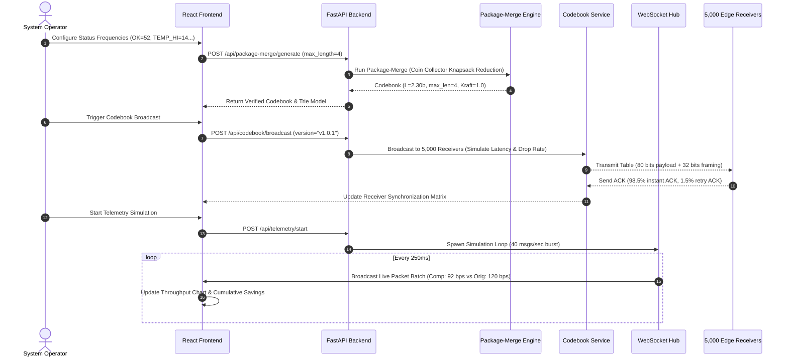

# System Architecture Specification
## Industrial IoT Telemetry Compression & Network Optimization Platform.

- **Project:** Industrial Edge Gateway Telemetry Compression System
- **Classification:** Full-Stack Architecture & Systems Reference
- **Version:** 1.0.0
- **Status:** Production Verified

---

## 1. Architectural Overview & Design Philosophy

The **Industrial IoT Telemetry Compression & Network Optimization Platform** is an enterprise-grade cyber-physical system designed to optimize telemetry throughput across severely bandwidth-constrained industrial networks. 

The edge architecture addresses three fundamental physical and computational constraints:
1. **Physical Narrowband Bottleneck:** A physical link capacity of **9,600 bits per second (9.6 kbps)** shared by an aggregate telemetry stream of **40 messages/second** from a population of **5,000 industrial sensor nodes**.
2. **Embedded Receiver Microcontroller Boundaries:** Low-cost field receiver nodes (e.g. ARM Cortex-M0+, PIC24, MSP430) with rigid **4-bit register boundaries**, precluding unconstrained Huffman trees that produce 5-bit or 6-bit codewords.
3. **Dynamic Channel Synchronization:** Over-the-air (OTA) codebook distribution to ensure zero out-of-sync packet decoding between gateway and field receivers.

```mermaid
flowchart TD
    subgraph SENSORS["5,000 Industrial Field Sensors"]
        S1["Sensor Node 1\n(OK / VIB / TEMP)"]
        S2["Sensor Node 2\n(TEMP_HI / DOOR)"]
        S5000["Sensor Node 5,000\n(FAULT / RESET)"]
    end

    subgraph GATEWAY["Industrial Edge Gateway (Central Node)"]
        INGEST["Telemetry Ingestion Engine\n(40 msgs/sec aggregate)"]
        FREQ["Empirical Frequency & Probability Analyzer\n(Calibrated 1-Hour Window)"]
        
        subgraph ALGO_CORE["Algorithm Engineering Engine"]
            H_OPT["Min-Heap Huffman\n(Optimal Unconstrained L=2.20b)"]
            SF_ENG["Shannon-Fano Analyzer\n(Counterexample Evaluator)"]
            TQ_ENG["Two-Queue Huffman\n(Linear-Time O(N) van Leeuwen)"]
            PM_ENG["Package-Merge Engine\n(4-Bit Constrained L=2.30b)"]
        end
        
        BCAST["Codebook Broadcast Manager\n(v1.0.0 Versioning & ACK Tracking)"]
        ENC["High-Throughput Bitstream Encoder\n(Prefix-Free Lossless Bit Packer)"]
    end

    subgraph CHANNEL["Narrowband Physical Channel (9.6 kbps)"]
        NARROW["Sub-GHz / RS-485 / Satellite Carrier\n(Bandwidth Freed: 23.33% / 28 bps)"]
    end

    subgraph RECEIVERS["Field Actuator & PLC Receivers"]
        DEC["Instantaneous Bit-Shift Decoder\n(4-bit Nibble Register Lookups)"]
        STATE["Actuator / Safety Logic\n(Trip / Nominal Response)"]
    end

    S1 --> INGEST
    S2 --> INGEST
    S5000 --> INGEST
    INGEST --> FREQ
    FREQ --> ALGO_CORE
    PM_ENG --> BCAST
    PM_ENG --> ENC
    BCAST -. "OTA Codebook Broadcast (112 bits/hr)" .-> NARROW
    ENC --> "Compressed Telemetry Stream (92 bps)" --> NARROW
    NARROW --> DEC
    DEC --> STATE
```

---

## 2. Backend Modular Architecture

The backend is built with **Python 3.14+**, **FastAPI**, **Pydantic v2**, and native asynchronous **WebSockets**. The code is organized into decoupled layers:

```
backend/
├── app/
│   ├── main.py                     # FastAPI application entrypoint, CORS, routes, WS
│   ├── algorithms/                 # Pure mathematical algorithm implementations
│   │   ├── __init__.py
│   │   ├── huffman.py              # PriorityQueue min-heap Huffman (O(N log N))
│   │   ├── shannon_fano.py         # Top-down recursive bipartitioning
│   │   ├── two_queue.py            # van Leeuwen Two-Queue linear-time (O(N))
│   │   └── package_merge.py        # Length-limited Package-Merge (L <= 4 bits)
│   ├── services/                   # Business logic and domain coordination
│   │   ├── __init__.py
│   │   ├── compression_service.py  # Orchestrates codebook generation and comparisons
│   │   ├── benchmark_service.py    # Real runtime and operations benchmark harness
│   │   ├── telemetry_service.py    # Live message generation & WebSocket dispatcher
│   │   └── codebook_service.py     # Version management, broadcast simulation & ACK
│   ├── api/                        # REST API routing controllers
│   │   ├── __init__.py
│   │   ├── huffman.py              # /api/huffman endpoints
│   │   ├── algorithms.py           # /api/shannon-fano, /api/huffman/two-queue, /api/package-merge
│   │   ├── encoder.py              # /api/encoder/encode, /api/encoder/decode
│   │   ├── telemetry.py            # /api/telemetry configuration & metrics
│   │   └── codebook.py             # /api/codebook broadcast & history
│   ├── schemas/                    # Pydantic v2 data transfer validation schemas
│   │   ├── __init__.py
│   │   ├── compression.py          # Frequencies, Tree, CodebookEntry, Step models
│   │   └── telemetry.py            # Packets, Metrics, SimulationStatus, Broadcast
│   ├── utils/                      # Helper mathematics and reporting
│   │   ├── __init__.py
│   │   ├── metrics.py              # Entropy, weighted length, link utilization
│   │   ├── validation.py           # Prefix-free, Kraft inequality, normalization
│   │   └── generate_pdf.py         # ReportLab mathematical specification builder
│   └── tests/                      # Automated test suite (Pytest)
│       ├── __init__.py
│       ├── test_huffman.py         # Tree correctness, Kraft inequality, validation
│       ├── test_shannon_fano.py    # Counterexample validation, suboptimality proof
│       ├── test_two_queue.py       # Equivalence with min-heap, step recording
│       ├── test_package_merge.py   # L <= 4 constraint, Kraft sum, brute-force match
│       ├── test_encoding.py        # Roundtrip lossless encode/decode, version checks
│       └── test_telemetry.py       # Bitrates, bandwidth freed, 1-hour simulation
└── requirements.txt
```

---

## 3. Frontend Architecture

The user interface is built using **React 18**, **TypeScript**, **Vite**, **Tailwind CSS v4**, **React Flow (`@xyflow/react`)**, and **Recharts**.

### 3.1 Design Language
- **macOS-Inspired Light Aesthetic:** High legibility, crisp slate backgrounds (`#f8fafc`, `#f1f5f9`), rounded cards (`rounded-2xl`), and subtle micro-shadows.
- **Tabular & Monospace Typography:** Monospace data displays (`JetBrains Mono`) for bitstreams, hexadecimal codes, and metrics; clean sans-serif (`Plus Jakarta Sans`) for body copy.
- **Visual Status Hierarchy:** Emerald for nominal/compliant states, sky for warnings/parameters, amber for counterexamples/suboptimal conditions, and rose for hardware register violations/faults.

### 3.2 Modular View Structure
```
frontend/src/
├── components/
│   ├── TreeVisualizer.tsx          # Interactive React Flow binary prefix tree
│   ├── FrequencyEditor.tsx         # Live probability normalization & symbol input
│   ├── TwoQueueStepper.tsx         # Step-by-step O(N) animation & queue inspector
│   └── MessageCodec.tsx            # Live telemetry encoder & versioned decoder
├── views/
│   ├── OverviewView.tsx            # 8 Executive KPI cards & system topology
│   ├── HuffmanEngineView.tsx       # Min-heap Huffman tree, codebook & metrics
│   ├── AlgorithmLabView.tsx        # Side-by-side comparison, counterexample & benchmark
│   ├── LiveNetworkView.tsx         # Real-time WebSocket throughput & packet logs
│   ├── HardwareInspectorView.tsx   # Package-Merge L<=4 engine & C header export
│   ├── CodebookManagementView.tsx  # OTA broadcast simulation, ACK tracker & version tests
│   └── DocumentationView.tsx       # In-app academic specification & PDF download
├── services/
│   └── api.ts                      # Centralized typed HTTP API service
├── types/
│   └── index.ts                    # TypeScript definitions mirroring Pydantic schemas
├── App.tsx                         # Top-level state coordinator & navigation
└── main.tsx                        # Application mount point
```

---

## 4. End-to-End Data Flow & Life Cycle



---

## 5. Security, Error Handling & Resilience

1. **Deterministic Random Seeding:** The telemetry generator supports configurable pseudo-random number seeds (`random_seed`) to ensure repeatable academic validation and regression testing.
2. **Strict Codebook Versioning:** To prevent deserialization corruption in field networks, decoders verify the active codebook version (`v1.0.0`). Attempting to decode with an outdated codebook triggers an HTTP 409 Conflict rejection.
3. **Graceful WebSocket Reconnection:** If network disruption drops the telemetry WebSocket, the client automatically handles reconnection attempts and gracefully degrades to polling fallback.
4. **Input Boundary Validation:** Negative frequencies, empty alphabets, alphabets smaller than 2 symbols, or mathematically impossible tree constraints ($N > 2^{L_{\max}}$) are trapped at the API layer with descriptive HTTP 400 error payloads.

